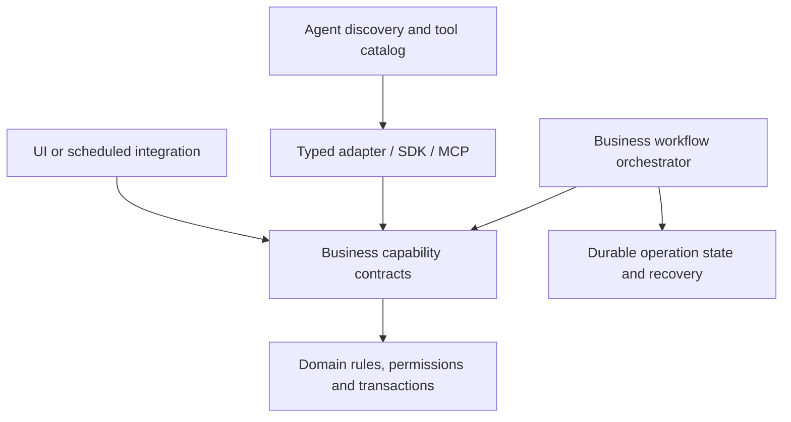

# API design across agent runtimes and business systems

> Build stable business capabilities with explicit effects and lifecycle contracts; adapt discovery and composition for agents without transferring business authority to model output.

**Evidence status:** Working synthesis of ten API systems and two research sources, captured 2026-11-04. This is a documentation study, not an agent benchmark, implementation audit, or live integration test. The case studies own vendor-specific findings; their source collections preserve exact evidence. This analysis remains **draft** pending the wiki's cross-family review gate in [[analyses/_eval-rubric]]. Same-family review is useful but cannot substitute for that gate.

## Research question and comparison method

How should a growing business platform name, categorize, expose, execute, and evolve its capabilities when users include agents and future workflows are uncertain? Compare what the interface promises and who owns execution, rather than ranking providers by age or branding. [[concepts/business-platform-api-design]]

The sample spans OpenAI, Anthropic, Business Central, SAP sales APIs, Salesforce, Cloudinary, Gusto, ftrack, Stripe, and Shopify. It intentionally includes both model/tool protocols and managed agent runtimes, plus ERP, CRM, payroll, DAM/media, production tracking, and payments. It does not establish representativeness across all business software or cover every endpoint in any product. [[sources/openai--agent-api-design#root]], [[sources/anthropic--agent-api-design#root]], [[sources/microsoft--business-central-api-design#root]], [[sources/sap--business-api-design#root]], [[sources/salesforce--business-api-design#root]], [[sources/cloudinary--business-api-design#root]], [[sources/gusto--business-api-design#root]], [[sources/ftrack--business-api-design#root]], [[sources/stripe--business-api-design#root]], [[sources/shopify--agent-commerce-api-design#root]], [[sources/shopify--admin-api-design#root]]

For each system, inspect resource identity, query/action distinction, composition, execution ownership, asynchronous lifecycle, result correlation, permissions, concurrency/retries, events, output shaping, compatibility, and remaining evidence gaps. Official documentation describes intended contracts; it does not demonstrate deployed enforcement or agent success. No source applications or SDKs were run and no provider accounts or business records were changed.

## What the sample actually shows

| API case study | Distinctive design evidence | Question it changes |
| --- | --- | --- |

| [[artifacts/projects/shopify-api]] | Business/Admin GraphQL coexists with negotiated UCP catalog/cart/checkout/order tools, buyer escalation and browser/server surfaces | What is declared, negotiated and actually permitted in this context? [[sources/shopify--agent-commerce-api-design#profiles]], [[sources/shopify--agent-commerce-api-design#auth]], [[sources/shopify--admin-api-design#overview]] |
| [[artifacts/projects/openai-agent-api]] | Responses, application-owned SDK loops, and managed agent sessions are different ownership layers | Are we calling a model, operating a loop, or delegating runtime ownership? [[sources/openai--agent-api-design#agent-surfaces]] |
| [[artifacts/projects/anthropic-agent-api]] | Messages/tool exchange, independent batches, and managed sessions coexist; tool grouping is intentional | What lifecycle and selection surface does this caller actually need? [[sources/anthropic--agent-api-design#messages]], [[sources/anthropic--agent-api-design#managed-runtime]], [[sources/anthropic--agent-api-design#tool-definitions]] |
| [[artifacts/projects/business-central-api]] | Business resources coexist with posting actions, eTags, conditional batch transactions, and subscription lifecycle | What business invariant sits behind a superficially ordinary update? [[sources/microsoft--business-central-api-design#invoice]], [[sources/microsoft--business-central-api-design#batch]] |
| [[artifacts/projects/sap-sales-api]] | Unsaved simulation, preconditioned updates, response projection, and async negotiation are separate concerns | Can a caller preview without committing, and what does preview omit? [[sources/sap--business-api-design#simulation]], [[sources/sap--business-api-design#update]], [[sources/sap--business-api-design#async]] |
| [[artifacts/projects/salesforce-api]] | Dependent request composition and durable query jobs | Can information retrieval itself require an explicit operation resource? [[sources/salesforce--business-api-design#composite]], [[sources/salesforce--business-api-design#query-jobs]] |
| [[artifacts/projects/cloudinary-api]] | Asset identity, delivery name, original readiness, transformation readiness, and enrichment readiness differ | Which asset and which processing milestone does “done” refer to? [[sources/cloudinary--business-api-design#identity]], [[sources/cloudinary--business-api-design#processing]] |
| [[artifacts/projects/gusto-api]] | Prepare, calculate, and submit are distinct effects with asynchronous processing state | Is this an editable preview, a recalculation, or an authorized payroll submission? [[sources/gusto--business-api-design#workflow]], [[sources/gusto--business-api-design#processing]], [[sources/gusto--business-api-design#submit-full]] |
| [[artifacts/projects/ftrack-api]] | One transport endpoint carries typed operations; Python sessions add local unit-of-work behavior | Does endpoint count tell us anything useful about semantic modularity? [[sources/ftrack--business-api-design#endpoint]], [[sources/ftrack--business-api-design#sessions]] |
| [[artifacts/projects/stripe-api]] | Business intent lifecycle and changing v1/v2 retry/event contracts; agent-oriented documentation | Can an established API evolve its discovery layer and operational guarantees independently? [[sources/stripe--business-api-design#intent]], [[sources/stripe--business-api-design#v2]], [[sources/stripe--business-api-design#skills]] |

### The frontier/legacy distinction needs more than one axis

“AI-native” does not identify one endpoint architecture. Both studied frontier providers document a model-level protocol and a distinct managed runtime. Messages/Responses tool proposals are not synonymous with executing a complete business task. Conversely, async jobs and client composition already exist in established operations APIs. [[sources/openai--agent-api-design#function-loop]], [[sources/openai--agent-api-design#agent-surfaces]], [[sources/anthropic--agent-api-design#messages]], [[sources/anthropic--agent-api-design#managed-runtime]], [[sources/salesforce--business-api-design#query-jobs]], [[sources/sap--business-api-design#async]]

A more useful comparison uses four independent axes:

1. **Consumer:** hand-written integration, UI, scheduled process, or model selecting actions.
2. **Subject:** business entity, computation, external effect, or agent runtime.
3. **Execution owner:** caller, application worker, business provider, or managed agent service.
4. **Evidence/guarantee:** schema validity, accepted execution, durable history, successful external effect, or verified business outcome.

This taxonomy is our synthesis from the sample, not a new vendor standard. It prevents a model response resource from being compared directly to a completed payroll as if they were the same thing. [[sources/openai--agent-api-design#strict-schema]], [[sources/anthropic--agent-api-design#managed-session-operations]], [[sources/gusto--business-api-design#processing]]

### What changes when the caller selects tools probabilistically

A conventional hand-written integration typically selects a predetermined method; an agent may need to find a capability, interpret its description, select arguments, decide whether it is relevant, and react to results. Provider guidance therefore treats descriptions, schema design, namespacing, selective tool loading, and information-rich outputs as important interface work. This is documented advice, not proof that one naming convention universally improves success. [[sources/openai--agent-api-design#tool-design]], [[sources/anthropic--agent-api-design#tool-definitions]]

The underlying business system still owns authorization and invariants. A schema-conforming tool call can express the wrong intent; a managed permission policy can have a different scope from a domain permission; an automatic review is not necessarily a human checkpoint. [[sources/openai--agent-api-design#structured-output-limits]], [[sources/openai--agent-api-design#review-boundary]], [[sources/anthropic--agent-api-design#managed-permissions]], [[sources/microsoft--business-central-api-design#authorization]]

## Principles that persist across the sample

### 1. State the effect in business terms

Create/update/post, prepare/calculate/submit, and payment/setup are not interchangeable verbs. Preserve their distinctions even when a higher-level workflow composes them. Names such as `prepare` can sound harmless while invalidating prior calculation state; names alone are insufficient, so describe side effects and preconditions. [[sources/microsoft--business-central-api-design#invoice]], [[sources/gusto--business-api-design#workflow]], [[sources/gusto--business-api-design#processing]], [[sources/stripe--business-api-design#intent]]

**Design judgment:** use a domain glossary plus an explicit effect category—inspect, compute/preview, draft mutation, approval, commit/submission, or external communication. These are review categories, not a proposal that every platform should use identical endpoint paths.

### 2. Keep identity, version, execution, and outcome distinct

Asset ID versus delivery name, company/resource ID versus document number, agent versus session/conversation/sandbox, and request ID versus batch item ID all serve different jobs. Preserve them in typed contracts instead of passing one ambiguous `id` across the system. [[sources/cloudinary--business-api-design#identity]], [[sources/microsoft--business-central-api-design#invoice]], [[sources/openai--agent-api-design#agent-surfaces]], [[sources/openai--agent-api-design#batch]]

Version is also multidimensional: a resource revision, HTTP API version, SDK version, model snapshot, workflow definition, and output event schema can evolve independently. The case studies document specific differences; don't infer semantic compatibility from an unchanged URL alone. [[sources/openai--agent-api-design#compatibility]], [[sources/anthropic--agent-api-design#versions]], [[sources/salesforce--business-api-design#results]], [[sources/stripe--business-api-design#v2]]

### 3. Separate business effect from execution duration

Salesforce query jobs are asynchronous reads at the business layer. SAP exposes async response retrieval for an ERP service. Model batches can contain independent requests. Therefore **command/query**, **foreground/background**, and **single request/workflow** are independent classifications. A batch is not automatically a transaction, dependency graph, or autonomous workflow. [[sources/salesforce--business-api-design#query-jobs]], [[sources/sap--business-api-design#async]], [[sources/anthropic--agent-api-design#batches]], [[sources/microsoft--business-central-api-design#batch]]

For the target platform, a short command can return its result immediately; a long-running command should expose durable status/results; a complex read may deserve an explicit report/export operation. Choose from the contract and cost, not from whether a worker happens to implement it. [[concepts/business-platform-api-design]]

### 4. Name the exact completion boundary

HTTP accepted, stream finished, model stopped, session idle, batch ended, calculation ready, payroll submitted, original uploaded, and transformation ready are different milestones. Do not collapse them into one boolean. ftrack's job example additionally shows why a status object is not evidence of a durable scheduler. [[sources/anthropic--agent-api-design#errors]], [[sources/anthropic--agent-api-design#managed-session-operations]], [[sources/gusto--business-api-design#processing]], [[sources/cloudinary--business-api-design#processing]], [[sources/ftrack--business-api-design#jobs]]

Use explicit result/error references, per-item outcomes, and correlation appropriate to the interface. Model batches use IDs; Salesforce composite uses references; ftrack documents positional correspondence. Correlation is necessary, but named IDs are not a universal observed rule. [[sources/openai--agent-api-design#batch]], [[sources/anthropic--agent-api-design#batches]], [[sources/salesforce--business-api-design#composite]], [[sources/ftrack--business-api-design#endpoint]]

### 5. Design recovery and authority in code

Persisted agent history, polling, and reconnect cursors do not make external effects exactly once. A request ID supports diagnosis; an idempotency key needs a documented effect/replay contract. Stripe's v1 and v2 differences illustrate why even “idempotency” must be read precisely. [[sources/openai--agent-api-design#background]], [[sources/openai--agent-api-design#compatibility]], [[sources/stripe--business-api-design#idempotency]], [[sources/stripe--business-api-design#v2]], [[sources/aws--idempotent-apis#retries]]

Likewise, an event is a signal to interpret, not automatically a complete ordered business ledger or new authorization. Business Central documents delayed/coalesced notifications and subscription maintenance; Stripe documents webhook verification and delivery caveats. [[sources/microsoft--business-central-api-design#webhooks]], [[sources/stripe--business-api-design#webhooks]], [[patterns/structural/authoritative-recheck-after-notification]]

## Modularity: four design boundaries, not one endpoint-size decision

### Shopify: an established platform building explicitly for agents

[[artifacts/projects/shopify-api]] adds a concrete bridge between the two categories. Its agent and merchant profiles negotiate compatible capabilities and prune extensions with missing parents; tool support is separate from authentication tier and purchase permission. Checkout MCP and WebMCP share business objects but differ in identity/context, arguments and available tools. This strengthens the case for separating domain semantics from agent presentation without assuming one implementation or universal transport equivalence. [[sources/shopify--agent-commerce-api-design#profiles]], [[sources/shopify--agent-commerce-api-design#auth]], [[sources/shopify--agent-commerce-api-design#webmcp]]

It also adds practical counterexamples to familiar-name assumptions: UCP cart/checkout updates replace full state; Admin idempotent retries can avoid duplicate effects while returning later object state; an inaccessible requested Admin version can fall forward. The AI Toolkit supplies current schemas and validation context instead of relying solely on model memory. These are documented contracts and design intent, not measured usability. [[sources/shopify--agent-commerce-api-design#checkout]], [[sources/shopify--admin-api-design#idempotency-implementation]], [[sources/shopify--admin-api-design#versioning]], [[sources/shopify--agent-commerce-api-design#toolkit]]

This is our proposed platform shape, not a diagram of any one vendor. It separates:

- **Domain capability:** a coherent business action with owned invariants and permissions.
- **Transport/API:** HTTP, RPC, SDK, or another supported representation of those capabilities.
- **Agent presentation:** names, grouping, descriptions, progressive discovery and output projection.
- **Workflow:** composition of capabilities toward a business outcome, with its own retained inputs, execution identity and recovery policy.

The proposal is grounded in observed model/tool versus runtime distinctions, explicit provider tool-design guidance, ftrack typed operations, and Salesforce composition. It does not require four deployed services. [[sources/openai--agent-api-design#agent-surfaces]], [[sources/openai--agent-api-design#tool-design]], [[sources/anthropic--agent-api-design#tool-definitions]], [[sources/ftrack--business-api-design#endpoint]], [[sources/salesforce--business-api-design#composite]]

### Should there be one tool per action?

There is no universal answer in this evidence. Anthropic explicitly suggests consolidating related operations into fewer tools; OpenAI recommends cohesive mandatory sequences and selectively loaded catalogs. A grouped tool must still preserve each action's effects, validation, and permission enforcement. A flat action-per-tool catalog may be clearer for some tasks, but catalog size and selection ambiguity can make it worse for others. Evaluate both instead of treating endpoint count as a quality metric. [[sources/anthropic--agent-api-design#tool-definitions]], [[sources/openai--agent-api-design#tool-design]]

Do not confuse this with a universal `execute(anything)` endpoint. A finite action union with explicit schemas and policy dispatch can expose a clear contract; an unconstrained string plus arbitrary options hides it. This distinction is our design inference, not a vendor performance result.

### Handling unknown future workflows

Start with cohesive, independently meaningful business capabilities and keep orchestration separate. Expose a private step when a real consumer needs it, when it has distinct authority/lifecycle, or when ownership and scale justify it. Keep steps private when arbitrary composition could violate invariants. Offer a complete task when its mandatory sequence is the reusable business unit. These judgments extend [[concepts/business-platform-api-design]] using the provider evidence above.

Avoid making a new network boundary solely for imagined future reuse. An internal capability can later gain an API surface; every published contract adds compatibility work. Conversely, a huge workflow endpoint is not modular just because it hides many steps: consumers may need preview, status, approval and result inspection independently. Preserve those semantic seams without exposing every helper.

## Proposed capability review contract

These fields are an internal design/review proposal, not a claim that a vendor or standard mandates them. They capture repeated distinctions in the case studies.

| Field | Review question |
| --- | --- |
| Domain and owner | Who owns the rules, data and contract? |
| Intent and effects | What does a caller request? What can be created, changed, sent, published or charged? |
| Input schema and missing values | What do omitted, empty, null and default values mean? |
| Preconditions | Which resource revisions, approvals, dependencies and eligibility checks apply? |
| Authority | Which tenant, actor, role and delegated permissions permit this exact action? |
| Execution owner and duration | Who runs it, and what survives disconnection or process death? |
| State and completion | Which lifecycle is reported, and what milestone is actually guaranteed? |
| Retry and concurrency | What key/version is required? What happens after an unknown outcome? |
| Results and correlation | What is returned inline, what is referenced, and how do child results map to inputs? |
| Freshness and provenance | Is this current state, a cached projection, a retained snapshot, or a provider result? |
| Limits and cost | What output, polling, batch, retention, rate and spend limits apply? |
| Evolution | Which API/schema/model/workflow versions are pinned, and how do clients migrate? |

Examples motivating these fields include BC eTags and transactional caveats, SAP empty-association and initial-value semantics, Gusto processing phases, Cloudinary multi-stage readiness, and both model providers' tool/result and runtime contracts. [[sources/microsoft--business-central-api-design#update]], [[sources/microsoft--business-central-api-design#batch]], [[sources/sap--business-api-design#simulation]], [[sources/sap--business-api-design#update]], [[sources/gusto--business-api-design#processing]], [[sources/cloudinary--business-api-design#processing]], [[sources/openai--agent-api-design#function-loop]], [[sources/anthropic--agent-api-design#managed-permissions]]

Freshness also applies to SDK-local state: ftrack sessions cache entities and preserve local edits when merging queried data. An object obtained through a query is therefore not necessarily an untouched fresh server snapshot. Keep local staged changes and committed provider state distinguishable in agent outputs. [[sources/ftrack--business-api-design#sessions]]

## Training, familiarity and evolution

The user's hypothesis is plausible as a research direction: as training and usage traces change, model priors about interfaces can change. This study cannot establish the composition of proprietary training corpora, familiarity with a particular ERP, or a causal advantage for established versus frontier APIs. “All agents are trained on the web” is too strong: an agent is a system, and its behavior can depend on model training, post-training, runtime schemas, retrieved docs, examples, and tool feedback. [[concepts/agent-api-learning-and-evolution]]

Toolformer reports improved downstream performance after explicit tool-call training on its studied tools; historical BFCL methodology evaluates function selection, relevance/abstention, argument structure, and executable behavior. Neither source predicts enterprise competence a decade out. Read the dedicated concept for evidence boundaries and the proposed controlled experiment. [[sources/schick--toolformer#abstract]], [[sources/berkeley--function-calling-evaluation#methodology]]

The **2027-11-04, 2031-11-04 and 2036-11-04** horizons are conditional scenarios, with alternative outcomes and tests in [[concepts/agent-api-learning-and-evolution]]. They are not promises of agent autonomy or reasons to relax authorization. The resilient design decision is to make contracts learnable and inspectable at runtime while retaining durable business invariants.

## What we'd build from this research

Our current recommendation, subject to the target platform's actual domains and tasks:

1. **A domain capability layer** with named intents, scoped permissions, validation, concurrency and explicit effects.
2. **A consistent operations layer** for work that needs durable execution and separately inspectable outcomes; avoid pretending every status object is an execution engine.
3. **A thin agent adapter** with clear descriptions, typed schemas, bounded results and task-appropriate grouping. Reuse the domain layer rather than copy its rules into prompts.
4. **A workflow layer** that composes capabilities, records input versions/approvals, and owns partial failure, cancellation and reconciliation.
5. **A discoverable catalog** generated from owned contracts where possible, exposing effects and lifecycle as well as names and types.
6. **A versioned task evaluation set** that tests selection, abstention, permissions, stale inputs, retries, partial failure and verified business outcomes.

These recommendations adapt the observed contracts, not a claim that one universal architecture beats all alternatives. A small bounded integration can need far less machinery.

## Portable-idea ledger

Vendor-specific exhaustive takeaways remain on the ten case-study pages. Cross-cutting lessons from this comparison:

- ★ Preserve business semantics while adapting discovery and composition to the caller.
- ★ Record intent/effects, execution ownership and completion boundary independently.
- ★ Enforce business authority outside model generation and schema validation.
- ★ Evaluate actual task success and recovery rather than relying on naming familiarity.
- Distinguish business identity, execution identity and correlation identity.
- Treat API, SDK, model, resource and workflow versions as different axes.
- Keep preview/calculation separate from commitment; document what preview excludes.
- Design result-size controls and readiness states for multi-stage processing.
- Correlate nested/parallel outcomes without assuming envelope success or response order.
- Specify batch transaction boundaries, including explicit commit caveats.
- Bind request retry guarantees to documented scopes and windows; reconcile unknown external effects.
- Maintain event subscriptions and verify delivery; do not treat events as an automatically complete ledger.
- Preserve input semantics for omitted/null/empty values and query dialect differences.
- Separate tool presentation granularity from deployment and domain ownership.
- Publish runtime-readable schemas/examples while keeping business rules authoritative.
- Prefer grounded adapters over rewriting an established business system solely to look agent-native.
- Retain contradictory documentation as evidence and resolve implementation-critical claims before acting.

## Tensions, limitations and unresolved questions

- **Sample bias:** ten selected systems, unequal doc depth, no representative usability benchmark. Cloudinary covers media/DAM operations, not every DAM; Gusto is one payroll design; ftrack is one production-tracking system.
- **Product generations:** BC API v2, SAP V4 update/async versus V2 simulation, Salesforce versioned APIs, Stripe v1/v2, and beta managed-agent surfaces are explicitly distinct. Do not merge their capabilities into fictional provider-wide guarantees.
- **Documentation disagreement:** BC action examples contain confusing verb-like labels; Gusto's fundamentals overgeneralize PUT semantics. The case studies preserve the tensions and use normative HTTP guidance or precise endpoint contracts rather than copying the generalization. [[artifacts/projects/business-central-api]], [[artifacts/projects/gusto-api]], [[sources/ietf--http-semantics#safe-methods]]
- **Pattern status:** recurring contract structures are observed at documentation level. No new confirmed pattern, durable execution guarantee, or agent-performance improvement follows from this review alone.
- **Next missing domains:** HR suites beyond payroll, procurement/supply chain, additional DAMs, identity/delegation standards and private/custom business APIs warrant separate case studies.
- **Next experiment:** choose a bounded business workflow and compare raw API, cohesive action tools, grouped tools and discoverable typed composition while holding business rules and permissions fixed. Evaluation specification lives in [[concepts/agent-api-learning-and-evolution]].

## Verification and review

- Captured primary docs and one paper; each source map records retrieval/version and extraction scope. SAP required browser rendering; examples left collapsed are excluded from claims.
- Link/anchor, required-section and snapshot-integrity checks are recorded in `log.md` with the batch doctor report. No API execution or model benchmark performed.
- **Publication gate:** cross-family review remains required by [[analyses/_eval-rubric]]. Available parallel research/review agents use the same model family; do not label this analysis reviewed by independent families.

- **Peer review:** same-family Anthropic/OpenAI track reviewer and business-operations track reviewer, 2026-11-04; lowest score 4/5 across citation integrity, faithfulness, completeness, specificity and decision usefulness. Applied scoped citation/provenance and attribution refinements. Cross-family gate pending; status remains draft.

### Shopify extension review — 2026-11-04

Added a tenth documentation-level case study. Same-family scoped review checked auth/capability separation, replacement semantics, nested success, version drift and idempotency boundaries; no publication-gate equivalence claimed. The original synthesis and this extension remain draft pending cross-family review.
