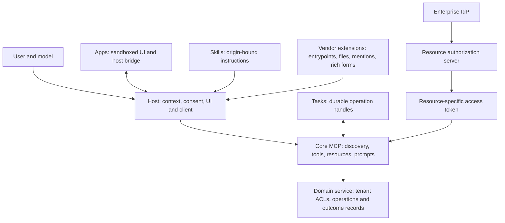

# MCP and extensions: shared service contracts, interactive apps and enterprise identity

> MCP is becoming a meeting point for capabilities, workflow instructions, interactive interfaces and identity. Its useful building block is a common service boundary; host support and real authority remain separate contracts.

**Evidence date: 2026-11-04.** Primary documentation and pinned implementation inspection. No host acceptance, OAuth flow, deployment, benchmark or security test was executed. This synthesis remains **draft under the wiki's cross-family review gate**; available subagents provide independent reviews with the same model family. Evidence pages remain useful with their individual limits. [[sources/modelcontextprotocol--mcp-core-and-extensions-docs#root]], [[sources/openai--mcp-extensions#root]], [[analyses/_eval-rubric]]

## The architecture that matters

The most productive reading is a layered contract. MCP standardizes exchange with a service; official extensions add optional interaction patterns; vendor extensions integrate those patterns into a particular product. The domain platform still owns what a real operation means and who may perform it. This is our synthesis of the boundaries documented in the linked studies, not a promise of seamless portability. [[sources/modelcontextprotocol--mcp-core-and-extensions-docs#architecture]], [[sources/openai--mcp-extensions#platforms]], [[sources/modelcontextprotocol--mcp-authorization-docs#enterprise-policy-limit]]

The diagram shows responsibilities rather than an exact OAuth wire sequence; [[concepts/mcp-enterprise-managed-authorization]] owns that sequence. A server is not entitled to the whole conversation merely because it is connected. A UI feature declaration is not an authorization grant. A task handle is not an exactly-once transaction. [[sources/modelcontextprotocol--mcp-core-and-extensions-docs#architecture]], [[sources/modelcontextprotocol--mcp-core-and-extensions-docs#task-errors-security]]

## Reading map and decision table

| Need | Contract to study | Reuse judgment | Material limit |
| --- | --- | --- | --- |
| Connect capabilities to several AI hosts | [[concepts/model-context-protocol]] | Make a focused service facade over existing domain APIs | Select a common core revision; host integration and semantics still vary |
| Let a person inspect/select/edit interactively | [[artifacts/projects/mcp-apps]] | Add a useful UI to the same underlying tool contract | Actual sandbox, bridge and host features need acceptance testing |
| Publish workflows beside their tools | [[concepts/skills-over-mcp]] | Keep instructions and references service-owned and load on demand | Format portability does not imply remote activation in every host |
| Return long work across disconnects | [[concepts/mcp-extension-architecture]] Tasks section | Persist a task handle and expose status/input/results | Cancellation is cooperative; domain effects need independent safety |
| Let employees use enterprise identity | [[concepts/mcp-enterprise-managed-authorization]] | Broker human delegation through trusted IdP/resource AS | Issuance control is not per-action audit or proven immediate revocation |
| Run unattended service jobs | Same auth comparison: client credentials | Use explicit workload identity and scoped tokens | Does not preserve an employee subject by itself |
| Integrate deeply with ChatGPT product surfaces | [[artifacts/projects/openai-mcp-extensions]] | Isolate a thin OpenAI adapter over portable services/UI | Specific host/build/capability support; vendor contracts do not port automatically |
| Find a remote server before connecting | Server Cards in [[concepts/mcp-extension-architecture]] | Treat static connectivity metadata as discovery | Lifecycle documentation conflicts; card is neither tool list nor install package |

The findings behind these choices are owned by the linked pages and their source maps. Their shared lesson is to distinguish **declared**, **compatible**, **authorized** and **verified successful**. [[sources/modelcontextprotocol--mcp-core-and-extensions-docs#extension-negotiation]], [[sources/modelcontextprotocol--mcp-core-and-extensions-docs#tools-state-errors]], [[sources/modelcontextprotocol--mcp-apps-docs#support-testing]]

## What changes the usual mental model

### 1. “MCP uses initialize and sessions” is now version-specific

The current `2026-07-28` core removed the initialization handshake and protocol-level sessions. Per-request metadata, `server/discover`, MRTR input continuations and explicit business handles define the new contract. HTTP response streams no longer resume with Last-Event-ID; losing a response requires a new request. Earlier examples may remain correct for older revisions. [[sources/modelcontextprotocol--mcp-core-and-extensions-docs#current-version]], [[sources/modelcontextprotocol--mcp-core-and-extensions-docs#http-recovery]]

**Building consequence:** determine the actual intersection of host and SDK versions first. For mutations, design idempotency and authoritative readback at the domain layer before enabling automatic request retry. “Stateless MCP” does not mean “no persistent workflow.” [[sources/modelcontextprotocol--mcp-core-and-extensions-docs#tools-state-errors]], [[sources/modelcontextprotocol--mcp-core-and-extensions-docs#compatibility]]

### 2. Apps turns a tool result into an interaction surface

MCP Apps associates a tool with an HTML UI resource and a host bridge. That lets people manipulate a chart, form or editor while the model receives selected context and invokes supported actions. The server/client extension negotiation and iframe `ui/initialize` are different channels. Stable wire behavior, development drafts and SDK migration APIs must be read separately. [[sources/modelcontextprotocol--mcp-apps-docs#resource-contract]], [[sources/modelcontextprotocol--mcp-apps-docs#bridge-sandbox]], [[sources/modelcontextprotocol--mcp-apps-docs#stable-version]], [[sources/modelcontextprotocol--mcp-apps-docs#sdk-version]]

**Building consequence:** use the same domain operation for an AI call and a direct UI action, while retaining a useful text result for hosts without UI. Define field-by-field disclosure to the model, view and host. Stable Apps data-passing guidance describes **tool-result** `structuredContent` as UI-only; explicit **`ui/update-model-context`** structured content is model input in the stable spec and OpenAI host contract. These are different channels. Core Tools also recommends text serialization of structured results for backward compatibility, so the field name itself is no secrecy guarantee. [[sources/modelcontextprotocol--mcp-core-and-extensions-docs#extension-negotiation]], [[sources/modelcontextprotocol--mcp-apps-docs#data-negotiation]], [[sources/modelcontextprotocol--mcp-apps-docs#messages-context]], [[sources/openai--mcp-extensions#model-context]], [[sources/modelcontextprotocol--mcp-core-and-extensions-docs#primitives]]

### 3. OpenAI's extensions make the app user-addressable

The pinned repo goes beyond a result card: navigation entrypoints, thread views, file handlers, settings, onboarding skills, mentions, messaging and rich forms give people ways to open and operate an app directly. Desktop WebMCP can expose the current UI state and actions to the model. The source explicitly excludes Apps SDK `App.registerTool()` support in favor of its documented Desktop mechanism. [[sources/openai--mcp-extensions#entrypoints]], [[sources/openai--mcp-extensions#settings]], [[sources/openai--mcp-extensions#mentions]], [[sources/openai--mcp-extensions#webmcp]]

**Building consequence:** an agent product can have a persistent user-controlled workspace inside a host, subject to that host's distribution and capabilities. Keep those integrations in an adapter. The repo's “Web” means Work browser, excluding classic ChatGPT; don't extrapolate its table to every ChatGPT account or surface. File URIs conceal paths from the view initially, while the native MCP server can receive absolute path metadata. Sandboxed UI does not contain that server. [[sources/openai--mcp-extensions#platforms]], [[sources/openai--mcp-extensions#file-authority]]

### 4. Enterprise auth federates authority without erasing resource ownership

The enterprise flow exchanges an identity assertion at the IdP for an ID-JAG, then redeems that grant at the resource authorization server for a resource-specific access token. Grant assertion, client authentication and resource token have different audiences and uses. Client credentials is a separate workload flow. [[sources/modelcontextprotocol--mcp-authorization-docs#enterprise-flow]], [[sources/modelcontextprotocol--mcp-authorization-docs#enterprise-token-and-discovery]], [[sources/modelcontextprotocol--mcp-authorization-docs#oauth-jwt-purpose]], [[sources/modelcontextprotocol--mcp-authorization-docs#client-credentials]]

**Building consequence:** corporate login can reduce per-service authorization friction, but domain ACLs, action confirmation and operational audit stay necessary. The normative profile limits IdP visibility to issuance, not MCP traffic. Its overview's immediate-revocation promise is stronger than the inspected mechanism establishes for already-issued tokens. Test offboarding against a token issued before access was removed. [[sources/modelcontextprotocol--mcp-authorization-docs#enterprise-policy-limit]], [[sources/modelcontextprotocol--mcp-authorization-docs#enterprise-overview]]

### 5. Skills supplies workflow knowledge without becoming an execution grant

The Skills extension transports the existing Agent Skills format with origin identity, manifests, content verification and controlled activation. It helps a service explain multi-step use without stuffing all instructions into tool descriptions. Loading a reference, activating a nested skill and granting code/tool authority are separate acts. [[sources/modelcontextprotocol--mcp-core-and-extensions-docs#skills]], [[sources/modelcontextprotocol--mcp-core-and-extensions-docs#skill-integrity]]

**Building consequence:** pair a small capability catalog with service-specific workflow guidance. Bind persisted approval to the complete manifest, verify fetched bytes and preserve remote origin through caching. A valid digest proves consistency with a declared artifact; it does not establish that the instructions are safe. [[sources/modelcontextprotocol--mcp-core-and-extensions-docs#skill-integrity]]

## What this adds to our existing research

[[artifacts/projects/kody]] and [[concepts/code-mode-capability-interface]] already show how to reduce a large capability graph to discovery and composition. MCP supplies an interoperability layer for that facade; it does not prescribe the facade's domain design. [[artifacts/projects/shopify-api]] shows richer domain-specific negotiation and commerce contracts. MCP feature declarations do not demonstrate Shopify's exact dependency-pruning mechanism, so [[patterns/composition/negotiated-capability-intersection]] remains proposed. [[sources/kody-hq--kody#mcp-surface]], [[sources/shopify--agent-commerce-api-design#profiles]], [[sources/modelcontextprotocol--mcp-core-and-extensions-docs#extension-negotiation]]

[[artifacts/projects/humanlayer]] and [[concepts/agent-control-plane]] separate task/session/host authority; Tasks adds a narrower wire-level operation handle. [[concepts/durable-agent-execution]] studies replay and checkpoints that a task-status API alone cannot establish. These comparisons keep “MCP support” from swallowing the rest of the product architecture. [[sources/humanlayer--humanlayer#domain-model]], [[sources/modelcontextprotocol--mcp-core-and-extensions-docs#tasks]]

## Proposed build sequence and acceptance evidence

This is a proposal derived from the inspected boundaries; no implementation or provider change is implied.

1. **Choose one read-heavy workflow and two target hosts.** Expose narrow domain operations and useful text/structured results. Record exact core/SDK/host versions, missing capabilities and intended fallback. [[sources/modelcontextprotocol--mcp-core-and-extensions-docs#compatibility]], [[sources/modelcontextprotocol--mcp-core-and-extensions-docs#extension-negotiation]]
2. **Add one Apps view where direct manipulation helps.** Test host sandbox/CSP, no-UI fallback, tool visibility and the exact data each channel reveals. Keep vendor additions behind capability checks. [[sources/modelcontextprotocol--mcp-apps-docs#security-limits]], [[sources/openai--mcp-extensions#capability-gates]]
3. **Choose identity by actor.** Use human delegation for employee work and explicit service identity for unattended execution. Verify issuer, resource/audience, scopes, tenant boundaries and actual token expiry/revocation. [[sources/modelcontextprotocol--mcp-authorization-docs#base-token-boundaries]], [[sources/modelcontextprotocol--mcp-authorization-docs#enterprise-policy-limit]], [[sources/modelcontextprotocol--mcp-authorization-docs#client-credentials]]
4. **Add Skills where a reusable workflow needs instructions.** Test manifest mutation, origin collisions, rejected content and nested activation; verify the target host loads skills at runtime rather than merely importing at submission. [[sources/modelcontextprotocol--mcp-core-and-extensions-docs#skill-integrity]], [[sources/modelcontextprotocol--mcp-core-and-extensions-docs#skill-support]]
5. **Add Tasks only when the operation outlives a response.** Verify durable creation/readback, reconnect, duplicate input, cancellation while work finishes, tool-domain error versus protocol failure, and authorization on each task request. Add domain idempotency separately. [[sources/modelcontextprotocol--mcp-core-and-extensions-docs#tasks]], [[sources/modelcontextprotocol--mcp-core-and-extensions-docs#task-errors-security]]
6. **Add vendor UX when its product surface is needed.** Verify each supported build, file writability/ETag conflicts, unsaved-state transitions and explicit draft/send semantics. Never promote the shared OAuth demo into a production identity design. [[sources/openai--mcp-extensions#resource-writes]], [[sources/openai--mcp-extensions#demo-webmcp]], [[sources/openai--mcp-extensions#messaging]], [[sources/openai--mcp-extensions#demo-oauth]]

## Remaining uncertainty

The source collection records concrete disagreements: current-versus-legacy initialization prose; Server Cards' Beta catalog versus Experimental README; Skills' obsolete stable-path links; auth overview versus normative policy limits; stable ID-JAG draft-04 dependency versus current draft-06; and client-secret metadata versus body-secret examples. Resolve the relevant pair before implementation. None has been quietly converted into a verified runtime defect or an interoperable behavior claim. [[sources/modelcontextprotocol--mcp-core-and-extensions-docs#documentation-conflicts]], [[sources/modelcontextprotocol--mcp-authorization-docs#id-jag-version-drift]], [[sources/modelcontextprotocol--mcp-authorization-docs#client-credentials]]

The highest-value next evidence is a small two-host pilot with one IdP/resource-AS combination and explicit business-effect readback. More catalog pages cannot settle those runtime questions. [[sources/modelcontextprotocol--mcp-apps-docs#support-testing]], [[sources/modelcontextprotocol--mcp-authorization-docs#support-caveats]]

## Review record

- Three independent same-family subagent reviews on 2026-11-04: OpenAI/core **4/4/4/5/5**, Apps **4/4/5/5/5**, auth/core **5/4/4/5/5**, in rubric order (citation integrity, faithfulness, completeness, non-genericness, decision usefulness). Lowest score **4/5**; no rubric blocker.
- Corrections applied: distinguish tool-result/model-context channels; qualify authenticated versus bearer state handles; prohibit all caching of MRTR retries; distinguish Elicitation from server primitives. Source spans were checked directly, with no runtime tests.
- Mechanical citation/link/hash checks recorded in [[meta/2026-11-04-mcp-ingest-lint]].
- **Cross-family gate:** pending; no different-family judge is available in this session. Status stays draft. This is a review limitation, not missing source capture or a request for user permission.
