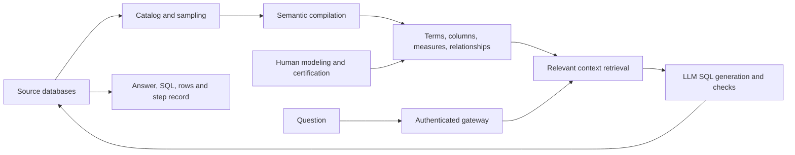

# NVIDIA Auto-Ontology

> Build a reviewable business-meaning layer over databases, then let agents retrieve definitions, measures and joins through a small tool surface instead of rediscovering their meaning for every question.

## Attributes

- **Unit studied:** the Auto-Ontology application at `caced11e69e19663dfa0f73778dbecbcb71e87a0`, plus the companion evaluator at `ec41b2c5b795637759297b90c1d19b42693200f9`. Both pins are restorable local source clones. [[sources/nvidia--auto-ontology#root]] [[sources/nvidia--auto-ontology-eval#root]]
- **Components:** Python/FastAPI backend and ingestion service, Next.js/Better Auth gateway and review UI, Postgres/pgvector catalog and semantic store, and a separate FastMCP adapter. A semantic graph does not require a separate graph-database product here. [[sources/nvidia--auto-ontology#architecture]]
- **Distribution:** Apache-2.0; inspected package declares `auto-ontology-server` 1.1.0, Python ≥3.12 and <3.14. Version is the manifest value, not a verified published-package status. [[sources/nvidia--auto-ontology#license]]
- **Attention:** 3,590 GitHub stars and 309 forks, captured 2026-11-04. Companion evaluator: 50 stars, 12 forks. These are interest signals, not production adoption or accuracy results. [[sources/nvidia--auto-ontology]] [[sources/nvidia--auto-ontology-eval]]
- **Evidence:** selected implementation, docs, skills, test assertions and architecture image inspected; offline OpenAPI count/allow-list/parity checks executed. No application deployment, provider calls, benchmark run or upstream test-suite execution. This is not a security audit or an exhaustive file-by-file read.

## Relationships

- **Creator:** [[creators/nvidia]].
- **Evidence:** [[sources/nvidia--auto-ontology]] and [[sources/nvidia--auto-ontology-eval]]. The companion is the same team's evaluation tooling, not independent confirmation.
- **Meaning and context:** [[concepts/ubiquitous-language-for-agents]], [[concepts/artifact-centered-agent-context]].
- **Selection:** [[concepts/lifelong-skill-routing]], [[concepts/code-mode-capability-interface]].
- **Verification:** [[concepts/imitation-vs-correctness-eval]], [[concepts/evidence-calibrated-research]], [[concepts/trace-lake]].

## Mechanism and themes

### 1. Compile meaning, then retrieve it on demand

The persistent layer maps business **Terms** to physical columns, reusable **SQL attributes** to computations, and relationships to possible joins. Ingestion catalogs and samples sources; semantic compilation processes tables, embeds definitions, resolves foreign-key relationships, suggests attributes from query history and builds bridge-table attributes. The source's product claim is more consistent, explainable answers; our supported implementation claim is that the agent receives reusable semantic context instead of only a raw schema. [[sources/nvidia--auto-ontology#architecture]] [[sources/nvidia--auto-ontology#compile]]

This is **not deterministic end-to-end query generation**. The SQL-construction path calls a language model with structured output and retries. Deterministic components constrain and check parts of the workflow; they do not remove model judgment or establish semantic correctness. [[sources/nvidia--auto-ontology#llm-sql]] [[sources/nvidia--auto-ontology#degenerate-sql]]

### 2. Model business identity, not just friendly column labels

The management skill requires a question contract—population, measure, grouping, time range, comparison and exclusions—before changing meaning. Relationship contracts cover direction, role, multiplicity, null/key behavior, join coverage and fanout. Measure contracts distinguish row/query grain, unit, additive dimensions, denominator, zero/empty behavior and time validity. Similar names or currently equal row sets do not prove concepts are equivalent; ratio-of-totals is not generally mean-of-ratios. These are **authoring instructions**, not automatic database constraints. [[sources/nvidia--auto-ontology#measure-contracts]]

The extraction prompt prefers one business term per table, permits a second for a genuine junction, assigns each candidate column once, qualifies archive/history variants and extracts only explicitly stated synonyms. These are useful scope-preserving prompts, not proof the model always follows them. [[sources/nvidia--auto-ontology#grounded-names]]

### 3. Parallel reasoning, ordered mutation

Compilation uses three table workers while serializing term commits in a canonical database/schema/table order. The intent is deterministic ownership of colliding unqualified names without serializing expensive LLM work. A separate compilation-wide in-flight model-call bound defaults to six; nested fan-out otherwise multiplies concurrency. Cancellation records skipped commit slots without waiting on earlier slots, so a cancelled backlog does not occupy every worker waiting for turns that will never happen. Already-running work still drains rather than being forcibly interrupted. [[sources/nvidia--auto-ontology#ordered-commits]] [[sources/nvidia--auto-ontology#compile]] [[sources/nvidia--auto-ontology#cancellation-tests]]

The narrow guarantee is ordered mutation for a given set of proposals—not identical generated ontology content across model runs.

### 4. Readiness, coverage and correctness are different questions

| Check | Implementation / purpose | What it does not prove |
| --- | --- | --- |
| `check_readiness` | Combines compilation status, configured connection count and catalog presence; reports blockers and inaccessible facts separately | Does not execute a live query; `can_execute_sql` is inferred from connection configuration, not a successful connection probe |
| `check_answerable` | Extracts entities, retrieves candidates, filters by distance and computes the fraction of entities covered by column-attribute hits | Does not prove the desired measure, grain, joins or permissions support a correct answer |
| SQL checks and execution | Parse/static and model intent checks, optional database probes, reconstruction and execution | Executable SQL can still implement the wrong business question |
| Human certification | Persisted flags and an aggregate certified/partial/pending presentation | Not a revision-bound, atomic review/promotion/rollback workflow |

Sources: [[sources/nvidia--auto-ontology#readiness]], [[sources/nvidia--auto-ontology#coverage]], [[sources/nvidia--auto-ontology#retry-boundaries]], [[sources/nvidia--auto-ontology#certification]], [[sources/nvidia--auto-ontology#publication]].

Readiness treats a 401 as a credential error. A forbidden connection/catalog read can be reported as **unverified** while other evidence supports a ready verdict; forbidden chat status blocks readiness. This is more informative than conflating permission-limited visibility with a broken deployment, but callers must retain the uncertainty. [[sources/nvidia--auto-ontology#readiness-tests]]

Certification also must not be mistaken for “only reviewed definitions are used.” The inspected SQL-attribute candidate expansion filters for requested IDs, attached SQL and term association, **not** `certified=true`. The checked path therefore does not establish a certified-only serving policy. [[sources/nvidia--auto-ontology#certification]]

### 5. Curate tools around decisions, not database tables

The MCP adapter exposes seven allow-listed OpenAPI operations plus custom `ask_question` and `check_readiness` tools. It deliberately omits generic catalog browsing so callers start from business meaning. Human-readable names and trigger-oriented descriptions are curated; parameter schemas come from OpenAPI. Route regexes are anchored and escaped, an exclusion catch-all hides new endpoints by default, and missing curated operations fail startup rather than silently disappearing. [[sources/nvidia--auto-ontology#curated-tools]]

**Count checked at this pin:** 119 OpenAPI HTTP operations; seven generated + two custom MCP tools. Docs/comments still say 87 operations. The canonical and packaged spec copies are byte-identical. Count/parity were checked offline; no MCP handshake was run. The smaller surface is a concrete design choice, not a measured tool-selection improvement in this ingest. [[sources/nvidia--auto-ontology]]

The three repository skills separate setup, query/validation and semantic management/publication. The query skill treats the live MCP handshake as authoritative and routes mutation to the management workflow instead of duplicating API capability in prose. Skill files are guidance, not API authorization. [[sources/nvidia--auto-ontology#query-skill]] [[sources/nvidia--auto-ontology#management-skill]] [[sources/nvidia--auto-ontology#setup-skill]]

### 6. Preserve evidence in answers and bound recovery

The streaming adapter returns separate answer, SQL, rows and step-summary fields; it forwards progress events rather than leaving a long query silent. It returns at most 100 rows and exposes `row_count`/`truncated`. **That count is over the payload received by the adapter**, not an independently computed count of every matching row in the source database; upstream result limits still matter. [[sources/nvidia--auto-ontology#structured-answer]]

The SQL graph caps reconstruction at seven attempts. Some post-construction soft checks stop blocking after **more than five** recorded reconstruction failures; the main parse/static and intent validation path is separate. A bounded retry loop is useful, but “all checks passed” would misstate a path where a soft check was skipped. Degenerate-SQL checks reject placeholder-like constructions that can execute without answering anything. [[sources/nvidia--auto-ontology#retry-boundaries]] [[sources/nvidia--auto-ontology#degenerate-sql]]

Probe execution has keyword-based single-SELECT/WITH screening, a call budget and a LIMIT append when absent. This is not a full SQL security proof or universal hard row cap. Chat SQL timeouts are applied where the connector advertises support; unsupported connectors are called unchanged. Keep the intended outcome separate from the exact enforcement mechanism. [[sources/nvidia--auto-ontology#probe-guard]] [[sources/nvidia--auto-ontology#query-timeout]]

### 7. Context, identity and authority have separate owners

| Boundary | Owner / enforcement | Limit |
| --- | --- | --- |
| Agent → MCP | Per-user OAuth token verified against Auto-Ontology UserInfo and forwarded upstream | No shared server token that makes every caller impersonate one owner |
| Public API → Next.js | Caller resolution and `withPermission` guards | These are application permissions, not proof of source-database row-level isolation |
| Next.js → FastAPI | Gateway builds internal identity headers from its resolved user | FastAPI trusts the header without independent verification; the network hop must remain private |
| App → source database | Configured connection/connector credentials | Do not infer that every database query executes under the browser user's own database principal |
| Semantic review → publication | Scoped export, backup, isolated application and exact re-export prescribed by management skill | Prompt workflow is not atomic infrastructure enforcement |

Sources: [[sources/nvidia--auto-ontology#mcp-auth]], [[sources/nvidia--auto-ontology#gateway]], [[sources/nvidia--auto-ontology#connection-storage]], [[sources/nvidia--auto-ontology#publication]].

Connection documentation records another meaningful boundary: without complete Vault configuration, full connection JSON including passwords is stored unencrypted in the catalog database. Partial Vault configuration falls back with a warning. Ingestion prefers environment connections when set, whereas answering prefers UI-managed connections when present; mixing them can make the compiled and queried source sets diverge. These are source-specific deployment characteristics, not instructions to connect this project to our data. [[sources/nvidia--auto-ontology#connection-storage]]

### 8. Evaluate the whole treatment honestly

The companion compares a **one-shot schema-only control** with the **ontology-backed multi-step agent**, scoring both by execution-match rules. The intended same-model comparison must still account for role-specific model configuration, extra calls, retrieval and repair. Our inference: it measures the configured system treatment; it is **not an isolated causal estimate of ontology quality** without additional matched-workflow ablations. Optional SQL exemplars/value anchors help only the treatment and are off unless enabled. [[sources/nvidia--auto-ontology-eval#root]] [[sources/nvidia--auto-ontology-eval#model-controls]] [[sources/nvidia--auto-ontology-eval#extra-context]]

Useful evaluator mechanisms:

- **Health before headline:** default reporting refuses a number when either arm has >5% `no_model_output`/`unknown_error` failures over common task IDs, or dispatched tasks lack results. The latter check depends on materialized-input sidecars; missing sidecars cannot prove completeness. `--ignore-health` explicitly bypasses the gate. [[sources/nvidia--auto-ontology-eval#health-gate]]
- **Show gains and regressions:** list question-level fixed/broken flips instead of only an aggregate delta. [[sources/nvidia--auto-ontology-eval#flips]]
- **Define correctness precisely:** BIRD set equality ignores row order and duplicate multiplicity; BEAVER uses different value normalization and treats certain failures as empty results. A passing benchmark match is not a universal semantic-equivalence test. The harness exposes nonempty-gold reporting to make the empty-result issue visible. [[sources/nvidia--auto-ontology-eval#scoring]]
- **Pin the real treatment:** the evaluator's dependency is application commit `dd78d0689ef9a8e062af90a294fa903cb6643015`, **not** this study's current application pin `caced11e…`. Never transfer a result between them without checking versions. [[sources/nvidia--auto-ontology-eval#pin]]

No accuracy improvement number is asserted here. We inspected the evaluation design and tests, not a completed, independently reproduced benchmark run.

## Patterns demonstrated

- [[patterns/behavioral/latent-vs-deterministic-split]] — model-proposed terms and SQL alongside deterministic ordering, parsing and benchmark grading; each guarantee has a smaller scope than the whole agent. [[sources/nvidia--auto-ontology#ordered-commits]] [[sources/nvidia--auto-ontology-eval#scoring]]
- [[patterns/behavioral/evidence-gated-completion]] — readiness blockers, exact publication readback and benchmark health gates all distinguish a finished procedure from supported success. Publication gates are prescribed by skills; evaluator gates are code. [[sources/nvidia--auto-ontology#publication]] [[sources/nvidia--auto-ontology-eval#health-gate]]
- [[patterns/composition/single-source-multi-surface-distribution]] — UI, REST and MCP reuse the public API; curated tool presentation overlays shared parameter schemas. [[sources/nvidia--auto-ontology#curated-tools]] [[sources/nvidia--auto-ontology#structured-answer]]
- [[patterns/composition/resolver-routing-table]] — named skill responsibilities and curated tool descriptions reduce competing entry points. Comparison only: no routing-accuracy experiment was run. [[sources/nvidia--auto-ontology#query-skill]]
- [[patterns/behavioral/context-is-not-authority]] — an ontology supplies meaning, not permission; gateway auth and database credentials remain distinct. [[sources/nvidia--auto-ontology#gateway]]

These are dated supporting comparisons. Existing pattern statuses and artifact example counts are not silently promoted by the companion repo or by multiple modules in this one system.

## What we'd steal

1. ★ **Persist business meaning outside the chat.** Reuse terms, measures and joins; regenerate answers against that shared context rather than re-inventing definitions each turn. Limit: generated definitions remain hypotheses until reviewed. [[sources/nvidia--auto-ontology#architecture]]
2. ★ **Start with representative questions.** Specify population, grouping, time, comparisons and exclusions before editing the semantic model. [[sources/nvidia--auto-ontology#measure-contracts]]
3. ★ **Make grain and denominators first-class.** Record units, additive dimensions and forbidden reaggregation; test ratio-of-totals versus mean-of-ratios explicitly. [[sources/nvidia--auto-ontology#measure-contracts]]
4. **Test joins with counterexamples.** Duplicate keys, nulls, reverse joins, missing mappings and fanout reveal errors that plausible names hide. [[sources/nvidia--auto-ontology#measure-contracts]]
5. **Preserve physical identity.** Keep exact IDs and bindings through model edits/imports; natural-name similarity is not an upsert contract. [[sources/nvidia--auto-ontology#publication]]
6. **Qualify misleading variants and ground synonyms.** Archive/history tables need explicit scope; aliases should come from evidence rather than invented semantic similarity. [[sources/nvidia--auto-ontology#grounded-names]]
7. **Parallelize proposals, order conflicting writes.** Use a deterministic commit sequence for shared-name ownership while preserving parallel model work. [[sources/nvidia--auto-ontology#ordered-commits]]
8. **Budget nested fan-out at the owning workflow.** A global compilation in-flight cap controls multiplied concurrency without throttling unrelated callers. [[sources/nvidia--auto-ontology#compile]]
9. **Make cancellation release its place in the queue.** Skipping must not wait on the slot being abandoned; distinguish cancelled from fully compiled. [[sources/nvidia--auto-ontology#ordered-commits]]
10. ★ **Expose readiness before expensive work.** Check independent prerequisites and report all blockers at once; retain “unverified” when permission prevents inspection. Do not claim configuration checks prove liveness. [[sources/nvidia--auto-ontology#readiness]]
11. **Use coverage as a preflight, not a certificate.** Preserve uncovered entities and validate material meaning after retrieval. [[sources/nvidia--auto-ontology#coverage]]
12. ★ **Publish a small, intentional tool surface.** Curate names and when-to-use descriptions while deriving parameter schemas from the API. Exclude future endpoints by default. [[sources/nvidia--auto-ontology#curated-tools]]
13. **Fail visibly when an adapter drifts.** Missing allow-listed operations should fail startup; packaged schemas should match their canonical source. [[sources/nvidia--auto-ontology#curated-tools]]
14. **Separate setup, read and mutation guidance.** Let the live tool handshake govern available reads; do not turn a query skill into a hidden model-editing workflow. [[sources/nvidia--auto-ontology#query-skill]]
15. **Return evidence as structured fields.** SQL and rows should not require scraping a prose answer; expose truncation and the boundary of counts. [[sources/nvidia--auto-ontology#structured-answer]]
16. **Stream meaningful progress.** Forward step events during long queries; distinguish progress reporting from proof of answer correctness. [[sources/nvidia--auto-ontology#structured-answer]]
17. **Reject successful no-ops.** SQL that parses and runs but cannot answer the question needs an explicit failure category. [[sources/nvidia--auto-ontology#degenerate-sql]]
18. **Bound repair and surface skipped checks.** A finite retry budget should not turn a bypassed soft check into an “all verified” claim. [[sources/nvidia--auto-ontology#retry-boundaries]]
19. **Put timeouts at the workload boundary.** Agent queries and ingestion scans have different budgets; keep connector support gaps explicit. [[sources/nvidia--auto-ontology#query-timeout]]
20. ★ **Keep caller identity end-to-end.** Reuse the user's authenticated authority in MCP instead of a shared service token; document private-hop trust separately. [[sources/nvidia--auto-ontology#mcp-auth]] [[sources/nvidia--auto-ontology#gateway]]
21. **Verify persisted publication, not HTTP success.** Export the exact scope, hash a rollback artifact, apply in isolation and compare exact re-export plus behavior. This is a workflow to implement, not a guarantee supplied by certification flags. [[sources/nvidia--auto-ontology#publication]]
22. **Distinguish recommendations from actions.** A published analytical result does not authorize a business commitment or external execution. [[sources/nvidia--auto-ontology#publication]]
23. ★ **Gate benchmark reporting on run health.** Infrastructure failures and missing cases must not masquerade as low model quality; retain the dispatch manifest. [[sources/nvidia--auto-ontology-eval#health-gate]]
24. **Keep question-level regressions.** An aggregate gain can hide newly broken business queries; turn flips into replayable cases. [[sources/nvidia--auto-ontology-eval#flips]]
25. **Publish the evaluator's semantics and denominator.** Row sets, multisets, empty outputs, failed gold queries and timeouts change what a score means. [[sources/nvidia--auto-ontology-eval#scoring]]
26. **Pin and disclose the complete treatment.** Record application revision, model roles, workflow/call budget and asymmetric extra context before attributing improvement to one component. [[sources/nvidia--auto-ontology-eval#pin]] [[sources/nvidia--auto-ontology-eval#extra-context]]

## Tensions and anti-patterns

- **Graph-shaped context is not truth.** Generated terms, inferred joins and sampled values can be wrong. Human-readable output and successful execution do not settle grain, population or causality. [[sources/nvidia--auto-ontology#measure-contracts]]
- **Do not adopt the entire stack merely to obtain a glossary.** Our judgment: start with a small, high-value domain and real ambiguous queries. Promote to a service when multiple consumers need governed definitions and measured failures justify the maintenance burden.
- **Curated MCP is not a database sandbox.** Tool exposure, application permissions, network isolation and database grants are different boundaries. Probe keyword screening is not a general proof that arbitrary SQL has no side effects. [[sources/nvidia--auto-ontology#gateway]] [[sources/nvidia--auto-ontology#probe-guard]]
- **Documentation can lag even in an actively maintained repo.** Besides the 87→119 operation count, the README describes prediction enablement via `KUMO_RFM_API_KEY`, while the graph gates on `KUMO_RFM_API_URL`. The setup skill says ingestion scope issue #255 is open; GitHub records it closed. Publication references issue #265 as a limitation; it is also closed. Issues #250 and #267 remain open at capture. Preserve both the pinned warning and current issue state; closing an issue is not our runtime verification of every deployment. [[sources/nvidia--auto-ontology#prediction-drift]] [[sources/nvidia--auto-ontology#setup-skill]] [[sources/nvidia--auto-ontology#publication]] ([dated issue capture](../../sources/nvidia--auto-ontology-evidence/capture.json)).
- **Same model does not mean same treatment.** The evaluation control lacks the agent's retrieval, repair and multi-step workflow; optional treatment hints widen the difference. Cost/latency and a matched-workflow ablation are needed to isolate the payoff of maintained semantics. [[sources/nvidia--auto-ontology-eval#root]] [[sources/nvidia--auto-ontology-eval#extra-context]]

## Open questions and verification record

- Which representative business queries improve over a matched agent with raw schema and equal tool/call budgets, at what cost and latency?
- How are source changes, stale embeddings and invalidated definitions detected and reconciled while preserving human edits?
- What would enforce a revision-bound certified-only serving policy, rather than displaying review flags?
- Can end-to-end table/row scope and publication parity be demonstrated on the target connector and application version?
- Do readiness heuristics correctly handle configured-but-dead connections, and can an inexpensive live probe strengthen them?
- How much of the curated surface benefit survives as the semantic vocabulary grows? Compare against [[concepts/lifelong-skill-routing]], not just API-count reduction.

**Verification performed:** repository pins and local preservation recorded; canonical/packaged OpenAPI byte parity and all seven generated tool-route memberships checked; 119 operations counted. Source-range and new-wikilink validation accompany this ingest. No application, SQL against a live source, model inference or accuracy benchmark was run. Upstream tests remain inspected-only, not passing evidence.
