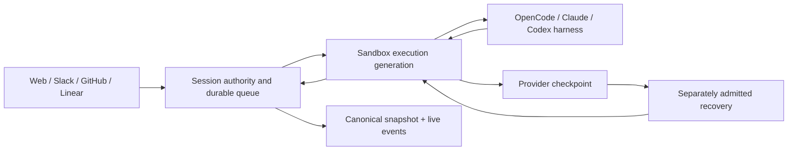

# Background Agents / Open Inspect

> Separate a durable, collaborative session from its replaceable sandbox execution—and make recovery, authority and context contracts explicit at that boundary.

## Attributes

- **Unit of study:** `open-inspect/background-agents`, a hosted background coding-agent system, not a new model or a single skill. The README credits Ramp's Inspect as inspiration; this investigation does not establish implementation or performance parity with Ramp. [[sources/open-inspect--background-agents#root]]
- **Revision:** `4b7f4e430dbb5c29cf776de41151365d1196d737`, retrieved 2026-11-04. Full 3,239-entry tracked tree preserved locally with Git metadata and a restoration manifest. Selected paths studied, not all files. [[sources/open-inspect--background-agents]]
- **Shape:** clients and integrations → session control plane → provider-managed sandbox → selected coding harness. The documented Cloudflare path uses per-session Durable Objects/SQLite and shared D1; the repository also documents a Node/SQLite host. Do not equate the Cloudflare deployment diagram with the only host. [[sources/open-inspect--background-agents#architecture]] [[sources/open-inspect--background-agents#preview]] [[sources/open-inspect--background-agents#portability]]
- **Signals:** MIT; 3,453 GitHub stars and 504 forks on 2026-11-04. Popularity is not reliability evidence. [[sources/open-inspect--background-agents]]
- **Verification:** documentation, selected implementations and focused test assertions read. No install, runtime build, test execution, deployment, live sandbox or model benchmark performed.

## Relationships

- Creator: [[creators/open-inspect]]. Source: [[sources/open-inspect--background-agents]].
- Adjacent systems: [[artifacts/projects/codex]], [[artifacts/projects/humanlayer]], [[artifacts/projects/eve]]. Codex is a supported harness here; these are distinct repositories and separately pinned investigations.
- Concepts: [[concepts/agent-control-plane]], [[concepts/durable-agent-execution]], [[concepts/artifact-centered-agent-context]], [[concepts/workspace-skill-distribution]], [[concepts/lifelong-skill-routing]], [[concepts/trace-lake]], [[concepts/completion-contract]], [[concepts/verification-model-fidelity]].

## Mechanism and themes

### 1. The session is durable; the sandbox is an execution generation

Sessions contain prompts, events, artifacts, participants and sandbox references. The control plane owns coordination; code runs in provider-managed environments. Web, Slack, GitHub and Linear are entry surfaces into shared session state, not separate agent memories. A user's disconnection is distinct from a worker crash or provider retirement. [[sources/open-inspect--background-agents#architecture]]

A provider checkpoint does not make arbitrary commands replay-safe, and an `execution_complete` event is not independently verified task success. The harness contract returns a typed turn outcome; the activity supervisor selects and schedules one terminal result for its owned activity. This is local terminal-selection ownership, not a global exactly-once delivery/effects claim. [[sources/open-inspect--background-agents#harness]] [[sources/open-inspect--background-agents#completion]]

### 2. Reconnect by canonical snapshot, with a small atomic handoff

ADR 0003 deliberately rejects a second retained session-view delta log while full replay remains bounded. Authentication/enrichment happens first; the final snapshot read/send and socket identity publication happen synchronously. `completeClientSubscription` performs the snapshot/send; `activateClient` invokes it and writes persistent/in-memory identity with no intervening await. Stable event identity/timeline sequence supports pagination separately. This is a specific per-session event-loop invariant, not a general distributed transaction. [[sources/open-inspect--background-agents#snapshot-handoff]]

Interactive sandbox credentials are a separately authenticated resource, not part of the canonical snapshot contract. Cached WebSocket authorization has an expiry and survives hibernation through stored mappings; the docs bound live-browser rechecks to five minutes. Read access, collaboration and sandbox access are different permissions. [[sources/open-inspect--background-agents#snapshot-handoff]] [[sources/open-inspect--background-agents#authority]]

### 3. Readiness, checkpoint, retirement and recovery are separate facts

The boot path distinguishes bridge connectivity, repository sync, setup, runtime start, skills and harness readiness. Fresh provisioning, prebuilt-image starts and snapshot restores are different operations: restores preserve the captured checkout/uncommitted work, whereas prebuild starts reset to the current branch head. The docs say failed boots do not create automatic restore points. Performance benefits from snapshots/prebuilds/warming are design claims here, not measured latency. [[sources/open-inspect--background-agents#boot]]

The lifecycle coordinator reserves generation identity and shutdown ownership transactionally. Replacing a sandbox ID also fails its processing prompt in that transaction; an in-place resume of the same identity differs. Admission checks current generation, provider, lifecycle phase and readiness. Checkpoint calls persist operation identity/deadlines before provider I/O; late results are fenced by generation and operation. [[sources/open-inspect--background-agents#generation-fence]] [[sources/open-inspect--background-agents#checkpoint]]

Unknown provider outcomes remain unknown. A routine checkpoint that neither stops nor alters a continuing source can eventually release its exclusion after the settlement window and a live-runtime check; this is **not** evidence that its snapshot succeeded or permission to reopen uncertain shutdown. Shutdown needs recoverable state and retirement evidence. If it interrupts a prompt, the prompt is terminalized and continuation paused; later user-authorized recovery does not replay that prompt. Clean-boundary continuation has a different policy. [[sources/open-inspect--background-agents#shutdown-design]] [[sources/open-inspect--background-agents#checkpoint]] [[sources/open-inspect--background-agents#continuation]]

Focused tests inspect settlement branches, generation replacement, and captures where quiescence cannot be confirmed. They support specific asserted policies, not a live multi-provider fault-tolerance certification. Existing snapshots may retain a `legacy` lifecycle policy; new launches do not gain safety by merely renaming stored wire fields. [[sources/open-inspect--background-agents#lifecycle-tests]] [[sources/open-inspect--background-agents#compatibility]]

### 4. Multi-repo work and child delegation have narrower scopes than their names suggest

A session captures an ordered repository/environment definition; the first repo drives defaults. Harness working-directory semantics matter: Claude starts in the primary checkout so its settings apply, with secondary directories added; secondary native settings/hooks are not simply equivalent to primary settings. This is a compatibility contract, not a universal multi-repo abstraction. [[sources/open-inspect--background-agents#architecture]]

Child spawning checks depth, total/concurrent admission and current author/team/repository authority. A child is **single-repository**, pinned to the parent's primary repo even when the parent has multiple repositories. It inherits exact managed-skill selection and conditional memory provenance. Parent follow-ups enter the child's normal queue; relationship checks occur both at the route and child handler. On an ambiguous delivery, the route retains the admission lease rather than immediately undercounting activity. [[sources/open-inspect--background-agents#child-scope]] [[sources/open-inspect--background-agents#child-followups]]

**Documentation/code difference:** the narrative says follow-ups are attributed to the child owner; the inspected route obtains the parent's active prompt author and the child handler enqueues that identity plus the original queued-account provenance. The implementation is the stronger evidence for this pinned behavior. [[sources/open-inspect--background-agents#child-followups]]

### 5. Pin context for reproducibility; revalidate authority for access

Managed skills are selected/pinned at session creation. Installation checks names, relative paths, content sizes, per-file hashes, executability and cross-page manifest identity before discovery. It stages paginated content, uses a durable swap marker/backup, and recovers interrupted replacement. A manifest digest is explicitly opaque at this receiver: validation is not a cryptographic proof of publisher trust. Collision handling drops managed skills in favor of already discovered names and reports the drops, so pinned selection is not identical to effective installation. [[sources/open-inspect--background-agents#skills-pinning]] [[sources/open-inspect--background-agents#skills-validation]] [[sources/open-inspect--background-agents#skills-install]]

Persistent memory separates full directives from a compact fact catalog with on-demand bodies and lexical search. Proposed shared/behavioral writes require review; a replacement proposal does not retire its predecessor before approval. Pinned catalog/directive revisions coexist with current fact-body reads. Budget overflow omits whole records with diagnostics. This makes memory provenance inspectable without assuming embeddings or unlimited context. [[sources/open-inspect--background-agents#memory-model]]

Personal live reads depend on the original prompt account, current permission and session/ancestor prompting history; an inherited child cannot expand to unpinned personal records. The service rechecks before releasing personal records. But pinned personal text, transcripts and sandbox files are not erased by opting out; another participant's persistent process can cross turn boundaries. **Read revocation is not retroactive information erasure or process-level isolation.** The docs state this explicitly. [[sources/open-inspect--background-agents#memory-boundary]]

### 6. Admission authority, cached credentials and attribution must not collapse

This is a single-tenant trusted-organization system. Teams add access control, not hostile-tenant isolation. The canonical auth guide defaults Teams enforcement to `shadow`, while some private/team action checks apply in every mode. Suspension stops new access/automation admission but does not automatically stop existing sandbox execution. [[sources/open-inspect--background-agents#root]] [[sources/open-inspect--background-agents#authority]]

GitHub credentials are narrowed to persisted session repositories/current team grants at issuance, but on-disk cached tokens can survive snapshots and remain valid until expiry. GitLab uses a deployment-wide PAT. Personal MCP tokens stay at the proxy, but that proxy authenticates a sandbox/active turn, not every process inside it. Encryption, token brokering, cache lifetime, revocation and process isolation are distinct guarantees. [[sources/open-inspect--background-agents#credentials]]

Commit author, run executor and PR author are also distinct. The docs describe automation-owned prompts opening PRs as the App so the human can review; child sessions or later human prompts have different attribution paths. Do not infer a blanket App identity for every descendant of an automation. [[sources/open-inspect--background-agents#attribution]] [[sources/open-inspect--background-agents#authority]]

### 7. Retry before uncertain execution, not after it

The launch service marks the point just before first-prompt enqueue as no longer retryable: a failed response could follow successful queue admission. Stable `clientRequestId` makes a repeated request distinguishable from a conflicting payload; `sessionKey` is a separate continuity concept. Follow-ups arriving during initial launch wait until its first prompt is queued. The launch test explicitly asserts no relaunch after an ambiguous enqueue failure. These are bounded admission safeguards, not exactly-once arbitrary agent effects. [[sources/open-inspect--background-agents#automation-retry]] [[sources/open-inspect--background-agents#automation-delivery]]

The documented breaker counts partial fan-out failures as a failed firing, skips as neutral, and pauses future firings without canceling already-started sessions. Scheduled/manual concurrency is per automation; event deliveries use keys. That does not establish a repository-wide mutex across independent automations. [[sources/open-inspect--background-agents#automation-breaker]]

### 8. Export truth at its actual consistency unit

Trace export is a pull-only versioned NDJSON interface, not an automatic trace lake. Each session's requested collections are read in one transaction with shared byte/page budgets; failure produces a session error instead of a success-shaped partial trace. Across the bulk export, pagination is explicitly best-effort rather than one database snapshot; a family may cross pages, and concurrent deletes can change it. [[sources/open-inspect--background-agents#export]] [[sources/open-inspect--background-agents#export-code]]

Compacted duplicate outputs can refer to a later event in exported order, so resolve by ID, not position. Upstream truncation is irreversible at export; raw usage step boundaries differ by harness. These constraints matter when turning traces into evals or cost comparisons. [[sources/open-inspect--background-agents#export]]

### 9. Verification should retain real internal boundaries

The authenticated local preview documents real application/BFF/control-plane/auth/storage/WebSocket paths with GitHub and the sandbox protocol peer substituted. A scripted sandbox does not execute prompts or prove agent quality. This is a useful middle ground between a static UI mock and a paid production run; this ingestion read its contract but did not launch it. [[sources/open-inspect--background-agents#preview]]

The SQL portability guide documents a CI ratchet: preserve old migrations, constrain new store syntax, and require explicit exception counts/reasons. It also marks Postgres as planned, not supported merely because syntax is being disciplined. The SCM ADR advocates one provider per deployment and provider-specific mechanics behind a boundary; its historical provider inventory should not override newer GitLab documentation. [[sources/open-inspect--background-agents#portability]] [[sources/open-inspect--background-agents#credentials]]

## Patterns demonstrated

- [[patterns/structural/thin-harness-fat-skills]] — shared orchestration/harness contracts with independently managed capabilities. A real harness is substantial infrastructure. [[sources/open-inspect--background-agents#harness]] [[sources/open-inspect--background-agents#skills-install]]
- [[patterns/behavioral/context-is-not-authority]] — context selection, active-author checks, token issuance and retained content have separate boundaries. [[sources/open-inspect--background-agents#memory-boundary]] [[sources/open-inspect--background-agents#credentials]]
- [[patterns/behavioral/evidence-gated-completion]] — provider response, checkpoint receipt, source retirement and actual task correctness are not interchangeable. [[sources/open-inspect--background-agents#shutdown-design]]
- [[patterns/behavioral/latent-vs-deterministic-split]] — model work stays inside runtime-owned admission, lifecycle and export invariants. [[sources/open-inspect--background-agents#automation-retry]] [[sources/open-inspect--background-agents#completion]]
- [[patterns/composition/single-source-multi-surface-distribution]] — shared protocol contracts and explicit client normalization; distinct harness adapters. [[sources/open-inspect--background-agents#protocol]]
- [[patterns/quality-bar/complexity-ratchet]] — bounded snapshot convergence instead of a speculative extra mutation log; documented portability debt counters. [[sources/open-inspect--background-agents#snapshot-handoff]] [[sources/open-inspect--background-agents#portability]]

## What we'd steal

Portable ledger; ★ marks priority, not independently measured performance. Each adoption retains its stated scope.

1. **★ Make sessions independent of human connectivity.** Persist queue/state in the coordinator and treat clients as views. Use for asynchronous work; losing a client must not imply worker termination. [[sources/open-inspect--background-agents#architecture]]
2. **Give lifecycle policy one owner with focused collaborators.** Queue, push and recovery should ask that owner rather than recombine flags. Their readiness policies can still differ. [[sources/open-inspect--background-agents#shutdown-design]]
3. **Author transport contracts once.** Share message types and normalize at UI/provider boundaries; do not assume shared types remove runtime validation needs. [[sources/open-inspect--background-agents#protocol]]
4. **Use bounded full snapshots until incremental replay earns its complexity.** Measure reconnect bandwidth before adding a second mutation log. [[sources/open-inspect--background-agents#snapshot-handoff]]
5. **★ Make the snapshot-to-stream handoff structurally synchronous.** Keep final read/send/registration in a no-await segment; transfer the invariant only where the host execution model supports it. [[sources/open-inspect--background-agents#snapshot-handoff]]
6. **Separate a shareable view from credential retrieval.** Authorize interactive access independently; a session reader need not be a sandbox operator. [[sources/open-inspect--background-agents#snapshot-handoff]]
7. **Distinguish connectivity from readiness.** Report boot phases and dispatch only after runtime-ready; a heartbeat alone does not prove dependencies/services work. [[sources/open-inspect--background-agents#boot]]
8. **Separate provisioning from per-start services.** Run setup when building/fresh, start on resume; preserve primary-versus-secondary failure semantics rather than claiming every hook failure is fatal. [[sources/open-inspect--background-agents#boot-code]]
9. **Preserve user workspace state when restoring.** Fetch without resetting a session snapshot; reserve hard reset for reproducible prebuild refresh. [[sources/open-inspect--background-agents#boot]]
10. **Optimize known startup layers independently.** Prebuild dependencies, restore state and warm on intent; measure each rather than inheriting “instant” claims. [[sources/open-inspect--background-agents#boot]]
11. **★ Require both saved state and old-execution retirement.** A checkpoint receipt cannot license two writers or establish provider cancellation. [[sources/open-inspect--background-agents#shutdown-design]]
12. **Commit generation replacement with prompt settlement.** Announce only after the transaction; fence delayed results by generation and operation. [[sources/open-inspect--background-agents#generation-fence]] [[sources/open-inspect--background-agents#checkpoint]]
13. **Persist uncertainty before remote I/O.** Record operation identity/deadlines so restart can recover the hold; timer expiry is not remote failure evidence. [[sources/open-inspect--background-agents#checkpoint]]
14. **Use domain-specific settlement, not generic cleanup.** A live non-destructive routine checkpoint may release later; uncertain shutdown cannot reuse that shortcut. [[sources/open-inspect--background-agents#checkpoint]]
15. **★ Never automatically replay an interrupted non-idempotent prompt.** Preserve later queue entries and require explicit continuation; file restoration cannot undo emails, pushes or API effects. [[sources/open-inspect--background-agents#continuation]] [[sources/open-inspect--background-agents#shutdown-design]]
16. **Project recovery actions from the same eligibility rules that execute them.** UI acknowledgement means accepted, not restored; timeout stays unconfirmed. [[sources/open-inspect--background-agents#shutdown-design]]
17. **Keep compatibility separate from terminology cleanup.** Preserve wire/storage identifiers and label legacy guarantees; new names cannot upgrade old runtime behavior. [[sources/open-inspect--background-agents#compatibility]] [[sources/open-inspect--background-agents#shutdown-design]]
18. **Pin ordered workspace membership and explain primary-repo semantics.** Edits to an environment must not silently retarget an active task; harness-native config discovery still differs. [[sources/open-inspect--background-agents#architecture]]
19. **Bound children with admission leases and explicit inherited scope.** Account for ambiguous dispatch instead of releasing capacity too early; do not infer all parent repos are delegated. [[sources/open-inspect--background-agents#child-scope]] [[sources/open-inspect--background-agents#child-followups]]
20. **Carry original prompt authority through follow-ups.** Recheck relationship/access and enqueue normally; current account linkage must not rewrite who authorized old work. [[sources/open-inspect--background-agents#child-followups]]
21. **Pin skill revisions at session creation.** Inherit the exact set for reproducible delegation; new edits should require a new selection boundary. [[sources/open-inspect--background-agents#skills-pinning]]
22. **Validate paged capability delivery across the whole installation.** Bind page identity, sizes, paths, hashes and duplicate names; require progress on non-final pages so bounds terminate traversal. [[sources/open-inspect--background-agents#skills-validation]]
23. **Use a recoverable filesystem swap for skills.** Stage, fsync, journal and rename; failed downloads must not leave half-installed discovery trees. This is filesystem publication, not trust in the content. [[sources/open-inspect--background-agents#skills-install]]
24. **Make effective skill loss visible.** Report collisions and distinguish selected from installed capabilities; availability does not imply correct routing or task success. [[sources/open-inspect--background-agents#skills-install]]
25. **Split durable facts from directives.** Load compact catalogs and expand bodies on demand; use lexical search until observed retrieval failures justify more machinery. [[sources/open-inspect--background-agents#memory-model]]
26. **Review behavioral/shared memory and supersede on approval.** Keep an old active record until its replacement is approved; fence decisions by revision. [[sources/open-inspect--background-agents#memory-model]]
27. **Check live authority at the release point.** Resolve prompt identity from runtime state and recheck before returning personal data; inherited contexts should not widen silently. [[sources/open-inspect--background-agents#memory-boundary]]
28. **★ Document what revocation cannot erase.** Pinned context, transcripts, cached files and persistent processes outlive a read permission; use a fresh isolation boundary if non-sharing is required. [[sources/open-inspect--background-agents#memory-boundary]]
29. **Treat credential caches and snapshots as authority-bearing artifacts.** Narrow issuance, document expiry/revocation lag and distinguish provider token semantics. [[sources/open-inspect--background-agents#credentials]]
30. **Separate ownership, visibility and tenant isolation.** Check deployment enforcement mode and action-specific rules; role changes do not imply running-work cancellation. [[sources/open-inspect--background-agents#authority]]
31. **★ Put a precise no-retry boundary before ambiguous prompt acceptance.** Retry eligible launch failures, not uncertain execution; distinguish permanent configuration failures from transient setup failures. [[sources/open-inspect--background-agents#automation-retry]]
32. **Use separate keys for idempotency and conversation continuity.** A request identity deduplicates a delivery; a session key groups work. Neither makes external effects exactly-once. [[sources/open-inspect--background-agents#automation-delivery]]
33. **Hold continuation until initial admission is established.** Release queued follow-ups after the first prompt; failure of release bookkeeping should not relaunch successful work. [[sources/open-inspect--background-agents#automation-retry]]
34. **Make fan-out failure visible to the circuit breaker.** Partial failures count, skipped runs do not, and pause blocks future firings rather than pretending to cancel existing work. [[sources/open-inspect--background-agents#automation-breaker]]
35. **Separate work attribution from external action identity.** Human commit attribution and App-authored automation PRs can coexist; specify descendant/human-follow-up exceptions. [[sources/open-inspect--background-agents#attribution]]
36. **Own terminal selection above interchangeable harnesses.** Normalize outcomes/events in the adapter contract while letting one supervisor settle activity; do not call that business acceptance. [[sources/open-inspect--background-agents#harness]] [[sources/open-inspect--background-agents#completion]]
37. **Distinguish stop requested from stop confirmed.** Expose separate harness methods and contain owned processes for the stronger result; audit each implementation before assuming parity. [[sources/open-inspect--background-agents#harness]]
38. **Declare the export consistency unit.** Transactionally read one session, but label bulk pagination best-effort; don't sell it as a global point-in-time snapshot. [[sources/open-inspect--background-agents#export-code]] [[sources/open-inspect--background-agents#export]]
39. **Emit explicit incompleteness, not partial success-shaped traces.** Share collection budgets, surface failed sessions, and resolve compacted references by stable identity. [[sources/open-inspect--background-agents#export]]
40. **Compare metrics only after aligning semantic units.** Harness steps and projected totals differ; upstream truncation cannot be repaired by a full-format export. [[sources/open-inspect--background-agents#export]]
41. **Keep auth/storage/protocol real in local previews.** Fixture only external boundaries and declare that scripted completion is not agent execution; test non-owner personas too. [[sources/open-inspect--background-agents#preview]]
42. **Ratchet migration debt without rewriting historical evidence.** Constrain new SQL and track exception counts/reasons; a portability check is not proof that a planned database is deployed. [[sources/open-inspect--background-agents#portability]]
43. **Define provider seams without implementing hypothetical deployment modes.** Isolate credentials/URLs/lifecycle differences; one-provider deployment is a valid deliberate limit, not a universally interchangeable stack. [[sources/open-inspect--background-agents#portability]]

## Tensions and anti-patterns

| Attractive claim | Boundary in this revision |
| --- | --- |
| Durable/background | Session persistence, provider state and external effects recover at different units. |
| Snapshot saved | Does not establish old execution retirement, successful task completion or secret-free contents. |
| Teams / private memory | Trusted single-tenant design; live checks cannot retract previously supplied context. |
| Child inherits parent | Primary repository only; managed skills and personal-memory selection have different inheritance rules. |
| Runtime-neutral events | Harness step/cost semantics are not automatically comparable. |
| Atomic export | One session's trace is consistent; multi-session pagination is not one snapshot. |

The evidence for these boundaries is in the mechanism sections above. Additional documentation conflicts worth preserving:

- README's blanket fatal `start.sh` wording is too broad: `repository_boot.py` fails the primary repo's start but records warnings for later repos. Hook stdout/stderr are discarded, so phase status is not a full diagnostic log. [[sources/open-inspect--background-agents#boot-code]] [[sources/open-inspect--background-agents#boot]]
- The preview guide says fresh deployments run Teams `on`; README/canonical auth guide says the deployment default is `shadow`. Use the deployed configuration as decisive evidence rather than either sentence alone. No deployment was inspected here. [[sources/open-inspect--background-agents#preview]] [[sources/open-inspect--background-agents#authority]]
- The follow-up author discrepancy is called out above; do not convert narrative prose into an authorization claim. [[sources/open-inspect--background-agents#child-followups]]

## Open questions and verification record

- Which provider-backed fault cases confirm capture/retirement semantics under lost responses, hard deadlines and real restarts? Source tests and ADR intent are not a substitute for those canaries.
- What are measured cold/warm/restore latencies and total costs under concurrent multi-repo work? No benchmark established here.
- What evidence would justify a retained delta log, semantic memory search or stronger hostile-tenant isolation? Require observed bottlenecks and explicit threat/workload models before extending the architecture.
- Does a complete harness/provider matrix uphold process containment, authorization and usage semantics? Selected seams were read, not every adapter.
- Source capture, hashes/ranges and wiki links are checked at ingestion. Tests above were **inspected, not executed**. No source system or installed skill was modified.
