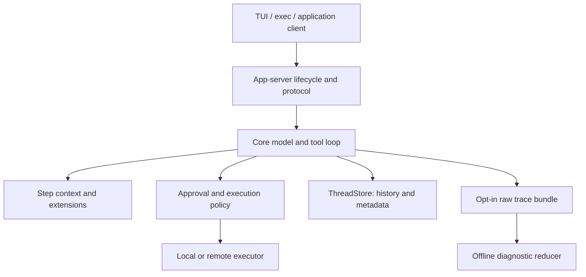

# Codex — an inspectable agent harness

> Separate the product interface from the model/tool loop, execution environment, persistent history and authority checks. The useful abstraction is a reusable runtime with explicit contracts—not a universally tiny loop and not proof of autonomous correctness.

## Attributes

- **Unit studied:** `openai/codex` at `021fccb046508938c4754982efccfb51d6e8356e`, retrieved 2026-11-04. The complete 9,974-entry tracked tree is saved locally; selected subsystems are investigated here, not every file. [[sources/openai--codex#root]]
- **Layers:** Rust core and extensions, conversational CLI clients, app-server protocol/client, local or remote executor, thread storage, TypeScript and Python SDKs. A shared in-process app-server client is used by both TUI and exec. [[sources/openai--codex#core]] [[sources/openai--codex#client-runtime]] [[sources/openai--codex#executor]]
- **Distribution:** Apache-2.0 repository with retained notices. Main-branch SDK version placeholders are not a verified release version; the Python package's inspected dependency pins `openai-codex-cli-bin==0.153.4`. Open-source harness code is not model weights, free inference or the complete hosted Codex service. [[sources/openai--codex#license]] [[sources/openai--codex#sdk-python]] [[sources/openai--codex#root]]
- **Attention:** 133,104 stars and 21,075 forks on 2026-11-04; not a correctness or adoption metric. [[sources/openai--codex]]
- **Evidence:** code/docs and focused test assertions inspected; Git-object, preservation and citation checks executed. No build, source test suite, model call, benchmark, login or deployment performed.

## Relationships

- **Creator and source:** [[creators/openai]], [[sources/openai--codex]].
- **Earlier narrower studies:** [[artifacts/projects/codex-goals]], [[artifacts/plugins/openai-codex-plugins-marketplace]], [[concepts/workspace-skill-distribution]]. Their historical release/catalog claims are not automatically refreshed by this source pin.
- **Architecture comparisons:** [[concepts/agent-control-plane]], [[concepts/durable-agent-execution]], [[concepts/artifact-centered-agent-context]], [[concepts/code-mode-capability-interface]].
- **Selection and evidence:** [[concepts/lifelong-skill-routing]], [[concepts/trace-lake]], [[concepts/completion-contract]], [[concepts/verification-model-fidelity]].

## Mechanism and themes

### 1. One runtime contract, several clients and execution locations

The in-process app-server facade centralizes startup, initialization, transport and shutdown for TUI and exec. Internal requests/events use typed channels but preserve the app-server response contract; external stdio/WebSocket boundaries use serialization. Startup identity is supplied by the caller, and an immediate thread-start response may precede richer session metadata. A UI must reconcile both rather than inventing a second session model. [[sources/openai--codex#client-runtime]]

This diagram combines the inspected component boundaries, not every product deployment. TypeScript's SDK wraps a CLI subprocess exchanging JSONL. Python exposes thread/turn and streaming operations with runtime compatibility requirements. The exec-server owns process/filesystem transport and handlers; its remote forwarder does not replay RPCs or persist execution state. Choose an integration for its lifecycle requirements, not because every interface happens to expose a method named `run`. [[sources/openai--codex#sdk-typescript]] [[sources/openai--codex#sdk-python]] [[sources/openai--codex#executor]]

Backpressure is deliberately asymmetric: command/runtime queues are bounded, but the facade's local consumer event queue is unbounded to keep draining notifications while a response is awaited. That avoids one deadlock mechanism while retaining a slow-consumer memory tradeoff. Graceful shutdown has a deadline and then aborts. [[sources/openai--codex#client-runtime]]

### 2. The loop coordinates state, not just model calls

At each sampling step the loop captures a consistent step context so advertised tools and subsequent execution share one view. Accepted steering is recorded before recovery proceeds; pending input can keep a turn alive even when the model otherwise stops. Stop hooks may request continuation, but a block without a continuation prompt is warned about and ignored. These are concrete runtime transitions, not merely exhortations in a system prompt. [[sources/openai--codex#loop]]

Tool dispatch uses a read/write admission lock: tools declared parallel-safe take a shared lock; others take an exclusive lock. This is not automatic semantic detection of independent effects. Cancellation distinguishes waiting for readiness/admission from handlers that must finish and publish their terminal state. Stopping a conversation is therefore not a universal rollback of already admitted work. [[sources/openai--codex#parallel-tools]]

### 3. Execution permission is not the same thing as an approval

The orchestrator combines policy, approval routing, environment-resolved permissions, sandbox selection and retry. A Guardian verdict for the first attempt does not automatically authorize a broader retry: the code reconstructs the actual escalated action for fresh review. User/hook approvals can have different reuse semantics; do not generalize the Guardian rule into “every retry always asks a human.” [[sources/openai--codex#approval]]

Managed human checkpoints are a separate path. The documented protocol requires a capable client, a unique approval ID and a fresh human response; reusable/session approvals and automated review cannot satisfy it. The central approval code preserves `NeedsHumanApproval` as a distinct requirement. We did not exercise the complete RPC path. [[sources/openai--codex#human-checkpoints]]

| Boundary | Inspected evidence | Important limit |
| --- | --- | --- |
| Filesystem/process containment | Platform support documentation describes Seatbelt, Linux policy-dependent Landlock/bubblewrap, and Windows backends | Enforcement support differs by platform; documentation says unsupported Windows policy shapes fail closed. No OS sandbox was tested here |
| Network | Proxy documents host allow/deny and limited-method filtering, with OS controls preventing bypass | GET/HEAD/OPTIONS filtering is not proof of semantic read-only behavior at an arbitrary service |
| Remote process connection | Exec-server documents opt-in bearer authentication and transport requirements | Omission can preserve unauthenticated behavior; reconnect is bounded by destination retention |
| Source selection/config | Config layers retain origins, versions and disabled reasons | A merged value is not proof that an account/provider is entitled to execute it |
| External notification | Python's `ExternalMessage` represents tool-level input | Passing external text as ordinary user input changes its authority classification |

Sources: [[sources/openai--codex#core]], [[sources/openai--codex#network]], [[sources/openai--codex#executor]], [[sources/openai--codex#config-layers]], [[sources/openai--codex#sdk-python]].

The config loader distinguishes ignored-but-visible layers from effective ones and records per-key provenance plus per-layer fingerprints. Starting work in an unmarked directory does not pre-trust project configuration added later. App-server account notifications are snapshots: clients reread current account/requirements instead of treating a queued notification as authorization. [[sources/openai--codex#config-layers]] [[sources/openai--codex#project-trust]] [[sources/openai--codex#policy-reload]]

### 4. Persistence, compaction and execution recovery have different scopes

`ThreadStore` separates canonical history append from explicit metadata updates. `LiveThread` applies persistence policy, appends history and updates metadata; the local store uses JSONL history and SQLite metadata when available, retaining compatibility paths for older/SQLite-less storage. This supplies resumable conversation state—not a demonstrated guarantee that arbitrary interrupted external effects execute exactly once. [[sources/openai--codex#storage]]

History reconstruction tracks context windows, retained context, attribution and compaction boundaries. The newest compaction can bound replay only when its required replacement/window metadata is present; an incomplete newer compaction cannot simply be replaced by an older checkpoint. “No baseline ever existed” is represented separately from “a baseline existed and was cleared.” Those distinctions prevent plausible-looking but wrong recovery state. [[sources/openai--codex#replay]]

Speculative compaction is gated by feature/provider support. Its attempt identity includes history version, model, compaction hash and auth-owner generation. Snapshot capture and task registration happen while holding state; expensive preparation runs outside the lock. Already-launched work is session-owned, shutdown cancels it, and completed usage is charged even for discarded work. We inspected these ownership boundaries, not all candidate-adoption logic or a measured latency benefit. [[sources/openai--codex#async-compaction]]

### 5. Provenance must survive context reduction

Accepted user goal changes carry host metadata separate from visible text wrappers. The reader checks the metadata and role, not just text that looks like an internal message. Oversized objective evidence is omitted whole rather than prefix-truncated, so a restriction at the end cannot disappear while an apparent grant survives. This concerns the retained evidence fragment—not deletion of the goal's stored objective. [[sources/openai--codex#goal-provenance]]

The Python SDK similarly distinguishes external messages from user instructions. Executor environment labels correlate commands with thread/tool IDs but explicitly are not authority: commands can change or remove them. Provenance, display syntax, correlation and authorization should not be collapsed into one string. [[sources/openai--codex#sdk-python]] [[sources/openai--codex#executor]]

### 6. Skill selection has deterministic and model-mediated failure modes

Explicit selection resolves structured paths first, accepts canonical or logical discovery paths, respects disabled identities and deduplicates by path. Bare names are selected only when exactly one enabled skill matches and no connector slug conflicts. Inspected tests cover ambiguous-name rejection and path-based disambiguation. This is a concrete complement to Skill++: description quality cannot fix a catalog identity collision by itself. [[sources/openai--codex#skill-selection]] [[sources/openai--codex#skill-selection-tests]]

Catalog rendering records included/omitted counts and description truncation. Its default budget is 2% of a known context window, falling back to 8,000 characters when unknown; an explicitly configured token budget is capped at 10,000. Render modes differ, including shortened or removed descriptions. Thus installed capability is not identical to model-visible capability. [[sources/openai--codex#skill-budget]]

The cheap-selector interface supports deterministic, side-effect-free bounded candidates and truncation metadata, designed to run in shadow mode without changing the visible catalog. This is an experiment seam, not evidence that one listed selector is enabled by default or improves outcomes. Global instruction refresh separately distinguishes a read failure (retain last good instructions and warn) from confirmed absence (clear them). [[sources/openai--codex#skill-shadow]] [[sources/openai--codex#instruction-refresh]]

### 7. Goals and children have explicit ownership—but completion still needs evidence

The current goal tools differ from the earlier cookbook study: `update_goal` exposes complete, blocked and paused. Its description requires an explicit user request to pause and a repeated-blocker audit before marking blocked; resume and system-limit states are rejected by the handler. **The inspected handler validates allowed states and persists accounting/status; it does not itself execute arbitrary acceptance tests or mechanically establish the prose blocker criterion.** A complete flag is not independent proof that the objective succeeded. [[sources/openai--codex#goal-tools]] [[sources/openai--codex#goal-tests]]

Idle continuation holds a permit over reading the active goal and launching work, preventing concurrent set/clear from changing the goal between those steps. It requires a live thread and honors stored deferral. Tests assert descendant usage rolls into a root goal budget exactly once; these are test assertions inspected, not a passing runtime experiment. [[sources/openai--codex#goal-continuation]] [[sources/openai--codex#goal-tests]]

Child creation owns a provisional runtime and graph edge until publication succeeds; cancellation cleanup waits for a pending edge write before closing it. Idle eviction checks the exact runtime instance, materializes state and preserves effective permission/environment snapshots, rather than reconstructing authority from a profile name. This is resource ownership, not evidence that every worker has its own filesystem/worktree or that every external mutation can be rolled back. [[sources/openai--codex#agent-spawn]] [[sources/openai--codex#agent-residency]]

### 8. Observe raw evidence first; build interpretations afterward

Opt-in local rollout traces preserve an ordered raw event stream and referenced payloads, then reduce them into conversation, tool, code-cell, terminal, inference and cross-agent objects. This diagnostic feature is not the same thing as ordinary thread history or general product telemetry. Bundles can contain sensitive prompt/tool content and are not automatically uploaded by this tracing path. [[sources/openai--codex#trace]]

The writer creates payload files before events reference them; failures stop further recording and suppress the closing event. Reducer tests distinguish identical text from discarded versus accepted inference attempts. Runtime nested-tool input/output does not establish that those exact bytes reached the model; the model may have received only a code-cell result. `recording_complete` means a closing record exists, **even if the task was interrupted**—not that the task succeeded. This directly sharpens the Trace Lake idea: preserve source identity and observation boundaries before deriving explanations. [[sources/openai--codex#trace-writer]] [[sources/openai--codex#trace-tests]] [[sources/openai--codex#trace]]

### 9. Client state and API evolution need their own contracts

Read receipts use thread-scoped opaque revisions and compare-and-swap updates. A stale “mark read” must not silently acknowledge an unseen result; clients are told to refresh rather than blindly retry. Some bulk policy reloads may partly apply before returning an error. Both are reminders that success/failure labels need explicit scope. [[sources/openai--codex#read-state]] [[sources/openai--codex#policy-reload]]

The removed `thread/rollback` request remains readable in old history while new clients use the replacement API. Read compatibility does not require keeping obsolete write commands alive. Shared tool machinery is being extracted incrementally, with explicit non-goals against pulling session/approval orchestration into a generic helper crate before stable boundaries exist. [[sources/openai--codex#api-evolution]] [[sources/openai--codex#extraction-boundaries]]

## Patterns demonstrated

- [[patterns/structural/thin-harness-fat-skills]] — supports separable skills/tools/runtime, but contradicts a literal tiny-middle reading: lifecycle, permission, storage, compaction and recovery are substantial responsibilities. No new pattern promotion. [[sources/openai--codex#client-runtime]] [[sources/openai--codex#loop]]
- [[patterns/behavioral/context-is-not-authority]] — external-input classes, host-annotated goal evidence, fresh review of broader execution and current-policy rereads. [[sources/openai--codex#goal-provenance]] [[sources/openai--codex#approval]]
- [[patterns/behavioral/evidence-gated-completion]] — distinguishes persisted goal status, recording completion, dispatch completion and verified task outcome. Not every product status is an acceptance test. [[sources/openai--codex#goal-tools]] [[sources/openai--codex#trace]]
- [[patterns/behavioral/latent-vs-deterministic-split]] — model reasoning sits inside deterministic identity resolution, state transitions, admission and evidence reduction; bounded mechanisms do not prove semantic correctness. [[sources/openai--codex#skill-selection]] [[sources/openai--codex#parallel-tools]]
- [[patterns/composition/single-source-multi-surface-distribution]] — typed in-process client and external protocol reuse runtime semantics; SDKs retain different integration contracts. [[sources/openai--codex#client-runtime]] [[sources/openai--codex#sdk-typescript]]
- [[patterns/composition/resolver-routing-table]] — canonical identity, ambiguity refusal, bounded metadata and shadow selectors are distinct parts of discovery. [[sources/openai--codex#skill-selection]] [[sources/openai--codex#skill-shadow]]

## What we'd steal

Portable ledger; ★ marks priorities, not an adoption mandate. Evidence classes and limits are explained above.

1. ★ **Share runtime semantics across clients.** Keep product UX separate without duplicating lifecycle and approval behavior. [[sources/openai--codex#client-runtime]]
2. **Keep protocol types low-dependency and behavior-light.** Move material logic into explicit owners, not wire structs. [[sources/openai--codex#protocol]]
3. **Choose the integration by lifecycle needs.** CLI jobs, persistent clients and remote process executors are not interchangeable wrappers. [[sources/openai--codex#sdk-typescript]] [[sources/openai--codex#executor]]
4. **Name queue tradeoffs.** Bounded command admission can coexist with an unbounded event drain; document the memory cost and shutdown deadline. [[sources/openai--codex#client-runtime]]
5. ★ **Separate canonical history from query metadata.** Define one metadata mutation API and retain compatibility deliberately. [[sources/openai--codex#storage]]
6. **Scope the word “resume.”** Recovering conversation, transport or a process is not replaying arbitrary side effects exactly once. [[sources/openai--codex#replay]] [[sources/openai--codex#executor]]
7. **Capture one tool/context view per model step.** Avoid advertising one capability snapshot and executing against an unrelated one. [[sources/openai--codex#loop]]
8. **Record accepted steering before recovery.** Pending input is a first-class continuation reason, not an append-only UI decoration. [[sources/openai--codex#loop]]
9. **Make parallel admission explicit.** Use shared/exclusive execution gates; a tool's declaration remains part of the correctness contract. [[sources/openai--codex#parallel-tools]]
10. **Separate cancellation before and after admission.** Some handlers must finish terminal bookkeeping even when the caller stops waiting. [[sources/openai--codex#parallel-tools]]
11. ★ **Review the authority of the actual retry.** A narrow automated approval must not silently authorize broader execution. [[sources/openai--codex#approval]]
12. **Represent mandatory human checkpoints distinctly.** A fresh-human requirement needs a separate policy state and capable-client contract. [[sources/openai--codex#human-checkpoints]]
13. **Fail closed on unsupported policy shapes.** Document platform differences instead of claiming a portable label guarantees identical containment. [[sources/openai--codex#core]]
14. **Pair network mediation with bypass controls.** Method filtering still is not a semantic side-effect guarantee. [[sources/openai--codex#network]]
15. **Expose config provenance and versions.** Keep disabled layers visible but ineffective; support inspectable conflict detection. [[sources/openai--codex#config-layers]]
16. **Do not pre-trust future configuration.** Work in a directory is not blanket approval of configuration added afterward. [[sources/openai--codex#project-trust]]
17. ★ **Type external messages by authority.** Notifications from tools/agents are not new user grants. [[sources/openai--codex#sdk-python]]
18. **Authenticate provenance outside display text.** Host metadata, not a convincing wrapper, identifies accepted goal instructions. [[sources/openai--codex#goal-provenance]]
19. **Omit oversized authority evidence whole.** Never preserve an apparent grant while truncating its restriction; mark the missing evidence. [[sources/openai--codex#goal-provenance]]
20. **Treat correlation IDs as labels, not credentials.** Editable process environment values help tracing but cannot authorize effects. [[sources/openai--codex#executor]]
21. ★ **Use canonical paths to resolve collisions.** Refuse ambiguous bare names and respect disabled identities rather than selecting whichever loads first. [[sources/openai--codex#skill-selection]]
22. **Measure discovery omissions.** Installed count, included metadata and truncated descriptions are different facts. [[sources/openai--codex#skill-budget]]
23. **Trial cheap selectors in shadow mode.** Bounded deterministic candidates and truncation flags make experiments inspectable before changing visible capability. [[sources/openai--codex#skill-shadow]]
24. **Distinguish read failure from confirmed absence.** Retain last-good instructions on failure, clear on absence, and surface warnings. Not a rule to retain revoked authorization. [[sources/openai--codex#instruction-refresh]]
25. **Separate task success from allowed lifecycle states.** A legal `complete` mutation is not evidence the task passed acceptance checks. [[sources/openai--codex#goal-tools]]
26. **Serialize objective read and continuation launch.** Prevent concurrent clear/update from racing automatic work admission. [[sources/openai--codex#goal-continuation]]
27. **Account for the whole worker tree.** Root budgets must include descendant work; repeated accounting events need non-duplication checks. [[sources/openai--codex#goal-tests]]
28. **Own provisional children until publication settles.** Cancellation cleanup must respect pending graph writes and release resources deliberately. [[sources/openai--codex#agent-spawn]]
29. **Evict exact runtime instances, not just IDs.** Preserve effective permissions and bindings; do not tear down a replacement or reconstruct authority from a label. [[sources/openai--codex#agent-residency]]
30. **Acknowledge reminders after delivery to history.** Creating a budget warning is not the same as the model receiving it. [[sources/openai--codex#agent-budget]]
31. **Make speculative compaction ownership explicit.** Version attempts, capture under lock, prepare outside it, cancel on shutdown and account discarded work. [[sources/openai--codex#async-compaction]]
32. **Reject misleading recovery shortcuts.** An incomplete newest checkpoint cannot silently become an older, different history boundary. [[sources/openai--codex#replay]]
33. ★ **Observe raw events before interpreting them.** Keep a stable evidence spine and derive diagnostic views offline. [[sources/openai--codex#trace]]
34. **Write payloads before references.** Preserve first failure and suppress false closing records when recording breaks. This is not a power-loss atomicity claim. [[sources/openai--codex#trace-writer]]
35. **Distinguish model-visible from runtime-visible bytes.** Nested tools, code cells and transcripts have different observation boundaries. [[sources/openai--codex#trace]]
36. **Track accepted identity, not equal text.** A discarded response does not become accepted because a later retry says the same thing. [[sources/openai--codex#trace-tests]]
37. **Separate recording completion from task completion.** A cleanly closed trace can describe interrupted work. [[sources/openai--codex#trace]]
38. **Preserve parent/child information-flow edges.** Shared tracing should link delivery and results without pretending independent threads share one conversation. [[sources/openai--codex#trace]]
39. **Use revision-bound acknowledgments.** Mark only the result the human actually saw; refresh on stale read-state updates. [[sources/openai--codex#read-state]]
40. **Make partial failure and current authority visible.** A reload error need not imply zero changes; queued account notifications need current-state rereads. [[sources/openai--codex#policy-reload]]
41. **Separate old-data compatibility from old-command support.** Continue reading historical events while removing obsolete write APIs. [[sources/openai--codex#api-evolution]]
42. **Version the integration with its runtime.** Pin compatible SDK/runtime pairs; source availability is not proof a deployed binary supports the new contract. [[sources/openai--codex#sdk-python]]
43. **Require actionable continuation feedback.** A stop hook that blocks without a prompt cannot meaningfully guide another iteration. [[sources/openai--codex#loop]]
44. **Extract shared infrastructure only at proven boundaries.** Move reusable models/adapters first; defer session/approval orchestration until interfaces are stable. [[sources/openai--codex#extraction-boundaries]]

## Tensions and anti-patterns

- **“Lightweight” is not a line-count guarantee.** The repo includes platform adapters, extensions, generated contracts, fixtures and clients. This study supports modular responsibility boundaries, not a claim that all production harness behavior belongs in a few hundred lines. [[sources/openai--codex#core]] [[sources/openai--codex#extraction-boundaries]]
- **Visible status can outrun its evidence.** Goal complete, trace closed, thread resumed and RPC acknowledged each mean different things. Keep the acceptance surface outside those status labels. [[sources/openai--codex#goal-tools]] [[sources/openai--codex#trace]]
- **Feature presence is not default activation.** Async compaction is gated; selectors include shadow experiment machinery; experimental app-server fields need explicit capability support. We did not infer deployed defaults from the existence of a file. [[sources/openai--codex#async-compaction]] [[sources/openai--codex#skill-shadow]] [[sources/openai--codex#human-checkpoints]]
- **Recoverability is not effect reversal.** Local history, worker eviction and remote reconnect preserve different state. None of the inspected evidence proves automatic compensation for an already published artifact or external mutation. [[sources/openai--codex#storage]] [[sources/openai--codex#agent-residency]] [[sources/openai--codex#executor]]
- **Security findings are scoped.** Platform docs and selected orchestrator paths are not an end-to-end security certification. External tools/services retain their own authority and side-effect behavior.
- **Do not copy the whole runtime to solve a small problem.** Our recommendation is to reuse a supported interface when its semantics fit; build additional orchestration only when actual lifecycle or authority requirements demand it.

## Open questions and verification record

- What do cancellation, reconnect, stale approval, permission changes and partial writes do in the exact target platform/runtime combination? Requires executable adversarial scenarios, not this source read.
- How much do candidate selection and speculative compaction change latency, cost and task success on representative workloads? No benchmark result asserted.
- Which stored states survive process loss versus an intentional unload? Exact guarantees require crash tests of the selected store/executor.
- Which capability/schema version is deployed by each intended client? The current checkout is not the installed binary.
- The hosted service, all connectors/providers, full sandbox implementations, every extension, complete test suites and all UI behavior remain outside the investigated scope.

**Preservation and validation:** the full pinned working tree and Git metadata are retained locally under `sources/openai--codex/`; research commits a citation map, source/tree identity, scoped file hashes and restoration instructions. Git connectivity and clean-tree checks passed. Source ranges, added wiki links and inventory are validated with the ingest. No inference, source build or upstream tests were run.

## Downstream control-plane comparison

[[artifacts/projects/background-agents]] wraps a pinned Codex `app-server` as one of several harnesses, but owns its own background queue, sandbox generations, recovery and multiplayer authority. Its terminal event and filesystem snapshot should not be confused with Codex’s inner thread history or task acceptance. The two source revisions are independent. [[sources/open-inspect--background-agents#harness]] [[sources/open-inspect--background-agents#shutdown-design]]

## SuperPlane — 2026-11-04

[[artifacts/projects/superplane]] studies the surrounding workflow layer rather than this harness: durable work identity, runner completion, external checks, mutation coordination and exact-head merging. The two source pins were not runtime-tested together in this study. [[sources/superplanehq--superplane#work-order]] [[sources/superplanehq--superplane#runner-protocol]] [[sources/superplanehq--superplane#merge]]
