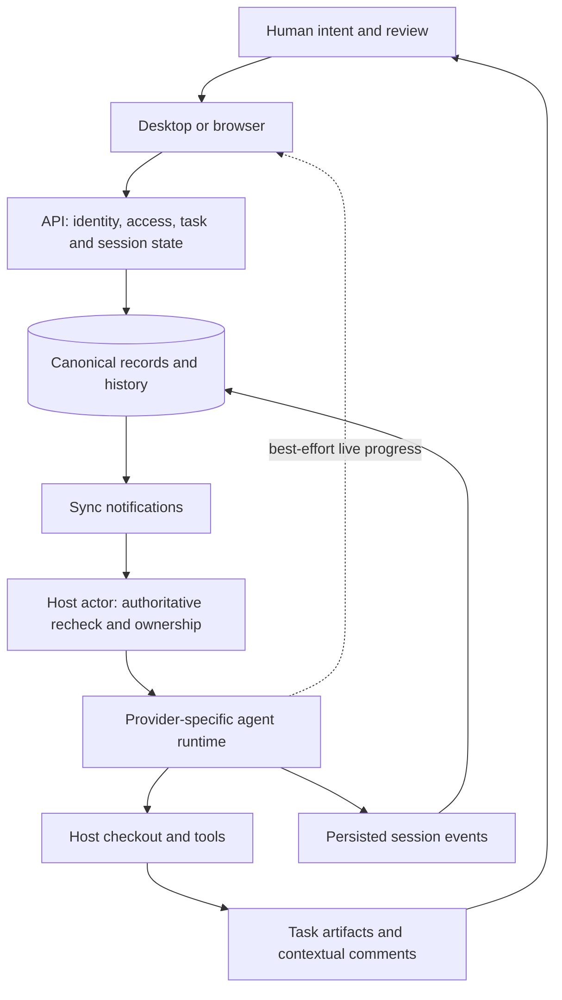

# HumanLayer

> HumanLayer's most useful idea is to make agent work **reviewable, transferable, and recoverable**: the task outlives a conversation, decisions live in artifacts, humans review versioned changes, and deterministic services coordinate execution around those decisions.

This is a source-based deep investigation, not an installation guide or a claim that the hosted product has been verified. Start with the themes and architecture below; the full reuse ledger covers product, runtime, quality, and evaluation. The companion [[artifacts/plugins/humanlayer-rpi]] contains the complete workflow/context ledger. Both pages preserve minor portable ideas as well as ★ priorities.

## Attributes

- **Unit of study:** the current HumanLayer/Riptide monorepo at `2f66a45b186d88488fa356862be0117db1ccae9f`, retrieved October 23, 2026. Earlier SDK and CodeLayer generations are outside this ingest. [[sources/humanlayer--humanlayer#root]]
- **Runnable components:** desktop shells, browser UI, host daemon, CLI, API, sync authorization proxy, shared database/session packages, provider integrations, background jobs, docs, and workflow plugins. Bun + Turborepo; Apache-2.0. [[sources/humanlayer--humanlayer#root]]
- **Product shape:** coding agents run on selected hosts; users steer and review related sessions through a shared task and artifact layer. The platform names Claude Code, Codex, OpenCode, and Pi, but mirroring, launching, and resuming have different capabilities. [[sources/humanlayer--humanlayer#root]], [[sources/humanlayer--humanlayer#runtime-boundary]]
- **Evidence:** code, schemas, packaged instructions, docs, and selected test bodies inspected. No application, test suite, paid eval, live provider, deployment, or security experiment was run. See [[sources/humanlayer--humanlayer]] for the pinned file-and-line map and coverage boundaries.
- **Attention signal:** 11,977 GitHub stars and 971 forks at retrieval. These do not establish user adoption, safety, or effectiveness. [[sources/humanlayer--humanlayer#repository-metadata]]

## Relationships

- **Creator:** [[creators/humanlayer]].
- **Workflow artifact:** [[artifacts/plugins/humanlayer-rpi]].
- **New concepts:** [[concepts/review-cost-aware-workflows]], [[concepts/artifact-centered-agent-context]], [[concepts/agent-control-plane]].
- **New proposed patterns:** [[patterns/quality-bar/revision-bound-review]], [[patterns/structural/authoritative-recheck-after-notification]]. Each has one independently verified artifact; internal modules are not counted as independent examples.
- **Existing wiki connections:** [[concepts/completion-contract]], [[concepts/durable-agent-execution]], [[patterns/behavioral/evidence-gated-completion]], [[patterns/behavioral/latent-vs-deterministic-split]], [[patterns/structural/thin-harness-fat-skills]].

## The most valuable themes

### 1. Human attention is the bottleneck to design around

The workflow rationale is explicit: agents can produce code faster than humans can review it. HumanLayer shifts consequential review earlier, into facts, choices, and small end-to-end slices. The product then applies the same logic to changing code: review the delta since the last marked version, surface approvals before routine activity, and turn comments into contextual agent inputs. **Our inference:** the useful target is accepted, verified progress per unit of reviewer attention—not agent count or output volume. No controlled productivity evidence was found to quantify that benefit. [[sources/humanlayer--humanlayer#workflow-phases]], [[sources/humanlayer--humanlayer#review-watermarks]], [[sources/humanlayer--humanlayer#HP23-task-attention]]

### 2. Preserve distinctions that fluent agents tend to collapse

Facts differ from proposals; recommendations differ from decisions; a task differs from a session; view access differs from permission to prompt a tool-enabled agent. A delivered comment differs from a fixed issue. A saved event differs from an exactly-once external effect. HumanLayer is valuable because these distinctions appear not only in explanatory prose but in schemas, APIs, state machines, typed outcomes, and tests. Some boundaries remain prompt policy, and the ledger labels them accordingly. [[sources/humanlayer--humanlayer#objective-research]], [[sources/humanlayer--humanlayer#domain-model]], [[sources/humanlayer--humanlayer#auth-boundaries]], [[sources/humanlayer--humanlayer#feedback-delivery]], [[sources/humanlayer--humanlayer#runtime-boundary]]

### 3. The durable collaboration unit is a task with artifacts

Conversations can be fresh, specialized, forked, or handed off; the task holds their relationship and work products. The filesystem is a familiar interface for agents, while synchronized artifacts provide review surfaces for people. Context-shard candidates go further: infer reusable guidance from recurring corrections, attach evidence, then separate release from personal enablement. This suggests an architecture where context is deliberately selected and maintained rather than accumulated indefinitely. It does not establish that arbitrary chat compression is lossless or that candidate memories are correct. [[sources/humanlayer--humanlayer#task-model]], [[sources/humanlayer--humanlayer#file-artifacts]], [[sources/humanlayer--humanlayer#context-shards]]

### 4. Reliability is mostly about boundaries between components

For V2 workspace launches, a sync update wakes an actor, which rechecks readiness. A prompt claim retains local execution ownership until cleanup completes. Canonical history persists separately from best-effort live presentation. A heartbeat detector distinguishes a missing worker from a live worker whose session has stalled. These are practical responses to independently failing processes, not evidence for a magical durable agent. In particular, append-idempotent logs do not make shell commands or external APIs exactly-once. [[sources/humanlayer--humanlayer#authoritative-recheck]], [[sources/humanlayer--humanlayer#session-ownership]], [[sources/humanlayer--humanlayer#stream-recovery]], [[sources/humanlayer--humanlayer#RT-I36]], [[sources/humanlayer--humanlayer#RT-I37]]

### 5. Autonomy is a collection of scoped policies

The implementation has selected auto-advance edges, actor/owner preference resolution, sibling reuse checks, and one-use flag consumption. That is more expressive than a single “autonomous” toggle. But an artifact existing or a model extracting a next-step suggestion is not proof of correctness or approval. The strongest reusable principle is to represent **what may advance, under whose policy, from which attempt, with what evidence**. The existing function does not establish exactly-once concurrent transitions or authorization for every later external action. [[sources/humanlayer--humanlayer#auto-advance]]

## Architecture and the authority of each layer

This diagram is an abstraction of inspected paths, not a full deployment topology. The host's operating-system authority, the service's resource ACLs, and the provider's permission behavior are separate boundaries. Local execution does not mean no cloud data; Git worktrees do not provide OS confinement. [[sources/humanlayer--humanlayer#remote-hosts]], [[sources/humanlayer--humanlayer#permissions]], [[sources/humanlayer--humanlayer#auth-boundaries]]

| Surface | What it establishes | What it does not establish |
|---|---|---|
| Research artifact | Dated explanation with source references | Live deployment behavior or a future design decision |
| Approved design / outline | Intended behavior and implementation constraints | Passing tests or authorization for unrelated side effects |
| Auto-advance state | A configured transition can create a next session | Correctness of its artifact or universal exactly-once execution |
| Local review marker | Which content version was marked reviewed locally | Shared approval, comprehension, or merge permission |
| Feedback confirmation | The selected delivery boundary accepted/persisted feedback | That the agent fixed it |
| Canonical event log | Recoverable history and narrowly defined retry identity | Atomic external effects or gap-free history in every case |
| Host/worktree identity | Execution placement and Git change isolation | Sandboxing, revocation of all credentials, or zero cloud data |

Evidence: [[sources/humanlayer--humanlayer#objective-research]], [[sources/humanlayer--humanlayer#implementation-gates]], [[sources/humanlayer--humanlayer#auto-advance]], [[sources/humanlayer--humanlayer#review-watermarks]], [[sources/humanlayer--humanlayer#feedback-delivery]], [[sources/humanlayer--humanlayer#event-log]], [[sources/humanlayer--humanlayer#remote-hosts]].

## Patterns demonstrated

- [[patterns/behavioral/latent-vs-deterministic-split]] — models generate explanations, next-step suggestions, and candidate lessons; code owns eligibility checks, ACLs, event identity, release filters, and delivery outcomes. Supporting sighting, not a claim that all model decisions are constrained. [[sources/humanlayer--humanlayer#auto-advance]], [[sources/humanlayer--humanlayer#context-shards]], [[sources/humanlayer--humanlayer#event-log]]
- [[patterns/behavioral/evidence-gated-completion]] — the RPI implementer separates automated checks from manual acceptance. Supporting workflow-policy sighting; auto-advance does not inspect test results. [[sources/humanlayer--humanlayer#implementation-gates]], [[sources/humanlayer--humanlayer#auto-advance]]
- [[patterns/structural/thin-harness-fat-skills]] — the workflow layer is separable, but collaboration, recovery, permissions, and host management require substantial infrastructure. This challenges literal “thinness”; it does not prove every part should be large. [[sources/humanlayer--humanlayer#root]], [[sources/humanlayer--humanlayer#session-ownership]]
- [[patterns/quality-bar/revision-bound-review]] — local review versions and separately versioned contextual comments preserve what a review concerned. Proposed, one artifact. [[sources/humanlayer--humanlayer#review-watermarks]], [[sources/humanlayer--humanlayer#feedback-targets]]
- [[patterns/structural/authoritative-recheck-after-notification]] — replicated state triggers a current-readiness check before V2 workspace launch dispatch. Proposed, one artifact. [[sources/humanlayer--humanlayer#authoritative-recheck]]

## What we'd steal

**Complete ledger for the investigated areas.** ★ marks high-leverage items; other entries remain because small choices often matter when building. The workflow/context ledger is maintained once in [[artifacts/plugins/humanlayer-rpi#what-wed-steal]] rather than copied here. The sections below retain product, runtime, and evaluation ideas with their limits. Similar ideas may recur at different layers; entry count is not a count of independent discoveries.

### Product, collaboration, and quality: making agent work reviewable

The recurring product problem is not merely starting an agent. It is keeping a person's understanding aligned with work that continues across conversations, machines, revisions, and collaborators. HumanLayer addresses that problem with durable tasks, bounded execution sessions, reviewable files, explicit feedback delivery, and an inbox of outstanding decisions. The strongest portable loop is **task → session → artifact version → contextual review → confirmed feedback delivery → revised output → incremental review**. This is a synthesis of the implementation, not a measured productivity claim.

The ledger below distinguishes implemented mechanisms, inspected test cases, and documented or prompt policy. Tests were read rather than run; no deployed behavior or business outcome was verified. Several attractive ideas require caution: local review markers are not a shared approval ledger, sending a comment does not prove it was fixed, and an onboarding milestone can be only a proxy for experienced value.

### Durable work and bounded execution

The task is the continuity layer. A session, host, checkout, and document have different identities and different failure modes. Keeping these distinctions explicit makes retries and handoffs understandable without pretending that an active process or its hidden state has migrated.

1. **★ HP-01 — Keep intention separate from execution.** Tasks hold workflow and desired workspace policy; sessions hold agent, host, directory, and fork/handoff lineage. Artifacts deliberately survive task deletion. Reuse this separation for long research, editorial, incident, or implementation work that spans several conversations. Retention still needs deliberate design: artifact survival does not establish that every associated comment or permission survives too. **Implementation inspected.** [[sources/humanlayer--humanlayer#HP01-task-policy]], [[sources/humanlayer--humanlayer#HP02-session-identity]], [[sources/humanlayer--humanlayer#HP04-artifact-retention]]

2. **HP-02 — Separate portable intent from machine facts.** A task stores a host-independent workspace specification; per-host setup records store resolved state, progress stage, and typed error. Reuse this desired/observed split when moving work between local and cloud environments: one host being ready cannot prove another is ready. The old task-level workspace state remains deprecated in the schema, so the separation is an evolving implementation rather than proof that every reader has migrated. [[sources/humanlayer--humanlayer#HP01-task-policy]], [[sources/humanlayer--humanlayer#HP03-host-setup]]

3. **HP-03 — Configure autonomy at transitions.** Separate flags govern questions→research, research→design, plan→worktree, worktree→implementation, and implementation→PR; task worktree timing defaults to later. Reuse this to defer environment costs and delegate low-risk transitions without one indiscriminate autonomy switch. Defaults differ between task and user-setting schemas, however; neither these fields nor their defaults establish effective authorization for a particular run. **Implementation inspected.** [[sources/humanlayer--humanlayer#HP01-task-policy]], [[sources/humanlayer--humanlayer#HP47-user-autonomy-defaults]]

4. **HP-04 — Show the current phase, not the furthest historical phase.** The board chooses the latest active, nonarchived, labeled session and derives its phase. Reuse this for workflows that legitimately return from implementation to research or design. Keep workflow position distinct from execution health and unread state. Labels remain proxies: a session's phase does not establish acceptance criteria, correctness, or completion. [[sources/humanlayer--humanlayer#HP22-task-position]]

5. **HP-05 — Surface blocking decisions before routine activity.** Shared task-status logic prioritizes approvals, then the latest failure, lost execution, and running/pending states. Reuse attention-oriented aggregation for supervising many agents: the next useful human action often matters more than the newest activity. This precedence is product policy, not universal truth; grouping usage-limit waiting as running illustrates how an overview can conceal an operational distinction. [[sources/humanlayer--humanlayer#HP23-task-attention]]

6. **HP-06 — Make suggestions recognize completed coordination.** A next-step action checks for a later sibling session with the target phase, then navigates there instead of launching another. Restricting candidates to sessions after the source also permits redo. Reuse this pattern for suggested drafts, follow-ups, and provisioning actions. UI deduplication improves behavior but does not replace server-side concurrency and uniqueness guarantees. [[sources/humanlayer--humanlayer#HP24-next-step-dedup]]

7. **HP-07 — Preserve lineage when changing engines.** Session records distinguish forks from harness handoffs and retain model, provider, host, and task identities. Reuse explicit lineage for specialist models, recovery, and independent second opinions: a successor can inherit useful context without impersonating its predecessor. A transcript and shared files cannot guarantee equivalent tool semantics, hidden state, permission behavior, or output quality across providers. [[sources/humanlayer--humanlayer#HP02-session-identity]]

### Artifacts and feedback as the working interface

HumanLayer meets agents at ordinary files and people at review surfaces. The useful abstraction is not “a chat attachment”; it is an evolving artifact whose identity, context, comments, and delivery status survive individual turns.

8. **HP-08 — Use files as an agent-facing artifact interface.** A task folder feeds cloud artifact sync through explicit scans and tool hooks. A separate outbox handles retries and file changes. Reuse this bridge for Markdown, images, HTML, and plans without forcing every agent through a specialized editor API. The inspected integration has no watcher and never deletes cloud artifacts; a successful conversation mirror therefore does not prove its artifact lane is current. [[sources/humanlayer--humanlayer#HP20-file-artifacts]], [[sources/humanlayer--humanlayer#HP21-outbox-isolation]]

9. **HP-09 — Synchronize metadata independently of bodies.** Artifact schema separates filename, frontmatter, content hash, storage information, and a metadata-only sync projection. Reuse lightweight subscriptions for navigation through large document or media libraries, fetching content where it is actually consumed. Hashes help identify changed bytes; they do not independently define edit conflict resolution, revision authority, or a security boundary. [[sources/humanlayer--humanlayer#HP45-artifact-metadata]]

10. **HP-10 — Review intermediate work while decisions are cheap.** Artifact comments attach to documents and versions, with contextual anchors and resolution state. Reuse the same review machinery for research, design, outlines, and plans rather than waiting for implementation to expose a misunderstanding. The mechanism makes staged review possible; it does not prove that every task needs every document or that document production itself advances the outcome. [[sources/humanlayer--humanlayer#HP05-comment-contract]]

11. **★ HP-11 — Preserve a comment's evidence through revision.** The document resolver checks exact fingerprints, context-scored quotes, and normalized text; a lost precise quote becomes outdated rather than expanding to a whole block. Inspected tests cover moved blocks, duplicate text, rewrites, and ambiguity. Reuse quote-plus-context anchors for contracts, research, editorial review, and catalog corrections. Text matching still cannot establish semantic equivalence. [[sources/humanlayer--humanlayer#HP06-anchor-resolution]], [[sources/humanlayer--humanlayer#HP08-anchor-tests]]

12. **HP-12 — Distinguish approximate navigation from verified targeting.** When exact recovery fails, surviving neighboring blocks may provide a boundary hint, never a replacement text range or rewritten anchor. Reuse this distinction in document citations, reconciliation, and entity matching: useful context must not masquerade as exact evidence. If neighbors are ambiguous or reversed, the correct result may be an unplaced comment rather than a guessed attachment. [[sources/humanlayer--humanlayer#HP07-anchor-approximation]]

13. **HP-13 — Store decisions as types.** Comments distinguish free-form discussion, deletion, and approval; the kind is authoritative rather than inferred from sentiment. Reuse explicit verdicts in rights verification, policy review, editorial decisions, and operational approvals. Support is surface-specific in the inspected schema, and typed approval of a passage does not automatically authorize deployment, merging, or every downstream effect. [[sources/humanlayer--humanlayer#HP05-comment-contract]]

14. **HP-14 — Compile feedback into a useful agent input.** The exporter gathers open root threads, replies, authors, selected text, neighboring context, filename, and captured comment IDs. Reuse this deterministic transformation instead of asking reviewers to reconstruct context through copy/paste. Preserve the IDs so follow-up can refer to the same work. Audit the actual export grammar: storing a typed verdict does not prove every exporter forwards that field. [[sources/humanlayer--humanlayer#HP09-feedback-compiler]]

15. **★ HP-15 — Treat delivery and resolution as separate outcomes.** Feedback dispatch must be accepted and confirmed before captured comments are resolved. A later resolution error returns partial success; inspected tests enforce ordering and no resolution after rejection. Reuse this for command queues, submissions, and review-to-fix loops to avoid duplicate dispatch during cleanup retries. Confirmation means accepted delivery, not successful correction: “sent and resolved” is not “verified fixed.” [[sources/humanlayer--humanlayer#HP10-feedback-delivery]], [[sources/humanlayer--humanlayer#HP11-feedback-tests]], [[sources/humanlayer--humanlayer#HP12-feedback-partial]]

16. **★ HP-16 — Review from the reader's last content version.** The diff store retains reviewed and previous versions per task/file, defaults to “since last review,” and drops references to unavailable versions. Reuse version-bound markers to avoid repeatedly inspecting unchanged output. These particular markers live in localStorage and are not an authenticated per-reviewer audit trail or shared approval ledger; unversioned binary files also fall outside the mechanism. [[sources/humanlayer--humanlayer#HP13-review-watermark]], [[sources/humanlayer--humanlayer#HP14-review-local-only]]

17. **HP-17 — Bind diff feedback to both comparison sides.** A comment on old-side lines depends on the displayed source version, while new-side comments depend on the destination version. Placement distinguishes current, outdated, pending, and missing files. Reuse this for any before/after review, including contracts and data corrections. An outdated comment displayed at a surviving line is explicitly a nearby reference, not proof of semantic reattachment. [[sources/humanlayer--humanlayer#HP15-diff-two-sides]]

### Collaboration and attention

The product distinguishes observing work, editing an instruction, executing that instruction, and granting access. Its attention mechanisms similarly distinguish historical activity from something a person can usefully act on now.

18. **HP-18 — Collaborate before the agent acts.** Shared prompt editing requires active sharing, eligible organization/session state, and explicit read-write or read-only capability. Reuse prompt coauthoring when several people must agree on creative direction, a sensitive operation, or a complex review response. This is a bounded deliberation surface; the inspected desktop feature gates do not establish unrestricted cross-organization or universal artifact editing. [[sources/humanlayer--humanlayer#HP16-shared-prompt]]

19. **HP-19 — Separate presence, connectivity, and authority.** The shared editor distinguishes reconnecting, view-only, and access-lost; losing access removes content from the displayed snapshot. An inspected provider test verifies that viewers can publish presence without creating or writing the document. Reuse these states in collaborative tools instead of overloading “online.” Transport connectivity or initial sync cannot certify that every subsequent local edit is durably acknowledged. [[sources/humanlayer--humanlayer#HP17-access-state]], [[sources/humanlayer--humanlayer#HP18-read-only-proof]]

20. **HP-20 — Test uncertain acknowledgements, not only disconnections.** Provider recovery tests hold replay/publication, race local edits, and simulate a POST accepted upstream whose acknowledgement is lost. Reuse such fault cases for offline editors, queued commands, and artifact sync: preserve local causal state while reconciling uncertainty. These tests were inspected, not executed here, and their presence does not prove every failure interleaving or retention scenario is safe. [[sources/humanlayer--humanlayer#HP19-recovery-proof]]

21. **★ HP-21 — Derive an inbox from outstanding work.** Notification rows are projections of approvals, ready-for-input sessions, failures, workspace problems, invitations, and comments. Reuse an intervention inbox alongside, rather than in place of, a historical event feed. Its policy must match responsibility: creator-filtered notifications or nondismissible approvals can be insufficient for shared ownership, escalation, and larger operational teams. [[sources/humanlayer--humanlayer#HP25-notification-projection]]

22. **HP-22 — Avoid announcing background synchronization as new urgency.** Arrival logic waits for sync-aware changes, suppresses redundant toasts, and coalesces recent arrivals. Reuse these techniques to protect attention during parallel agent work. Keep the claim precise: the inspected sound path runs before destination-based toast suppression, and diff destinations are not suppressed as already viewed. A calm-notification design intention is not proof that every interruption is eliminated. [[sources/humanlayer--humanlayer#HP26-notification-calm]]

23. **HP-23 — Compress routine work without burying decisions.** Contiguous thinking/tool activity collapses into working blocks, but pending approvals force expansion. Windowed rendering bounds expensive row mounts. Reuse activity summaries plus inspectable traces for long-running agents and operational jobs. Disclosure must remain reversible; a compact summary is not evidence that hidden work was correct, and errors or consequential decisions need their own visible treatment. [[sources/humanlayer--humanlayer#HP27-progressive-disclosure]], [[sources/humanlayer--humanlayer#HP30-virtualization]]

24. **HP-24 — Define who renders an event during live-to-durable handoff.** Stable event IDs identify when a synced final row supersedes temporary streaming rows; older orphan blocks disappear while the newer live tail remains. Reuse explicit ownership transfer in chat, progress feeds, and streamed imports to prevent duplicates and ghost activity. Ordering and identity resolve representation ownership, not transactional execution of the underlying tool action. [[sources/humanlayer--humanlayer#HP28-stream-ownership]]

### Interfaces that can evolve without fragmenting truth

Presentation experiments and reactive performance have different requirements from domain consistency. HumanLayer's local policies favor shared facts, independently readable stateful leaves, and production components that can be demonstrated without rebuilding a parallel fake product.

25. **HP-25 — Share domain facts while allowing a substantial UI experiment to fork.** Minimalist-interface guidance shares collections, stores, queries, and helpers but forks rendering and interaction through route-level selection. Reuse this for genuinely different interfaces when variant flags would contaminate every component. This is documented architectural policy, not a universal rule: duplicated presentation increases maintenance and is excessive for minor visual differences. [[sources/humanlayer--humanlayer#HP32-ui-experiment]]

26. **HP-26 — Put reactive state near its consumer.** Actual conversation rows query their event, tool result, and approval by stable IDs; the Wired/Pure policy keeps layout shells separate from connected leaves. Reuse this for heavy realtime interfaces where unrelated row updates must remain isolated. The local query engine's predicate-order optimization is implementation-specific, and naming conventions do not themselves guarantee bounded rendering or correct subscription cleanup. [[sources/humanlayer--humanlayer#HP29-leaf-queries]], [[sources/humanlayer--humanlayer#HP31-ui-boundaries]]

27. **HP-27 — Demonstrate production components, not a second product.** Storybook policy distinguishes real Pure components, provider-free ShellDemo wrappers, and Wired production components; prototype mockups are temporary. Reuse this boundary so visual review exercises code that users receive. This is a documented practice rather than proof of universal compliance. Component stories cannot establish authentication, persistence, realtime behavior, or complete interaction correctness. [[sources/humanlayer--humanlayer#HP44-storybook-policy]]

### Development and evaluation as part of the agent system

Parallel reasoning is only useful when its environments and verification remain trustworthy. The development tooling applies the same identity, ownership, and explicit-state ideas used in the product; the evaluation code also supplies useful lessons about where apparent rigor can overstate actual coverage.

28. **★ HP-28 — Isolate runtime services, not only branches.** Devstack gives worktrees distinct stacks and checks ownership; repository instructions explicitly prohibit stopping peers or the shared router to free a port. Reuse scoped databases, streams, caches, routes, and test services for concurrent agents. A shared router remains shared infrastructure, and an isolated worktree or container arrangement is not automatically a security sandbox. [[sources/humanlayer--humanlayer#HP33-devstack-plan]], [[sources/humanlayer--humanlayer#HP35-devstack-isolation]]

29. **HP-29 — Make setup a reconciled plan.** Pure planning produces create/update/refresh actions; application executes them sequentially with indexed failures and tracing. Reuse observation→plan→apply for development environments and agent workspaces so intended changes can be inspected and tested. Sequential actions are not an atomic transaction: partial setup, cleanup ownership, retained secrets, and recovery still require explicit handling. [[sources/humanlayer--humanlayer#HP33-devstack-plan]], [[sources/humanlayer--humanlayer#HP34-devstack-apply]]

30. **HP-30 — Preserve empirical integration experiments separately.** Root scripts own test-service readiness and cleanup; a local learning test exercises real Caddy routing to two streaming backends. Reuse this separation between hermetic contract tests and external-behavior experiments when mocks cannot settle a platform question. Conditional skips and prerequisites must remain visible: a checked-in learning test or green ordinary suite does not establish that the empirical case was recently run. [[sources/humanlayer--humanlayer#HP36-quiet-quality]], [[sources/humanlayer--humanlayer#HP37-learning-tests]]

31. **HP-31 — Turn repeated mistakes into cheap executable feedback.** The custom lint plugin registers rules for recurring type/assertion, readability, and service-composition problems; root checks provide concise success output. Reuse narrowly justified rules to preserve reviewer and agent attention for substantive failures. Rules remain opinionated, and registration alone does not prove every rule is enabled everywhere. Prefer measured recurring errors over a growing collection of arbitrary style prohibitions. [[sources/humanlayer--humanlayer#HP38-quality-constraints]], [[sources/humanlayer--humanlayer#HP36-quiet-quality]]

32. **HP-32 — Inspect retrieval and final-answer quality separately.** The documentation evaluator preserves raw retrieval, summaries, and independent judgments, making pipeline failure easier to locate. Reuse intermediate evidence and explicit rubrics rather than judging only polished output. The implementation also warns against false confidence: a model option is unused, judging is hardcoded, and failed cases can be dropped. Report actual provider routes, failures, and denominators before claiming comparative results. [[sources/humanlayer--humanlayer#HP48-eval-pipeline]]

33. **HP-33 — Keep helper-model contracts narrow and behavioral.** Intent-classification evaluation includes research, design, implementation, ambiguity, and combined investigate-and-fix cases across credential-available providers. Reuse small structured classifiers for routing while keeping authorization deterministic. The inspected case set is small, and missing credentials skip live evaluation. Passing a handful of examples neither validates broad language coverage nor permits a classifier to expand a user's authorized scope. [[sources/humanlayer--humanlayer#HP49-intent-evaluation]]

34. **HP-34 — Test understanding through mechanisms.** The learning-question prompt favors what happens, how a mechanism works, and why a tradeoff exists; it rejects filename trivia and vague technology recall. Reuse research artifacts as comprehension checks with plausible alternatives and explanatory feedback. This is prompt policy, not demonstrated pedagogy: generated questions, reconstructed snippets, and their designated correct answers still require verification. [[sources/humanlayer--humanlayer#HP39-learning-questions]]

35. **HP-35 — Measure experienced value, but name proxies honestly.** Onboarding separates device readiness from a first task, structured workflow, and collaboration; milestone eligibility distinguishes human-only campaign events from broader checklist events. Reuse explicit, centrally defined activation criteria. A PR-description filename is still only a proxy for implementation completion, and another user's agent comment is not equivalent to human review. Do not let convenient instrumentation redefine the intended outcome. [[sources/humanlayer--humanlayer#HP40-onboarding-value]], [[sources/humanlayer--humanlayer#HP41-onboarding-proxy]], [[sources/humanlayer--humanlayer#HP42-onboarding-direction]]

36. **HP-36 — Give usage telemetry identity and precise semantics.** Session updates accumulate keyed per-run usage, reject recent replay duplicates, preserve legacy overwrite behavior, and prefer runtime context limits. Reuse distinct context occupancy, cumulative consumption, model identity, and cost fields for long-lived tasks and provider switching. Bounded deduplication is not eternal exactly-once accounting, and model-reported cost is not necessarily a customer charge or reconciled invoice. [[sources/humanlayer--humanlayer#HP43-usage-dedup]], [[sources/humanlayer--humanlayer#HP02-session-identity]]

## Runtime architecture: an agent control plane

HumanLayer turns agent work into something that can be addressed, observed, resumed, shared, and recovered across components with different lifetimes. The browser records intent, the API owns authoritative state, a host executes work, persistent history supports reconstruction, streams deliver responsive presentation, and reconcilers expose abandoned or stalled work. Calling this an **agent control plane** is a synthesis of the source, not a claim that every execution path shares identical guarantees.

The important separation is between **recorded intent**, **admitted execution**, **persistent results**, and **what the user currently sees**. Each can temporarily disagree with the others. Much of the valuable engineering is the machinery that makes those disagreements bounded and understandable.

This ledger is grounded in the inspected checkout and test definitions. No tests were run and no deployed behavior was verified. Tests cited below demonstrate the cases the authors encoded, not a passing result from this investigation.

### Control and lifecycle

**RT-01 — Record execution intent independently of the browser.** A reply writes a prompt and `resuming` status; a stop writes `interrupt_requested`. Hosts watch their assigned rows and translate transitions into commands. This lets a browser disappear without owning the process lifetime. Reuse the pattern for private-network workers, user machines, and CI agents. The tradeoff is eventual delivery: row replication introduces stale and repeated observations, so admission and reconciliation remain necessary. [[sources/humanlayer--humanlayer#RT-I01]] [[sources/humanlayer--humanlayer#RT-I02]]

**★ RT-02 — Recheck authority after receiving a notification.** V2 session updates wake a deterministic launch actor. The actor reloads current readiness from the API, marks waiting once, periodically rechecks, backs off failures, and ignores duplicate wakeups during handoff. Tests arrange duplicate hints, delayed readiness, and disappearance. Steal this for CDC, webhooks, and filesystem watchers: a notification means “re-evaluate,” not “execute this stale snapshot.” One actor's single handoff is narrower than globally exactly-once execution. [[sources/humanlayer--humanlayer#RT-I03]] [[sources/humanlayer--humanlayer#RT-I04]] [[sources/humanlayer--humanlayer#RT-I05]] [[sources/humanlayer--humanlayer#RT-T01]]

**RT-03 — Make lifecycle states correspond to different remedies.** Workspace setup separates checking, cloning, resolving a commit, materializing, publishing, copying, setup, parked, and failed states. Actors reconstruct their stage from a snapshot and reconcile authoritative changes. Approval waits and usage-limit waits also differ from failure. Reuse states that tell users and supervisors what can happen next. The cost is a larger compatibility contract; a state diagram is insufficient evidence when it lags current schemas and handlers. [[sources/humanlayer--humanlayer#RT-I06]] [[sources/humanlayer--humanlayer#RT-I07]]

**RT-04 — Register readiness before dispatching work.** The daemon waits for a successful initial heartbeat before dispatch. Model discovery gets a bounded head start; heartbeat requests have deadlines so a sleeping machine's dead connection cannot stall all future beats. Reuse this ordering when worker identity, visibility, and capability must exist before work begins. It deliberately makes startup depend on control-plane availability: local execution alone does not make the product offline-first. [[sources/humanlayer--humanlayer#RT-I08]] [[sources/humanlayer--humanlayer#RT-I09]]

**RT-05 — Negotiate capabilities instead of inferring everything from versions.** Heartbeats advertise capability names and observed model catalogs. Unknown capability strings remain acceptable to older APIs. An attached-session-only host can mirror an external agent without offering launch or sign-in. Malformed optional telemetry is dropped rather than invalidating host liveness. Reuse additive capability contracts for independently updated clients, but keep capabilities separate from permission: reporting that a host supports an operation does not authorize it. [[sources/humanlayer--humanlayer#RT-I10]]

**RT-06 — Normalize product concepts without pretending providers are interchangeable.** Sessions distinguish product identity, provider-session identity, host, provider, and model. Claude resumes using its provider ID; Fold and CodeLayer use product-owned state. Unsupported agents can appear in product data while remaining unlaunchable. Reuse common task/history surfaces with explicit provider adapters. Resume, permissions, and tools still require provider-specific semantics; partial custom endpoint configuration should fail clearly rather than silently select an unintended provider. [[sources/humanlayer--humanlayer#RT-I11]] [[sources/humanlayer--humanlayer#RT-I12]] [[sources/humanlayer--humanlayer#RT-I13]]

### History, delivery, and accounting

**RT-07 — Define exactly what makes an event retry identical.** Fold stores sequence, event ID, timestamp, and the JSON event after null-byte normalization; DB constraints align the relational envelope with the payload. The API serializes appends using a parent-session lock and accepts an older retry only when identity, timestamp, and normalized payload match. Tests distinguish exact replay from conflicts and competing writers. Steal this precise idempotency contract for event storage. It prevents duplicate records, not duplicate external actions performed before a record exists. [[sources/humanlayer--humanlayer#RT-I14]] [[sources/humanlayer--humanlayer#RT-I15]] [[sources/humanlayer--humanlayer#RT-T02]]

**★ RT-08 — Close the gap between replay and live subscription.** The scoped event log acquires its subscription and history snapshot under the same append semaphore, then concatenates historical and live entries. Appends persist before updating cache or publishing. This prevents an event slipping between “read history” and “subscribe.” Reuse it for activity feeds and progressive jobs. Its scope matters: a cached log and unbounded PubSub do not establish bounded-memory scalability or coordination with unrelated writers. [[sources/humanlayer--humanlayer#RT-I16]] [[sources/humanlayer--humanlayer#RT-T03]]

**RT-09 — Give canonical history and live presentation different failure policies.** Fold persists canonical conversation events before publishing them. Stream hydration has a deadline and can fall back to a no-op writer while canonical persistence continues. After the first failed stream write, later writes are skipped instead of repeatedly damaging the run. Reuse this separation whenever progress delivery is less important than completing valuable work. The user may temporarily see stale output; canonical storage remains a required dependency. [[sources/humanlayer--humanlayer#RT-I17]] [[sources/humanlayer--humanlayer#RT-I18]] [[sources/humanlayer--humanlayer#RT-I19]]

**RT-10 — Give provisional and final output a shared identity.** Streaming blocks receive conversation IDs that canonical events can reuse. Reconciliation handles provider block-index shifts. The shared SDK also derives stable name-based IDs for resent events and applies transport size limits. Reuse this for optimistic UI, streamed documents, and progressive uploads, where finalization should replace an interim representation rather than duplicate it. Stable identity solves delivery ambiguity; truncation and provider event transformations still require explicit information-loss policies. [[sources/humanlayer--humanlayer#RT-I20]] [[sources/humanlayer--humanlayer#RT-I21]] [[sources/humanlayer--humanlayer#RT-I22]]

**RT-11 — Separate intent, observation, and event-time accounting.** The selected model remains distinct from the runtime-resolved model. Fold prices an event against its historical prefix instead of the latest model state. Usage report keys suppress delayed retries even when a newer run has reported. Reuse this for any provider whose requested and actual configuration can differ. The deduplication window is bounded, and source-side pricing calculations do not substitute for reconciliation against provider billing. [[sources/humanlayer--humanlayer#RT-I11]] [[sources/humanlayer--humanlayer#RT-I17]] [[sources/humanlayer--humanlayer#RT-I23]] [[sources/humanlayer--humanlayer#RT-I24]]

### Ownership and concurrency

**★ RT-12 — Use different exclusivity mechanisms for different scopes.** A filesystem lease protects daemon identity; an in-memory registry unifies legacy and V2 session launches; prompt claims serialize turns; database locks protect appends. These controls complement each other rather than forming one universal lock. Reuse the discipline of stating each lock's key, owner, lifetime, and covered paths. A filesystem lease protects one filesystem, a set one process, and a transaction one storage boundary. [[sources/humanlayer--humanlayer#RT-I25]] [[sources/humanlayer--humanlayer#RT-I26]] [[sources/humanlayer--humanlayer#RT-I15]]

**RT-13 — Ownership ends after cleanup, not after the main operation.** A Fold claim's completion signal follows terminal projection, writer finalization, and claim release. Release checks object identity before deleting the owner. Tests hold projection or network flush open and verify that replacement prompts cannot start. Reuse this for workers, connections, and provider sessions: “interrupted” or “returned” does not mean resources are released. Cleanup latency becomes part of admission latency and therefore needs its own observability. [[sources/humanlayer--humanlayer#RT-I27]] [[sources/humanlayer--humanlayer#RT-T04]]

**RT-14 — Make cancellation a protocol with ownership and deadlines.** Fold first asks for a cooperative interrupt, then interrupts the prompt fiber if needed. Lost-session takeover has a separate total deadline and stops the captured old claim, not a later owner. It avoids writing stale `interrupted` status over a newer resume. Reuse generation-aware cancellation and explicit status policy. Forced local cancellation cannot prove an external side effect stopped or rolled back; that requires a separate provider contract. [[sources/humanlayer--humanlayer#RT-I27]]

**★ RT-15 — Treat warm state as an optimization over reconstructable history.** Fold caches open sessions with an idle TTL and reuses them across prompts. It samples settings after acquisition and applies model changes between turns, preserving the current response's configuration. Stored history decides start versus resume. Reuse this separation for expensive sessions and connections: caches accelerate work but do not define logical history. Reconstruction still depends on compatible event formats and runtime behavior. [[sources/humanlayer--humanlayer#RT-I23]] [[sources/humanlayer--humanlayer#RT-I28]] [[sources/humanlayer--humanlayer#RT-T05]]

**RT-16 — Isolate a failed item without losing cancellation semantics.** Subscription processing catches and reports a session's non-interruption failure, marks that session failed, and keeps independent processing alive. Interruptions remain distinct. Slow change handling receives head-of-line diagnostics with session and task context. Reuse this supervisor boundary for queues and reactive pipelines. Catching broad causes is useful only when defects remain visible; silently absorbing them would turn crashes into unexplained stuck work. [[sources/humanlayer--humanlayer#RT-I29]]

**RT-17 — Commit asynchronous progress against its original revision.** Setup reports include generation and expected revision. The API validates both, repeats them in the conditional update, and returns a fresh snapshot on conflict. Revisions increase even within one millisecond; workspace base commits are pinned once. Reuse this against stale worker completions and recovery buttons. The fence applies to the report: a rejected update does not undo a Git command already executed, so physical operations still need safe repetition or adoption. [[sources/humanlayer--humanlayer#RT-I58]] [[sources/humanlayer--humanlayer#RT-I59]]

### Recovery and operational behavior

**RT-18 — Require evidence of progress before resetting recovery.** Durable-stream recovery counts consecutive missing-stream failures, throttles logs, limits hydration attempts, introduces randomized exponential delay, and resets only when the acknowledged offset advances. Flush diagnostics distinguish a slow drain from a stall. Reuse this instead of an unlimited “retry until success” loop: bound attempts, concurrency, log volume, and shutdown delay. The policy is a pure function, making the recovery decision independently testable. [[sources/humanlayer--humanlayer#RT-I30]] [[sources/humanlayer--humanlayer#RT-I18]]

**RT-19 — Put backpressure at the event/publication boundary.** Claude's publication worker uses a bounded command queue and one ordered worker for deltas, ID reconciliation, canonical writes, and close. The producer allows one request in flight and short batching. Reuse this when a provider can generate faster than the network can publish. It constrains one pipeline, not the whole system: other queues and PubSub structures remain unbounded, so global memory behavior cannot be inferred from this example. [[sources/humanlayer--humanlayer#RT-I31]] [[sources/humanlayer--humanlayer#RT-I18]]

**★ RT-20 — Degrade the failed subsystem, not the entire product.** Sync health is tracked per collection, with query fallback after consecutive Electric failures and recovery after consecutive successes. A collection is offline only when both paths fail. Reuse localized fallback and hysteresis instead of one global connected flag. This preserves useful behavior through a partial outage, but requires equivalent authorization and data semantics across both paths and acceptance of additional polling load. [[sources/humanlayer--humanlayer#RT-I32]]

**RT-21 — Classify errors according to the protocol.** Daemon RPC retries transient statuses; Electric treats 409 as re-sync control flow and retries authentication churn with fresh headers; its 404 stops synchronization. Yjs distinguishes genuine permission denial from an epoch conflict before the SDK can auto-claim. Reuse explicit protocol-specific categories rather than one HTTP retry table. A 403 that may be recoverable in one transport can be terminal in another; blanket retries can amplify outages or defeat intended permission handling. [[sources/humanlayer--humanlayer#RT-I33]] [[sources/humanlayer--humanlayer#RT-I34]] [[sources/humanlayer--humanlayer#RT-I35]]

**RT-22 — Measure worker liveness and job progress separately.** Stale heartbeats mark a host offline and settle associated sessions and approvals. A different reconciler detects stalled sessions even on live hosts, with different thresholds for running, launching, resuming, and interrupting. Valid long tool calls receive bounded exemptions. Reuse domain-aware failure detectors and batched locked reconciliation. Missing activity is suspicion, not proof the old process stopped; recovery must account for partitions, sleep, and late completion. [[sources/humanlayer--humanlayer#RT-I36]] [[sources/humanlayer--humanlayer#RT-I37]]

**RT-23 — Design shutdown as an ordered, repeatable operation.** Repeated signals share one shutdown promise. The daemon stops new activity, interrupts sessions, closes subscriptions and sync, sends a bounded notification, disposes resources, and flushes telemetry. Individual cleanup failures do not prevent later cleanup. Reuse explicit ownership and ordering rather than scattered exit handlers. Orphan detection has launch-context assumptions, and timing out a promise does not automatically cancel its underlying operation. [[sources/humanlayer--humanlayer#RT-I38]] [[sources/humanlayer--humanlayer#RT-I39]]

### Permission and workspace boundaries

**RT-24 — Keep authentication identity separate from resource authority.** User credentials and daemon credentials enter through different paths. Daemon writes additionally check organization, host, creator, and task ACL; host ownership matches a registration tuple. Resource errors distinguish hidden existence from insufficient write access. Reuse shared ACL helpers without assuming authentication completes authorization. Organization membership, session ownership, host control, and task edit rights are different facts and should remain visible in the data model. [[sources/humanlayer--humanlayer#RT-I40]] [[sources/humanlayer--humanlayer#RT-I41]] [[sources/humanlayer--humanlayer#RT-I42]] [[sources/humanlayer--humanlayer#RT-T02]]

**RT-25 — Treat prompting an agent as a delegated capability.** Session access separates view, prompt, and owner. Multiplayer prompting requires named users, organization enablement, and an active timing window; task sessions also require edit rights. Collaborative editor writes require prompt authority, and daemon credentials cannot become browser editing authority. Reuse this wherever a shared conversation controls tools: reading content is not permission to direct execution. Existing open streams require separate consideration before promising immediate revocation. [[sources/humanlayer--humanlayer#RT-I43]] [[sources/humanlayer--humanlayer#RT-I44]]

**★ RT-26 — Make approvals real control objects.** Claude approval records preserve requested inputs and tool provenance, handle resolution racing with creation, wait for resolution or cancellation, and distinguish temporary from reusable permission. Internal failure denies the request. Reuse that executable approval lifecycle rather than a decorative confirmation dialog. The boundary is explicit: HumanLayer also supports bypass permission mode. Approval handling therefore does not establish that every session, provider, or tool is approval-gated or sandboxed. [[sources/humanlayer--humanlayer#RT-I45]] [[sources/humanlayer--humanlayer#RT-I46]] [[sources/humanlayer--humanlayer#RT-I47]]

**RT-27 — Separate bootstrap and runtime credential classes.** Launch tokens are user/organization scoped with 24-hour expiry; daemon tokens additionally bind a host and reject the launch-token type. Reuse noninterchangeable credentials for enrollment versus execution. Do not copy the lifetime policy uncritically: the inspected daemon-token minting does not set expiry, and its shown validation performs no revocation lookup. That is a bounded source observation, not a complete security audit of surrounding enforcement. [[sources/humanlayer--humanlayer#RT-I48]] [[sources/humanlayer--humanlayer#RT-I49]]

**RT-28 — Adopt existing work only after checking structural identity.** Worktree reuse verifies repository common-dir, expected branch, and resolvable HEAD. Remote ancestry is checked; safe fast-forwards are allowed, while divergence fails instead of resetting work. Reuse identity-based adoption after interrupted setup rather than interpreting path existence as ownership. Worktrees isolate Git change state, not operating-system authority: they share repository infrastructure and credentials, and branch-to-task ownership still depends on application conventions. [[sources/humanlayer--humanlayer#RT-I50]] [[sources/humanlayer--humanlayer#RT-I51]]

**RT-29 — Make workspace preparation intentional and inspectable.** File copying separates explicit literals from Git-enumerated globs, rejects obvious traversal, deduplicates paths, and limits concurrency. HTTP remotes with embedded credentials are rejected. Setup output is file-backed and failure reports retain command, stage, exit, and log paths. Reuse these bounded diagnostics and explicit preparation contracts. Lexical path checks alone are not symlink-safe confinement, and arbitrary setup commands remain execution authority. [[sources/humanlayer--humanlayer#RT-I52]] [[sources/humanlayer--humanlayer#RT-I53]] [[sources/humanlayer--humanlayer#RT-I54]] [[sources/humanlayer--humanlayer#RT-I55]]

**★ RT-30 — Preserve the provenance of accepted exceptions.** Workspace recovery allows skipping failed copy/setup-command steps, but not source verification. A skip records stage, original error, user, and time. Recovery requires edit permission and the expected revision, preventing an old button from acknowledging a new failure. Reuse exceptions as durable, scoped decisions rather than erasing errors. Downstream readiness must distinguish accepted partial configuration from a claim that every setup operation succeeded. [[sources/humanlayer--humanlayer#RT-I60]] [[sources/humanlayer--humanlayer#RT-T06]]

### Collaboration and integration seams

**RT-31 — Recover collaborative state from retained causal information.** Yjs writers replay remote updates into the retained document, then publish full state on every connection. Edits racing publication trigger another publication before readiness. Readers never initialize content; presence uses a separate stream. Reuse mergeable state to resolve uncertain network acknowledgments. Full replay and publication have scale costs, and `synced` covers bootstrap readiness rather than durable acknowledgment of every subsequent edit. [[sources/humanlayer--humanlayer#RT-I56]] [[sources/humanlayer--humanlayer#RT-D01]]

**RT-32 — Own the narrow integration seam where defaults matter.** The owned Yjs adapter resolves auth at actual fetch time, rejects stale connection work, distinguishes permission denial from protocol conflicts, downgrades denied writes, and stops on access loss. Its documentation deliberately narrows supported upstream behavior and records provenance. Reuse a small explicit adapter around critical dependencies. This does not establish instantaneous revocation: the transport documents no periodic reauthorization or authorization-driven SSE lifetime limit. [[sources/humanlayer--humanlayer#RT-I35]] [[sources/humanlayer--humanlayer#RT-D01]]

**RT-33 — Include intermediaries in the streaming contract.** Streaming routes declare `no-transform` and disable proxy buffering, while preserving upstream cache policy. Authentication catch boundaries exclude downstream handlers so internal failures are not mislabeled as 401. Reuse route-level composition for transport and error semantics instead of fragile global exception lists. Correct incremental delivery depends on servers, compression, proxies, cancellation, and headers together—not merely emitting chunks in application code. [[sources/humanlayer--humanlayer#RT-I57]]

### The durability boundary to preserve

HumanLayer supplies concrete evidence for **recoverable session history, idempotent log appends, scoped ownership, and stale-progress rejection**. It does not establish atomic execution of arbitrary external tool effects. A tool can succeed before its completion record becomes durable; deduplicating that record does not resolve the external action's uncertainty. Fold's execution engine is an external package dependency, not implementation inspected here.

Even log integrity has a precise limit: an inspected test deliberately removes an existing sequence, replays the remaining entries, and appends above the highest surviving sequence. The system's exact-next append policy is therefore not proof that existing history must remain gap-free. These patterns complement checkpointed durable execution; they should not be presented as equivalent to exactly-once side effects. [[sources/humanlayer--humanlayer#RT-T03]]

## Additional portable choices: language and evaluation honesty

The UI-copy source is a behavioral guide, not proof that every screen follows it. These small rules are worth retaining separately because they transfer beyond agent runtimes. [[sources/humanlayer--humanlayer#ui-copy]]

1. **HX-01 — Explain the consequence and next action, not the internal state.** The guide's error shape combines what failed, what is still true about the user's work, and what can happen next. For uncertain task creation, advise checking the task list before retrying instead of implying no task exists. Reuse in any asynchronous workflow where a blind retry could duplicate work. **Prompt/authoring policy; not a universal implementation guarantee.** [[sources/humanlayer--humanlayer#ui-copy]]
2. **HX-02 — Separate mechanical defects from editorial judgment.** Fix a raw enum, wrong product name, or broken route mechanically; assess voice and warning language one case at a time. “More compliant with the style guide” is not sufficient benefit. Reuse this to keep agent editing from flattening useful personality or producing needless mass rewrites. [[sources/humanlayer--humanlayer#ui-copy]]
3. **HX-03 — Use reversibility to choose the interaction.** The guide prefers undo for reversible actions, concrete consequences for confirmations, and an owner/action for permission failures. Reuse the principle to reduce approval fatigue while retaining meaningful decisions. Actual risk and authorization matter more than copying a button pattern. [[sources/humanlayer--humanlayer#ui-copy]]

## What not to copy blindly

These findings are part of the extraction, not reasons to discard the useful design.

| Tempting assumption | What the pinned source supports instead |
|---|---|
| “The model comparison varied the model because its output folder says GPT or Sonnet.” | The doc-research eval loops over a model matrix, but `runEvaluation` accepts `_opts` without using it; its judge explicitly instantiates Anthropic Opus. Verify the actual invocation route, not the label. |
| “A green retrieval eval means all cases succeeded.” | The batch runner catches case failures and removes them from results; the suite only requires a nonempty result set. Report attempted, succeeded, failed, skipped, and credential-missing denominators separately. |
| “The OpenAI key is sufficient because the skip guard permits it.” | The cited raw doc-research test guard accepts either model key, while the judge requires Anthropic. A credential-gated matrix can skip cases or fail for unrelated setup reasons. No live eval was run here. |
| “Agent approval settings mean every action asks a human.” | The Claude integration supports bypass permission mode; automation docs explicitly describe permission prompts being bypassed. Task ACLs, runtime tool approvals, and host OS authority protect different boundaries. |
| “The runtime has durable history, therefore effects are exactly-once.” | Append retries have a specific identity check; an inspected test permits a gapped historical log. External Fold engine/tool internals are not in this source audit. |
| “The artifact was sent and resolved, so the issue is fixed.” | The delivery path confirms acceptance/persistence and then resolves captured comments. Applying and verifying the change is a later operation. |
| “Research finished, so it is safe to implement automatically.” | Auto-advance checks workflow evidence such as an artifact type or extracted next-step entry, not truth, test results, or all relevant authorization. |
| “A PR-description artifact proves implementation succeeded.” | The onboarding mechanism uses that filename as a milestone proxy; generating a file is not evidence of correct code. |
| “Synced means every edit is durably acknowledged and access revocation is immediate.” | The owned Yjs adapter documents narrower sync semantics and no periodic reauthorization/SSE-lifetime enforcement. |
| “Current docs always describe current instructions.” | Workflow reference docs retain an optional PR walkthrough while the current PR-description skill prohibits it and adds CI follow-through. Preserve the disagreement and prefer the owning source for the specific claim. |

Sources: evaluation [[sources/humanlayer--humanlayer#eval-pipeline]]; permissions [[sources/humanlayer--humanlayer#permissions]], [[sources/humanlayer--humanlayer#automation]]; durability [[sources/humanlayer--humanlayer#event-log]], [[sources/humanlayer--humanlayer#runtime-boundary]]; feedback [[sources/humanlayer--humanlayer#feedback-delivery]]; transition [[sources/humanlayer--humanlayer#auto-advance]]; milestone [[sources/humanlayer--humanlayer#HP41-onboarding-proxy]]; CRDT [[sources/humanlayer--humanlayer#RT-D01]]; doc drift [[sources/humanlayer--humanlayer#WF29]].

The retrieval evaluation still contains a valuable experiment design: compare both raw retrieval and the answer produced from it, retain intermediate outputs, and use a task-specific rubric. Its implementation flaws show why **experiment wiring and coverage are themselves part of the evidence**. Do not inherit reported “model” distinctions without checking the code path that changes the model. [[sources/humanlayer--humanlayer#eval-pipeline]]

## How this changes the existing wiki

- **Completion contracts gain a concrete handoff distinction.** A completion check, a next-step suggestion, and permission to start the next session are different facts. HumanLayer's source makes those boundaries inspectable, while also showing where artifact-existence proxies are weaker than acceptance evidence. [[concepts/completion-contract]], [[sources/humanlayer--humanlayer#auto-advance]]
- **Durability needs a named grain.** The existing eve source describes session/turn/step checkpoint replay. HumanLayer supports recoverable conversation history, append retry identity, and scoped ownership. They are related but not equivalent contracts. The cited eve execution-model text was rechecked for this comparison; no new engine audit was performed. [[concepts/durable-agent-execution]], [[sources/vercel--eve#docs-execution-model]], [[sources/humanlayer--humanlayer#event-log]]
- **“Thin harness” should not conceal infrastructure obligations.** The useful separation is between portable workflow judgment and runtime responsibilities. That does not make collaboration, authorization, recovery, and host control cheap or small. This is supporting counterevidence, not an automatic promotion or renaming of the existing proposed pattern. [[patterns/structural/thin-harness-fat-skills]], [[sources/humanlayer--humanlayer#root]], [[sources/humanlayer--humanlayer#session-ownership]]
- **The latent/deterministic split becomes specific.** HumanLayer infers candidate memory, then checks source IDs and release/enablement in code; it extracts next steps, then checks workflow eligibility. A schema can validate shape without proving semantic correctness. [[patterns/behavioral/latent-vs-deterministic-split]], [[sources/humanlayer--humanlayer#context-shards]], [[sources/humanlayer--humanlayer#auto-advance]]

## Practical adoption sequence

These are proposed experiments for future agent products, not implemented changes to Recoup, Seeker, or another repository.

1. **Start with artifact contracts.** Choose one workflow that repeatedly loses decisions between chats. Define the owning research/design/progress artifact and a short handoff. Measure whether a fresh worker can continue without asking the same questions. Derivation: [[sources/humanlayer--humanlayer#artifact-authority]], [[sources/humanlayer--humanlayer#context-handoff]].
2. **Improve the review loop before adding more workers.** Preserve feedback context and exact IDs; distinguish delivery, application, and verification; show changes since review. Measure repeated review time and unaddressed comments. Derivation: [[sources/humanlayer--humanlayer#feedback-targets]], [[sources/humanlayer--humanlayer#feedback-delivery]], [[sources/humanlayer--humanlayer#review-watermarks]].
3. **Add recurring automation with a review-capacity limit.** Give one maintenance workflow a no-op guard, explicit concurrency key, and one outstanding proposal per chosen scope. Compare accepted improvements with queue age, rather than rewarding daily output. This adapts documented guidance; no production result is claimed. [[sources/humanlayer--humanlayer#automation]].
4. **Add governed memory only after repeated steering is observable.** Test candidate evidence, overgeneralization, dismissed-rule repetition, and conflicting preferences before injecting rules widely. Keep required policy outside the optional fail-open context lane. Derivation: [[sources/humanlayer--humanlayer#context-shards]].
5. **Build the distributed control plane only when real concurrency needs it.** Start with distinct identities and authoritative rechecks; add ownership, recovery, and per-workspace service isolation as the execution topology requires. Do not copy a whole multi-tenant platform for a one-shot script. Derivation: [[sources/humanlayer--humanlayer#authoritative-recheck]], [[sources/humanlayer--humanlayer#session-ownership]], [[sources/humanlayer--humanlayer#HP33-devstack-plan]].

## Open questions and coverage boundaries

- How much do the workflows improve review latency, rework, escaped defects, and accepted output? This source investigation establishes mechanisms, not causal outcome measurements.
- What do external Fold/provider internals guarantee around partial tool execution, crashes, and replay? Their packages were identified but not fetched or audited.
- Which auto-advance and ownership properties hold under concurrent API requests, network partitions, and still-running old hosts? Inspected targeted tests are narrower than a complete fault model.
- How should candidate context expire, conflict, or become eligible after dismissal? Current evidence is strongest for filtering and injection, weaker for long-term knowledge governance.
- Which interfaces share review markers and which keep them local? The investigated task-diff markers are localStorage, while artifact comments are server records.
- How closely do deployed binaries and live service configuration match this source revision? No deployment was inspected.
- Earlier HumanLayer SDK generations, complete billing reconciliation, full authentication/revocation coverage, every provider adapter, and every UI route remain outside this ingest. This report should not be read as a security or completeness audit of all 5,856 files.

## Verification record

Source and wiki checks are recorded in [[log]] under the October 23, 2026 HumanLayer ingest. Source anchors resolve to the pinned revision; new wiki links and required sections are checked mechanically. Independent same-family agents reviewed the specialist claims and draft boundaries. This is an artifact investigation, not a cross-family-reviewed `analyses/` synthesis. No claim is made that HumanLayer tests or live evaluations passed.
