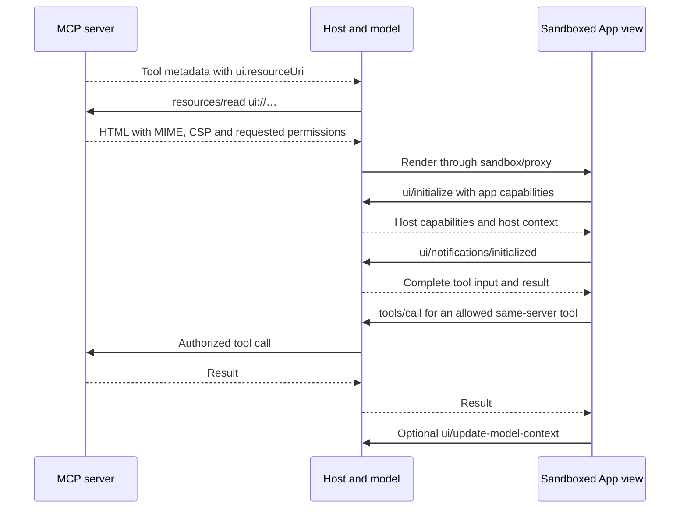

# MCP Apps

> A server associates a tool with a reusable HTML view; the host renders it in an isolated frame and brokers structured communication among the view, server and conversation.

## Attributes

- **Unit:** official optional MCP extension `io.modelcontextprotocol/ui`, with a wire specification, app/server/host SDK modules and runnable examples. This is a UI delivery and interaction contract, not an agent framework. [[sources/modelcontextprotocol--mcp-apps-docs#stable-version]], [[sources/modelcontextprotocol--mcp-apps-docs#sdk-version]]
- **Version axes:** stable Apps wire specification `2026-01-26`; separate development draft; SDK guides captured at `92195a772fe42efe6eeda3d1a3a90482464631f1` on 2026-11-04. SDK 2.x changes TypeScript APIs and dependencies while retaining 1.x `ui/*` wire compatibility, with documented host error/schema deltas. Do not equate an npm major with the wire-spec date. [[sources/modelcontextprotocol--mcp-apps-docs#sdk-version]]
- **Credibility:** official MCP documentation and SEP-1865, influenced by MCP-UI and OpenAI Apps SDK. The overview names supported hosts; no independent installation count, adoption estimate or live host compatibility test was obtained. [[sources/modelcontextprotocol--mcp-apps-docs#stable-version]], [[sources/modelcontextprotocol--mcp-apps-docs#support-testing]]
- **Investigated:** overview, stable/draft specification, SDK migration, auth/CSP/CORS, recipes and testing guidance. Documentation/specification evidence only; source application installation, SDK test execution, provider OAuth, host acceptance and security audit were not performed. [[sources/modelcontextprotocol--mcp-apps-docs#root]]

## Relationships

- [[creators/model-context-protocol]] — extension project/governance context; [[creators/openai]] and [[creators/anthropic]] — related host ecosystems and design contributors, not exclusive authorship. [[sources/modelcontextprotocol--mcp-apps-docs#stable-version]]
- [[concepts/model-context-protocol]] and [[concepts/mcp-extension-architecture]] — underlying protocol and optional-feature compatibility.
- [[artifacts/projects/openai-mcp-extensions]] — host-specific APIs layered onto an MCP App; the portable contract does not promise all OpenAI capabilities. [[sources/openai--mcp-extensions#model-context]], [[sources/modelcontextprotocol--mcp-apps-docs#migration-openai]]
- [[artifacts/projects/shopify-api]] — neighboring WebMCP browser tools; Apps draft bridges WebMCP and app-provided tools, while Shopify's checkout tools preserve browser-specific identity and lifecycle. [[sources/modelcontextprotocol--mcp-apps-docs#draft-tools-webmcp]], [[sources/shopify--agent-commerce-api-design#webmcp]]
- [[patterns/behavioral/context-is-not-authority]] — UI messages, tool visibility, server authorization and browser permissions are separate boundaries. [[sources/modelcontextprotocol--mcp-apps-docs#discovery-visibility]], [[sources/modelcontextprotocol--mcp-apps-docs#authorization]]

## Mechanism and themes

### The three-party architecture

This is the specification's intended flow, not an executed trace. Web hosts use an intermediate cross-origin sandbox proxy. A view is an active participant with its own connection and lifetime, while the host mediates its access to the MCP server and conversation. [[sources/modelcontextprotocol--mcp-apps-docs#bridge-sandbox]], [[sources/modelcontextprotocol--mcp-apps-docs#lifecycle]]

### Bind a static view to dynamic tool results

A tool declares `_meta.ui.resourceUri: "ui://…"`. The host retrieves that resource with `resources/read`; returned content must be HTML5, `text/html;profile=mcp-app`, carried as text or a base64 blob. The host may prefetch/cache templates independently of dynamic tool data. UI-only resources can be omitted from `resources/list`; discovery through tool metadata remains authoritative. The deprecated flat `_meta["ui/resourceUri"]` key is not the preferred current form. [[sources/modelcontextprotocol--mcp-apps-docs#resource-contract]], [[sources/modelcontextprotocol--mcp-apps-docs#discovery-visibility]]

This separation makes a view inspectable and reusable without returning its full HTML on every tool invocation. Text-only hosts still need meaningful tool `content`; a view is an added interaction surface, not the only representation of the result. [[sources/modelcontextprotocol--mcp-apps-docs#data-negotiation]], [[sources/modelcontextprotocol--mcp-apps-docs#security-limits]]

### Distinguish two negotiation channels

The client/server extension declaration expresses whether the MCP host understands Apps and the supported MIME types. The captured Apps stable and draft documents still illustrate the older core `initialize` mechanism. Current core-generation negotiation must be read from [[concepts/mcp-extension-architecture]]; copying that example without the negotiated core revision is unsafe. This is documentation drift, not evidence that all old clients stop working. [[sources/modelcontextprotocol--mcp-apps-docs#data-negotiation]]

Separately, `ui/initialize` and `ui/notifications/initialized` run between the view and host over the iframe bridge. They negotiate app capabilities, host capabilities, host identity/context and rendering constraints. The host must wait for the initialized notification before sending view traffic. Replacing old core initialization does not imply this UI handshake disappears. Register handlers before connecting so early input/results are not lost. [[sources/modelcontextprotocol--mcp-apps-docs#bridge-sandbox]], [[sources/modelcontextprotocol--mcp-apps-docs#host-context]], [[sources/modelcontextprotocol--mcp-apps-docs#migration-openai]]

### Visibility controls two callers

`_meta.ui.visibility` defaults to `["model", "app"]`. A tool with only `"app"` is omitted from the agent's tool list while remaining available to this server's app; a tool without `"app"` must reject app calls. App-only cross-server calls are blocked. This enables refresh, pagination and form operations without making every UI operation an agent tool. It is not tenant access control: servers must still authenticate and authorize every sensitive operation. [[sources/modelcontextprotocol--mcp-apps-docs#discovery-visibility]], [[sources/modelcontextprotocol--mcp-apps-docs#authorization]]

The app's `tools/call` is normally a host-proxied call to its server. Asking the conversation to perform a broader action through `ui/message` is a different path, where host consent/policy and the agent's other integrations may be involved. Do not treat conversational delegation as arbitrary cross-server tool access. [[sources/modelcontextprotocol--mcp-apps-docs#messages-context]], [[sources/modelcontextprotocol--mcp-apps-docs#root]]

### Keep display data, conversation context and authority separate

The host delivers tool input/result notifications to the view. The view can update its replaceable context for future model turns using `ui/update-model-context`; this does not itself require a new assistant response. `ui/message` adds a conversation message and can trigger a follow-up, subject to the host. Repeated context updates can be deduplicated or coalesced to the latest one. [[sources/modelcontextprotocol--mcp-apps-docs#messages-context]], [[sources/modelcontextprotocol--mcp-apps-docs#lifecycle]]

**Disclosure caveat:** the stable Apps specification's data-passing guidance labels `structuredContent` as UI-optimized and not added to model context. This concerns the tool-result data-passing channel. The stable spec itself and OpenAI extensions separately define `ui/update-model-context.structuredContent` as model input; this is not a direct contradiction between identical channels. Core Tools also recommends serializing structured results into text for backward compatibility. The field name is therefore not a portable secrecy guarantee. Sensitive data needs an explicit field-by-field host contract and server-side permission checks. `_meta` is described as metadata not intended for model context, but hiding content from the model does not hide it from the app or authorized host infrastructure. [[sources/modelcontextprotocol--mcp-apps-docs#data-negotiation]], [[sources/modelcontextprotocol--mcp-apps-docs#messages-context]], [[sources/openai--mcp-extensions#model-context]], [[sources/modelcontextprotocol--mcp-core-and-extensions-docs#primitives]]

### Browser containment and server authority are different

The resource read response's `_meta.ui` can declare CSP domain lists, requested camera/microphone/geolocation/clipboard permissions and a preferred stable sandbox domain. For a web host, the sandbox proxy must have a different origin from the host. The host constructs/enforces CSP, validates incoming RPC, controls which requests it handles and may impose additional restrictions. The CSP must not allow undeclared external domains; absent metadata, the stated default blocks external network connections. Permissions are requests the host may honor, not granted capabilities. [[sources/modelcontextprotocol--mcp-apps-docs#resource-contract]], [[sources/modelcontextprotocol--mcp-apps-docs#bridge-sandbox]], [[sources/modelcontextprotocol--mcp-apps-docs#security-limits]]

CSP is a browser-side allowlist; CORS is an API server's origin policy. A stable app origin can make a CORS allowlist practical, but `_meta.ui.domain` has host-specific formatting and validation. The guides' resource CSP/domain fields belong inside returned `contents[]` metadata rather than just registration configuration. Neither CSP nor a stable domain supplies API authentication or checks whether a user may modify a particular object. The CSP/CORS guide's shorthand around API keys must not be read as an API key bypassing CORS. [[sources/modelcontextprotocol--mcp-apps-docs#csp-cors]], [[sources/modelcontextprotocol--mcp-apps-docs#authorization]]

OAuth is handled at the MCP server/host boundary. The auth guide describes per-server protection or public tools plus protected tools that return HTTP `401` and resource metadata, prompting the host to obtain/retry with a token. Protected handlers should also check their auth context and scope data by authenticated identity. Illustrative JWT snippets check issuer; production validation must also meet the prose requirement that the token was issued for this MCP resource, as well as action/object permissions. The HTML view should not become the trusted bearer of enterprise access. [[sources/modelcontextprotocol--mcp-apps-docs#authorization]]

### Design for an interruptible view

Partial tool input supports previews; it may be incomplete even when represented as valid JSON and must not trigger critical operations. Complete input, result, cancellation, host-context changes, resize and teardown are separate events. Stop polling/animation on teardown and pause expensive offscreen views. Persist durable user effort on the server; local storage with a server-issued view identifier can restore cheap view state, subject to host-origin/storage behavior. A view is not durable background execution. [[sources/modelcontextprotocol--mcp-apps-docs#lifecycle]], [[sources/modelcontextprotocol--mcp-apps-docs#recipes]]

The draft makes the lifecycle limit explicit for app-provided long-running tools: delegate work that may outlive a render to the server and return its task handle. This is a design recommendation in the draft, not proof that the server task survives every transport or process failure. [[sources/modelcontextprotocol--mcp-apps-docs#draft-tools-webmcp]]

### Stable baseline versus frontier direction

| Layer | Captured evidence | How to use it |
| --- | --- | --- |
| Stable Apps wire spec | Tool-linked HTML, bridge, same-server app calls, context/message APIs, host sandbox obligations | Portable baseline subject to host support. [[sources/modelcontextprotocol--mcp-apps-docs#stable-version]] |
| Development draft | App-provided tools, semantic introspection, WebMCP mirroring/bridging, downloads and richer teardown | Track or prototype against explicit capabilities; do not claim universal stable support. [[sources/modelcontextprotocol--mcp-apps-docs#draft-tools-webmcp]], [[sources/modelcontextprotocol--mcp-apps-docs#draft-lifecycle]] |
| SDK 2.x migration | Split base-SDK packages, Node 20+, Standard JSON Schema requirements and API/error differences | Pin package versions; wire compatibility does not make source APIs compatible. [[sources/modelcontextprotocol--mcp-apps-docs#sdk-version]] |
| OpenAI extensions | Additional host-specific UI/context/files/forms/entrypoint behavior | Negotiate the actual OpenAI surface separately; use its current contract. [[artifacts/projects/openai-mcp-extensions]] |

The draft's WebMCP direction is significant: a view can expose state and actions as typed semantic tools rather than requiring the agent to inspect its DOM or infer canvas state. SDK mirroring/bridging is additive, avoids echo loops and requires correct iframe Permissions Policy for native WebMCP registration. This is a documented design direction, not verified cross-host interoperability. [[sources/modelcontextprotocol--mcp-apps-docs#draft-tools-webmcp]]

### What portability does and does not promise

The SDK provides `App`, React hooks, `AppBridge` and server helpers; a compliant implementation can use the wire protocol directly. The README expressly says the repository has no supported host implementation beyond its example. Importing `AppBridge` therefore should not be presented as delivering a production host's complete sandbox, authorization, persistence, consent or resource-budget design. [[sources/modelcontextprotocol--mcp-apps-docs#sdk-version]], [[sources/modelcontextprotocol--mcp-apps-docs#security-limits]]

The official overview names Claude, Claude Desktop, VS Code GitHub Copilot, Microsoft 365 Copilot, Goose, Postman, MCPJam and Archestra.AI. These are documentation-level compatibility claims at retrieval. The captured Markdown matrix loses support icons, while OpenAI distinguishes support by host and capability. A target-host proof remains necessary for each capability used. [[sources/modelcontextprotocol--mcp-apps-docs#support-testing]], [[artifacts/projects/openai-mcp-extensions]]

Migration from historical `window.openai` applications includes metadata/MIME changes and event-driven connection. The guide records gaps in widget persistence, files and modal APIs, but some notes describe pending work and can lag current OpenAI extensions. Treat it as a migration map, not a current universal capability matrix. [[sources/modelcontextprotocol--mcp-apps-docs#migration-openai]], [[artifacts/projects/openai-mcp-extensions]]

## Patterns demonstrated

- [[patterns/behavioral/context-is-not-authority]] — input/context, UI visibility, browser permission and server OAuth are distinct authorities; correspondence documented, not adversarially tested. [[sources/modelcontextprotocol--mcp-apps-docs#messages-context]], [[sources/modelcontextprotocol--mcp-apps-docs#authorization]]
- [[patterns/composition/negotiated-capability-intersection]] — MIME/extension support plus app/host capabilities select usable optional behavior. This is a related form of peer negotiation; unlike Shopify UCP, the inspected Apps material does not establish version/dependency pruning, so it does not by itself confirm the narrower pattern. [[sources/modelcontextprotocol--mcp-apps-docs#data-negotiation]], [[sources/modelcontextprotocol--mcp-apps-docs#host-context]]
- [[patterns/behavioral/latent-vs-deterministic-split]] — the agent chooses the task/tool; deterministic schemas, bridge messages and UI controls handle structured inspection/editing. This is an architectural interpretation of the specified flow, not a measured quality claim. [[sources/modelcontextprotocol--mcp-apps-docs#lifecycle]], [[sources/modelcontextprotocol--mcp-apps-docs#discovery-visibility]]
- [[patterns/quality-bar/revision-bound-review]] — template predeclaration permits resource hashes/signatures and allowlist review; optional host behavior, not proof of deployed hash enforcement. [[sources/modelcontextprotocol--mcp-apps-docs#security-limits]]

## What we'd steal

- ★ **Bind reusable UI resources to useful tools.** Add the interaction layer to an existing operation while keeping meaningful text output; retain graceful degradation on unsupported hosts. [[sources/modelcontextprotocol--mcp-apps-docs#discovery-visibility]], [[sources/modelcontextprotocol--mcp-apps-docs#data-negotiation]]
- ★ **Keep UI operations out of the model catalog when they serve UI mechanics.** App-only refresh/pagination/form tools reduce catalog noise; retain server authorization and audit every call. [[sources/modelcontextprotocol--mcp-apps-docs#discovery-visibility]], [[sources/modelcontextprotocol--mcp-apps-docs#recipes]]
- ★ **Treat the bridge as an enforcement point.** Validate messages, enforce same-server/tool visibility, apply host consent and record calls; a view message is a request, not permission. [[sources/modelcontextprotocol--mcp-apps-docs#bridge-sandbox]], [[sources/modelcontextprotocol--mcp-apps-docs#security-limits]]
- ★ **Separate current-view context from an instruction to respond.** Replace/coalesce context as users explore; send a distinct explicit message when a follow-up is needed. Verify which fields each host sends to the model. [[sources/modelcontextprotocol--mcp-apps-docs#messages-context]], [[sources/modelcontextprotocol--mcp-apps-docs#recipes]]
- ★ **Track core, extension, SDK and host versions independently.** Preserve exact claims and examples for each; migration guides and draft docs can coexist with an older stable wire contract. [[sources/modelcontextprotocol--mcp-apps-docs#stable-version]], [[sources/modelcontextprotocol--mcp-apps-docs#sdk-version]], [[sources/modelcontextprotocol--mcp-apps-docs#draft-tools-webmcp]]
- **Prefetch and review static templates.** Cache HTML separately from data; bind approval to exact resource hashes where the host implements that mechanism. [[sources/modelcontextprotocol--mcp-apps-docs#security-limits]]
- **Use host themes and constraints with defaults.** Check display modes, dimensions, safe areas, optional CSS variables and fonts; the host may omit values or decline modes. [[sources/modelcontextprotocol--mcp-apps-docs#host-context]]
- **Show previews from partial input; commit from complete input.** Improve perceived latency without acting on truncated/healed arguments. [[sources/modelcontextprotocol--mcp-apps-docs#lifecycle]], [[sources/modelcontextprotocol--mcp-apps-docs#recipes]]
- **Chunk large UI data and load binary resources separately.** Preserve offset/total/has-more metadata; avoid sending every binary byte through model context. Host/tool response limits still apply. [[sources/modelcontextprotocol--mcp-apps-docs#recipes]]
- **Turn UI failures into usable model feedback.** The recipes show context plus an explicit message when the model needs to recover; do not silently leave a broken preview. [[sources/modelcontextprotocol--mcp-apps-docs#recipes]]
- **Persist by value of the state.** Cheap camera/page state may use per-view local storage; bookmarks, annotations and other user effort belong server-side. A stable view ID is a lookup key, not authorization. [[sources/modelcontextprotocol--mcp-apps-docs#recipes]]
- **Manage CPU and network over the whole lifecycle.** Stop timers on teardown and pause polling/WebGL when offscreen; a rendered view can stay mounted for a long conversation. [[sources/modelcontextprotocol--mcp-apps-docs#recipes]]
- **Request narrow browser origins and permissions.** Put CSP/permission/domain metadata on resource-read contents, account for CORS separately, and feature-detect permission denial. [[sources/modelcontextprotocol--mcp-apps-docs#resource-contract]], [[sources/modelcontextprotocol--mcp-apps-docs#csp-cors]]
- **Offer public exploration with protected actions where appropriate.** Let the host handle a proper HTTP-401 OAuth step-up instead of collecting credentials in the iframe; test retries and permission failures in the target host. [[sources/modelcontextprotocol--mcp-apps-docs#authorization]]
- **Give rich canvases a semantic interface.** Draft app-provided tools expose current state and meaningful operations to the model; keep a stable fallback and do not require draft support blindly. [[sources/modelcontextprotocol--mcp-apps-docs#draft-tools-webmcp]]
- **Test the reference host and real host separately.** Use debug panels for wire/data/context inspection, then test OAuth, CSP, persistence, cancellation and degraded behavior in each intended host. This research performed neither. [[sources/modelcontextprotocol--mcp-apps-docs#support-testing]]

## Tensions and anti-patterns

- **A sandbox cannot certify truthful UI.** The spec explicitly retains phishing/social engineering and CPU/memory risks. Read marketing language about security through these concrete limits. [[sources/modelcontextprotocol--mcp-apps-docs#security-limits]]
- **App visibility is not a business ACL.** Hiding a tool from the agent does not establish user/tenant/object authorization or safe side effects. [[sources/modelcontextprotocol--mcp-apps-docs#discovery-visibility]], [[sources/modelcontextprotocol--mcp-apps-docs#authorization]]
- **Private-to-model is not private-to-host.** View metadata, model context and tool results have different recipients and host-specific behavior. Never put a secret in `structuredContent` based only on the stable spec's wording. [[sources/modelcontextprotocol--mcp-apps-docs#data-negotiation]], [[sources/openai--mcp-extensions#model-context]]
- **The stable spec contains illustrative inconsistencies.** Its early bridge snippet says `initialize` where the lifecycle uses `ui/initialize`; its generic CSP construction uses `connect-src 'self'` whereas restrictive default prose says no connections. Follow normative boundaries and owning host implementation, then verify behavior; do not copy every snippet as production policy. [[sources/modelcontextprotocol--mcp-apps-docs#bridge-sandbox]], [[sources/modelcontextprotocol--mcp-apps-docs#resource-contract]], [[sources/modelcontextprotocol--mcp-apps-docs#security-limits]]
- **The current SDK is not the stable feature set.** App tools/WebMCP and newer download/teardown APIs appear in draft while the official stable link remains `2026-01-26`; host capability detection remains necessary. [[sources/modelcontextprotocol--mcp-apps-docs#draft-tools-webmcp]], [[sources/modelcontextprotocol--mcp-apps-docs#draft-lifecycle]]

## Open questions and verification record

- Run a bounded app against each intended host and core generation. Test extension discovery, text fallback, UI handshake ordering, denied tools, cross-server attempts, auth escalation, CSP/CORS, frame permissions, cancellation, teardown and reload/persistence.
- Inspect the owning SDK/host code and negative tests before claiming implementation-level sandbox or authorization enforcement. The present record is documentation/specification only.
- Determine field-by-field model/host/view disclosure in each host. Resolve the stable Apps `structuredContent` wording against actual core and host behavior before storing sensitive data.
- Verify draft app-provided tools and WebMCP in the target browser/host, including frame Permissions Policy, tool-change propagation, duplicate names and teardown during execution.
- Recheck current host support directly; the captured community matrix loses visual support icons, and package/version compatibility is not a live acceptance result.

## Component reuse and catalog size — November 4

The current OpenAI component guide supports React bundles with additional chart/interaction libraries and treats the bridge/data wrapper as separate from the visual component. Reusing an existing application's presentation code still requires an adapter for its authentication, app-relative requests, routing and persistence; an embedded frame does not inherit the original website's session. [[sources/modelcontextprotocol--mcp-apps-docs#openai-implementation-guides]], [[sources/modelcontextprotocol--mcp-apps-docs#authorization]]

App-only visibility can keep refresh/filter/navigation operations outside the model catalog while retaining typed UI calls and server authorization. Count total server registrations and model-disclosed tools separately. Tool-linked resources are declared at the host-visible MCP boundary; automatic rendering of metadata returned from an inner Code Mode call must not be assumed. Direct user entrypoints and a top-level renderer are distinct presentation options to test in the selected host. The latter is an implementation inference from the declared resource mechanism, not a conformance test performed here. [[sources/modelcontextprotocol--mcp-apps-docs#discovery-visibility]], [[sources/openai--mcp-extensions#entrypoints]]

## WebMCP and agent documentation follow-up — 2026-11-05

[[artifacts/projects/webmcp]] records current CG draft/browser/testing contracts separately: `document.modelContext` in the captured draft/Chrome guidance, older `navigator.modelContext` vocabulary in other current documentation, and declarative forms outside the current CG specification. This qualifies earlier evidence without editing its immutable snapshots. It is a documentation disagreement, not a reproduced interoperability failure. [[sources/frontier-docs--webmcp-20261105#documentation-drift]] [[sources/frontier-docs--webmcp-20261105#declarative-proposal]]

[[concepts/agent-documentation-interfaces]] compares page-local tools with documentation retrieval, generated answers, backend execution and administration.
