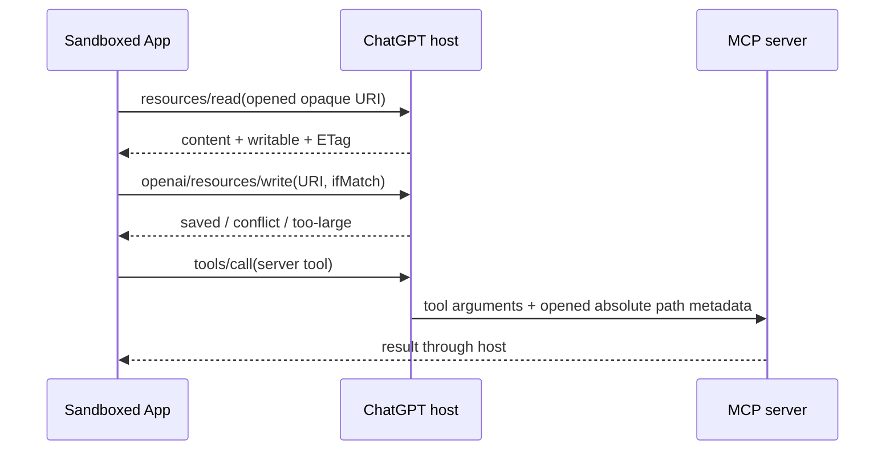

# OpenAI MCP Extensions

> Host-specific capabilities turn an MCP-backed tool/UI into a persistent ChatGPT app: users can open it directly, mention its resources, edit files, change settings and provide structured input.

## Attributes

- **Unit studied:** an extension specification, TypeScript server/app SDK, Python server SDK and Bits & Bolts demonstration plugin. It is broader than a single MCP server. [[sources/openai--mcp-extensions#root]]
- **Pin:** `9e6d418439cca0790bece62f6cd886ad4c04f133`, committed 2026-10-29; SDK manifests say `0.2.1`. TypeScript server helpers use MCP SDK 2; App integration uses `ext-apps` 1.7.5+ and MCP SDK 1.29+. Python requires 3.10+ and MCP 2. Node requirement is 22+. These are source dependency contracts, not installations tested here. [[sources/openai--mcp-extensions#versions]], [[sources/openai--mcp-extensions#sdk-setup]]
- **Distribution/license:** README names `@openai/mcp-extensions` and `openai-mcp-extensions`; Apache 2.0. Registry publication and fresh installation were not checked. [[sources/openai--mcp-extensions#root]]
- **Dated attention:** 1,126 stars, 54 forks, 5 subscribers on 2026-11-04; not evidence of active production installs. [[sources/openai--mcp-extensions#root]]
- **Evidence classes:** documentation, implementation inspected and selected tests inspected. No tests/application/host/provider flow executed. The host support table is the publisher's claim. [[sources/openai--mcp-extensions#platforms]], [[sources/openai--mcp-extensions#app-tests]]

## Relationships

- [[creators/openai]] — publisher; [[artifacts/projects/openai-agent-api]] studies a separate model/runtime API layer.
- [[artifacts/projects/mcp-apps]] — shared UI-resource and app-to-host bridge foundation; `OpenAIExtensions(app)` composes with its `App` rather than replacing it. [[sources/openai--mcp-extensions#sdk-setup]], [[sources/openai--mcp-extensions#migration]]
- [[concepts/code-mode-capability-interface]] — relevant distinction between server-side domain tools and model-callable app/UI tools.
- [[patterns/behavioral/context-is-not-authority]] — UI context, feature advertisement, file authority and provider identity have different enforcement points.

## Mechanism and themes

### There are three different contracts

1. **MCP:** server tools/resources, client capabilities, protocol version and elicitation continuation.
2. **MCP Apps:** UI resource, `App`, host bridge, `ui/message`, model-context updates and display lifecycle.
3. **OpenAI extensions:** `openai/*` capabilities/metadata/methods that specialize these contracts for the documented ChatGPT host surfaces.

This layering follows the repo's explicit extension links and actual SDK composition. It is not evidence that every vendor extension is accepted as an official MCP extension or supported in other hosts. The old `createAppTransport` API was removed in 0.2.0 in favor of the shared Apps `App`. [[sources/openai--mcp-extensions#platforms]], [[sources/openai--mcp-extensions#sdk-setup]], [[sources/openai--mcp-extensions#migration]]

### Extension inventory

| Surface | Mechanism and useful boundary |
| --- | --- |
| Global/thread/file entrypoints | Tool `_meta["openai/ui"].entrypoints`; sidebar, thread tab or extension-matched viewer; user opening need not wait for a model decision. Entry invocation ignores ordinary UI visibility metadata. [[sources/openai--mcp-extensions#entrypoints]] |
| Deep links | Encoded plugin/app-relative route; URI parsing rules constrain shape, not business authorization. [[sources/openai--mcp-extensions#deep-links]] |
| Settings | Capability names read/update tools; read result has schema/current values/layout; update submits changed properties; server persists. [[sources/openai--mcp-extensions#settings]] |
| Initial display | Resource metadata chooses inline/fullscreen before app initialization; OpenAI host does not support Apps `pip`; entrypoints use fullscreen. [[sources/openai--mcp-extensions#display-onboarding]] |
| Onboarding | Plugin manifest references a packaged setup skill to run after installation. The skill is an onboarding surface, not automatic account authorization. [[sources/openai--mcp-extensions#display-onboarding]] |
| Extended context | Typed content, named groups, thumbnails, replacement/update IDs, host reflection, background state. `_meta` on content is excluded from model input; `audience` changes user visibility, not model delivery. [[sources/openai--mcp-extensions#model-context]] |
| UI automation | Expanded app registers `document.modelContext` WebMCP tools on Desktop. This host explicitly does not support Apps SDK `App.registerTool()`. [[sources/openai--mcp-extensions#webmcp]] |
| Messaging | `ui/message` metadata chooses active/new conversation and send/draft. Defaults are active and send immediately; draft behavior must be explicit. [[sources/openai--mcp-extensions#messaging]] |
| Composer mentions | Read-only app-visible search tool returns resource links that a user can insert into a prompt; capability `openai/mentions` replaces a legacy marker. [[sources/openai--mcp-extensions#mentions]] |
| Extended forms | Resource selection, suggestions, thumbnails and previews; continuation under MRTR or legacy direct-connection RPC. Unsupported inputs reject the form rather than rendering a partial interpretation. [[sources/openai--mcp-extensions#forms]], [[sources/openai--mcp-extensions#resource-pickers]] |
| Host files | Opaque opened-file URI; host intercepts resource read/subscription/write; conditional ETag update returns explicit saved/conflict/too-large outcomes. [[sources/openai--mcp-extensions#file-entrypoints]], [[sources/openai--mcp-extensions#resource-writes]] |

### Platform support is an explicit product dependency

The source defines **Web as Work browser, excluding classic ChatGPT**. Its table claims global/thread entrypoints, settings, onboarding and display modes across Desktop/Web/iOS/Android; file handlers, host file resources/opening and WebMCP are Desktop-only; composer mentions are Desktop/Web; extended forms are Desktop/Web with picker restrictions; deep links exclude Android. Some context/image/message combinations have further limits. Treat these as a dated support matrix, not a promise that any “ChatGPT” account exposes every feature. [[sources/openai--mcp-extensions#platforms]], [[sources/openai--mcp-extensions#model-context]], [[sources/openai--mcp-extensions#resource-pickers]]

The guidance gives `26.928.20710` as the desktop minimum for its DevDay 2026 APIs, then says to check advertised feature capabilities. The implementation makes `files`, `message`, `modelContext` and `resources` undefined until the host advertises their corresponding experimental capabilities. A semantic version alone cannot substitute for feature checks. These gates expose supported SDK methods; they do not authorize their effects. [[sources/openai--mcp-extensions#interaction-guidance]], [[sources/openai--mcp-extensions#capability-gates]]

### Version-aware forms cross a real continuation boundary

The spec distinguishes MCP `2026-07-28` server capabilities in `server/discover` from legacy `initialize`. Its form path requires registered OpenAI servers to support the 2026-07-28 multi-round-trip protocol; direct connections retain legacy forms. On the new path, a result returns `resultType: input_required` with keyed `inputRequests`, and the resumed request carries answers. This differs from holding a synchronous callback open indefinitely. [[sources/openai--mcp-extensions#platforms]], [[sources/openai--mcp-extensions#forms]]

The TypeScript helper concretely checks protocol date, core `elicitation.form` and `extensions["openai/elicitation"].form`. It validates the requested schema, parses answers keyed by `params.key`, validates accepted content, or returns the input-required envelope with optional `requestState`. The core form schema is deliberately empty; the actual richer schema goes under `_meta["openai/elicitation"].requestedSchema` because core validators reject or strip some extended fields. This requires the dual capability gate so a legacy host cannot mistakenly display an empty form. [[sources/openai--mcp-extensions#form-client]], [[sources/openai--mcp-extensions#forms]]

The source requires JSON numbers for numeric answers but strings for exact high-precision decimal text or large integers. Resource fields distinguish explicit selection from a preselected implicit checklist, restrict defaults to declared options, and disallow a default with implicit mode. These small details matter for financial/identifier workflows and selection semantics. [[sources/openai--mcp-extensions#forms]], [[sources/openai--mcp-extensions#resource-pickers]]

### File access: opaque URI at the app, filesystem authority at the server

The app does not initially receive a raw filesystem path. Resource operations on the opened URI are handled by the host. Calls to server tools, however, receive `_meta["openai/resource"].path`; the documentation explicitly permits the server to return that path if the app is trusted. The iframe boundary is therefore not containment of the native MCP server, and it cannot prove that a server won't disclose paths or perform broader filesystem operations. [[sources/openai--mcp-extensions#file-authority]]

The write contract restricts writes to the opened-file URI and a read result with `writable: true`. `ifMatch` is optional; omitting it permits a write without version protection. The SDK helper only validates argument/result shapes and sends the request; it does not itself remember the eligible URI or enforce the writable gate. Enforcement is a host responsibility documented by the spec. In-memory tests verify wire shape, outcomes and propagated host errors, not real-host isolation. [[sources/openai--mcp-extensions#resource-writes]], [[sources/openai--mcp-extensions#write-client]], [[sources/openai--mcp-extensions#app-tests]]

### The UI and model share a view, not automatically authority

The UX guidance separates explicit `content` selected by the user from `structuredContent` reflecting normal app navigation. It recommends the model see what the user sees and act through app tools. In Bits & Bolts this becomes actual WebMCP read/open/configure/rotate/save handlers, not only prose. The open handler parses arguments and refuses to replace dirty geometry unless `discardUnsaved` is explicit. These are valuable local state checks; they do not constitute organization-wide approval or permission to save any file. [[sources/openai--mcp-extensions#interaction-guidance]], [[sources/openai--mcp-extensions#demo-webmcp]]

`ui/update-model-context` replaces context supplied by the same app instance and has a host-returned `updateId` for changes/remounts. Audience-hidden content is still supplied to the model. The resulting lesson is precise: presentation metadata, model visibility, user selection, action approval and provider-side ACLs must be designed separately. [[sources/openai--mcp-extensions#model-context]]

### Demo OAuth is deliberately not production identity

Bits & Bolts remote offers anonymous Personal/Work demo libraries. The auth page warns that files are shared with everyone choosing the same account, and the implementation explicitly calls selection “not authentication for private data.” `accountFromAuthorization` selects an account by a bearer-token format. This is useful for demonstrating host account switching, not an enterprise authorization reference or evidence that a real identity provider was integrated. [[sources/openai--mcp-extensions#demo-oauth]]

## Patterns demonstrated

- [[patterns/behavioral/context-is-not-authority]] — context/groups/audience and advertised features influence behavior/visibility, while host file policy and server/provider identity control effects. The SDK and demo show why these layers cannot be collapsed. [[sources/openai--mcp-extensions#model-context]], [[sources/openai--mcp-extensions#write-client]], [[sources/openai--mcp-extensions#demo-oauth]]
- [[patterns/behavioral/latent-vs-deterministic-split]] — model/user picks intent; schema parsers, continuation keys, outcome unions and dirty-state guards determine mechanics. [[sources/openai--mcp-extensions#form-client]], [[sources/openai--mcp-extensions#write-client]], [[sources/openai--mcp-extensions#demo-webmcp]]
- [[patterns/composition/negotiated-capability-intersection]] — supporting comparison: optional getters and form prerequisites gate feature use. This is narrower than full profile/version/dependency intersection and does not alone promote that pattern. [[sources/openai--mcp-extensions#capability-gates]], [[sources/openai--mcp-extensions#form-client]]

## What we'd steal

- ★ **Keep a shared base app and thin host extension wrapper:** use ordinary MCP/App contracts first; isolate `openai/*` fields and feature fallbacks. Adapts to cross-host applications without pretending vendor UX is portable. [[sources/openai--mcp-extensions#sdk-setup]], [[sources/openai--mcp-extensions#migration]]
- ★ **Build direct user entrypoints:** persistent navigation, per-thread workspace and file viewers let users drive an app before a model chooses a tool. Use dedicated entrypoint tools to keep purposes clear; entrypoint opening still needs authorization checks. [[sources/openai--mcp-extensions#entrypoints]], [[sources/openai--mcp-extensions#interaction-guidance]]
- ★ **Gate on the actual feature set:** expose unavailable methods as absent, validate protocol and prerequisite capabilities, and test missing capabilities. Do not use the product name/version as the sole support check. [[sources/openai--mcp-extensions#capability-gates]], [[sources/openai--mcp-extensions#form-client]], [[sources/openai--mcp-extensions#app-tests]]
- ★ **Separate app context from action authority:** show selected resources explicitly, synchronize background view state, and apply execution ACLs independently. Audience-hidden data remains model input. [[sources/openai--mcp-extensions#model-context]], [[sources/openai--mcp-extensions#interaction-guidance]]
- ★ **Use opaque resource handles with conditional writes:** bind host access to the opened object, fetch version metadata and send `ifMatch`; present conflict/size failures explicitly. The native server remains another authority boundary. [[sources/openai--mcp-extensions#file-authority]], [[sources/openai--mcp-extensions#resource-writes]]
- **Represent interaction pauses as keyed protocol state:** correlate answers, validate accepted content and preserve resumable request state; don't infer exactly-once side effects from continuation. [[sources/openai--mcp-extensions#form-client]]
- **Reject unsupported rich forms as a whole:** avoid user decisions against a silently truncated interpretation; require base plus extension support before sending richer schemas. [[sources/openai--mcp-extensions#forms]]
- **Make numeric precision a schema choice:** strings for exact decimal/integer text, numbers for ordinary numeric values, with explicit server parsing/validation. [[sources/openai--mcp-extensions#forms]]
- **Give resource selection exact semantics:** explicit versus implicit selection, allowed defaults, thumbnails and previews; don't represent a suggested checklist as a user decision. [[sources/openai--mcp-extensions#resource-pickers]]
- **Expose resource references in typeahead:** readonly mention-search returns resource links; enforce tenant access in the real handler, beyond the `readOnlyHint`. SDK handles registration and legacy metadata mechanically. [[sources/openai--mcp-extensions#mentions]], [[sources/openai--mcp-extensions#mentions-client]]
- **Register initial result handlers before connecting:** render the already-supplied data rather than calling the tool twice; useful for latency/flicker, not a measured universal speedup. [[sources/openai--mcp-extensions#sdk-setup]]
- **Separate display declaration from initialized behavior:** preload supported/preferred mode in resource metadata; respond to user intent instead of duplicating host mode buttons. [[sources/openai--mcp-extensions#display-onboarding]], [[sources/openai--mcp-extensions#interaction-guidance]]
- **Use typed settings read/write contracts:** schema, defaults/current values and grouped layout; update only changed fields, but keep persistence and authorization on the server. [[sources/openai--mcp-extensions#settings]]
- **Make onboarding a packaged skill reference:** setup can reuse normal agent instructions without embedding the whole onboarding procedure in a host manifest. Setup still cannot manufacture missing account consent. [[sources/openai--mcp-extensions#display-onboarding]]
- **Default deliberately between draft and send:** the source defaults to send; an adaptation that needs user composition/review should explicitly request a draft. [[sources/openai--mcp-extensions#messaging]]
- **Reflect model-callable tools in the visible UI state:** return current view after each UI operation and guard unsaved changes before navigation. Support depends on the host's chosen WebMCP mechanism. [[sources/openai--mcp-extensions#demo-webmcp]]
- **Treat cache layers separately:** host caches menu/HTML but not tool results; local cached data can render first and revalidate later. Partition sensitive caches by identity/tenant in an adaptation; the demo guidance is not a permission-revalidation guarantee. [[sources/openai--mcp-extensions#interaction-guidance]]
- **Match host theme, safe areas and responsive sizes:** native appearance comes from host style variables plus intentional layout, not only embedding HTML. Inline/bundle styles where CSP blocks external CSS. [[sources/openai--mcp-extensions#interaction-guidance]], [[sources/openai--mcp-extensions#sdk-setup]]
- **Document migrations at the removed API boundary:** old transport/settings APIs are actually removed, not silently retained; keep compatibility code localized. Verify the target installed generation before copying examples. [[sources/openai--mcp-extensions#migration]]
- **Label demo authority plainly:** shared demo accounts and illustrative OAuth must remain visibly different from private-data authentication. [[sources/openai--mcp-extensions#demo-oauth]]

## Tensions and anti-patterns

- **Extension does not mean cross-host standard:** this repository calls its features ChatGPT-specific. Shared MCP/App foundations reduce duplication but do not make sidebar/files/forms support universal. [[sources/openai--mcp-extensions#root]], [[sources/openai--mcp-extensions#platforms]]
- **Capability advertisement does not guarantee safe execution:** optional SDK methods and readonly hints do not enforce a real business ACL. The write helper's host boundary makes this especially clear. [[sources/openai--mcp-extensions#capability-gates]], [[sources/openai--mcp-extensions#write-client]]
- **Opaque UI handles do not sandbox the native server:** host-supplied filesystem path metadata is intentionally available server-side. [[sources/openai--mcp-extensions#file-authority]]
- **Conditional write is opt-in:** leaving `ifMatch` out can overwrite changed content; returning a `saved` result in a mock does not verify the host's actual race handling. [[sources/openai--mcp-extensions#resource-writes]], [[sources/openai--mcp-extensions#app-tests]]
- **Cross-platform labels hide exceptions:** Web excludes classic ChatGPT; mobile and file/WebMCP differences require a genuine fallback design. [[sources/openai--mcp-extensions#platforms]]
- **Convenient hidden context can surprise users:** assistant-audience content is hidden in the composer but reaches the model. Retention, privacy, tenant filtering and user control need application-specific decisions. [[sources/openai--mcp-extensions#model-context]]

## Open questions and verification record

- No application or SDK dependency was installed/run. Tests were inspected only; no real ChatGPT account/platform support, file authority, ETag race, CSP bypass, MRTR reconnection, IdP integration or tenant isolation was exercised.
- The original ingest did not check publication. A subsequent November 4 public npm metadata lookup confirms `@openai/mcp-extensions@0.2.1` exists; PyPI publication, fresh installation and combined SDK runtime remain untested. [[sources/modelcontextprotocol--mcp-apps-docs#registry-compatibility-followup]]
- The repo's “supported” matrix needs actual target host/build/account acceptance before product commitments. Official extension listing/ratification must be checked separately from this vendor spec.
- Keyed continuation is not evidence of replay safety/idempotency for external effects; domain operations need their own contracts.
- Source anchors and pinned line ranges are checked by the wiki's source-citation validator; final index/creator/pattern propagation and whole-wiki LINT are coordinated with this ingest's synthesis.

## Implementation follow-up — November 4

Current official OpenAI guides confirm both ordinary tool-linked views and global/sidebar or thread/conversation entrypoints. The component guide supports bundled React with charts/interaction libraries and recommends component templates for production. Full existing-page iframe embedding is also possible under the current policy, subject to registrable-domain/origin/justification/review conditions; common shared hosting is not common ownership. This makes component reuse versus full-page embedding a real design choice rather than a blanket prohibition. [[sources/modelcontextprotocol--mcp-apps-docs#openai-implementation-guides]]

Preserve two new compatibility qualifications. The public extension guide now says composer mentions are Desktop-only while the pinned repository table lists Desktop/Web. The general UI guide discusses picture-in-picture while this pinned extension contract excludes it. Resolve the exact capability in the target host rather than silently replacing either source. [[sources/modelcontextprotocol--mcp-apps-docs#openai-implementation-guides]], [[sources/openai--mcp-extensions#platforms]], [[sources/openai--mcp-extensions#display-onboarding]]

Public npm metadata confirms OpenAI Extensions 0.2.1 and Apps 2.0.4 exist, but their declared app-side peer ranges differ. The Apps migration guide separates wire compatibility from SDK class/type compatibility. A consuming project should prove a pinned combination rather than force peer installation or infer compatibility from similar API names. No package was installed or host executed in this follow-up. [[sources/modelcontextprotocol--mcp-apps-docs#registry-compatibility-followup]], [[sources/modelcontextprotocol--mcp-apps-docs#sdk-version]]

## WebMCP and agent documentation follow-up — 2026-11-05

[[artifacts/projects/webmcp]] records current CG draft/browser/testing contracts separately: `document.modelContext` in the captured draft/Chrome guidance, older `navigator.modelContext` vocabulary in other current documentation, and declarative forms outside the current CG specification. This qualifies earlier evidence without editing its immutable snapshots. It is a documentation disagreement, not a reproduced interoperability failure. [[sources/frontier-docs--webmcp-20261105#documentation-drift]] [[sources/frontier-docs--webmcp-20261105#declarative-proposal]]

[[concepts/agent-documentation-interfaces]] compares page-local tools with documentation retrieval, generated answers, backend execution and administration.
