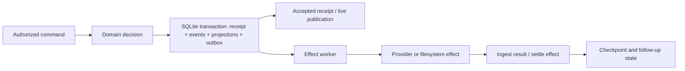

# T3 Code

> Keep business capability, durable intent, provider execution, user review and recovery as separate contracts, then expose them through shared services and consistent clients.

## Attributes

- **Unit studied:** Ping.gg's T3 Code repository, pinned to `33f85846be8bc4bc592f0e621d6f0313e5abd4a4`, committed2026-11-07. A Node server controls provider processes and project workspaces; web, Electron desktop and mobile are control clients. README describes bring-your-own authenticated providers. [[sources/pingdotgg--t3code#root]]
- **Distribution:** MIT; server package declares `t3` version0.1.7 in source. This is not a verified release/install result. [[sources/pingdotgg--t3code#root]]
- **Preservation:** ignored live shallow Git clone plus committed citation map, review inventory and GitHub metadata. The restore manifest pins the full SHA; upstream availability remains a restoration dependency.
- **Reading scope:** targeted architecture, normalized orchestration, provider/session recovery, permissions/MCP, shared client state, workspace/review and engineering practices. Includes implementation and selected test bodies; excludes whole-tree review, full third-party reference trees, complete mobile/native internals and independent security assessment. The source page owns the exact file/range inventory.
- **Execution:** no dependency installation, provider/model calls, T3 startup, migrations, CLI commands, native build or bundled tests executed. Wiki preservation/citation checks are separate.

## Relationships

- [[creators/pingdotgg]] publishes the system; [[artifacts/projects/codex]] is an independently studied underlying runtime, not the same artifact or revision.
- [[artifacts/projects/humanlayer]], [[artifacts/projects/background-agents]] and [[artifacts/projects/superplane]] provide comparison points for task artifacts, runtime generations and durable command/effect boundaries.
- [[concepts/agent-control-plane]], [[concepts/durable-agent-execution]], [[concepts/review-cost-aware-workflows]] and [[concepts/artifact-centered-agent-context]] own broader concepts. This page owns T3-specific evidence and its portable ledger.
- [[concepts/business-platform-api-design]] and [[concepts/agent-documentation-interfaces]] connect the original modular API/docs research to this implementation.

## Mechanism and themes

### 1. Put reusable capabilities behind services, then adapt each transport

The service conventions explicitly place filesystem, Git, persistence, naming, retries and rollback inside domain service methods. RPC/HTTP/MCP/jobs/CLI should adapt them. The named-project RPC actually delegates to `ManagedProjectFolders.createNamedProject`, which orchestrates allocation, repository scaffolding and project registration. This is a concrete answer to uncertain future use: keep the meaningful capability reusable, rather than embedding it in today's screen or protocol handler. [[sources/pingdotgg--t3code#service-reach]]

This is a direction, not an absolute achieved property. The clone handler still supplies callbacks and enrichment work. Do not mistake a contributor rule for proof that every transport is thin. A shared service also needs explicit authority context wherever callers differ; code reuse alone cannot make a mobile user and a provider-spawned agent equally authorized. [[sources/pingdotgg--t3code#service-partial-success]]

The named-project workflow also exposes a useful partial-success contract: an initial Git commit can fail while the project is created, with `commitError` returned. Cleanup after failed registration checks whether the workspace already has an owner before removing it. The portable lesson is to name the durable result and subsidiary failure, and compensate only resources the failed attempt still owns. A failed step is not permission to undo another successful actor's work. [[sources/pingdotgg--t3code#service-partial-success]]

### 2. Keep freshness, membership, connection and mutation retry separate

The connection design has one shared environment owner rather than a retry loop in every view. It distinguishes transport health, HTTP credential renewal, configuration readiness and domain-stream freshness. Partial shell snapshots deliberately omit rows, so a missing thread is not proof it was deleted. Shared client code remembers applied state and cursor with an owner check, and updates projection/history atomically so cancellation or a superseded scope cannot overwrite newer data. [[sources/pingdotgg--t3code#client-consistency]]

For business platforms, this matters beyond UI performance: a paginated or filtered read is not a complete authoritative inventory from which to infer destructive actions. Reconnect can resume subscriptions; replaying a mutation requires that operation's own idempotency/outcome contract. These are our applications of the observed implementation/documented invariants, not tests of an ERP integration. [[sources/pingdotgg--t3code#client-consistency]]

### 3. Context is structured evidence with stable identity

Context records have typed kinds, bounded payloads and identity separate from their display label or repeated occurrence. Provider projection retains inline markers, emits referenced payloads once and marks missing or ambiguous duplicate identity unavailable. Tests explicitly preserve actual mention paths and skill names even when the visible label differs. Attached threads are represented by identity and a read instruction rather than dumping their history. [[sources/pingdotgg--t3code#typed-context]]

Escaping prevents captured text from forging the context envelope's tags; it does not establish general prompt-injection safety or authorize instructions inside that text. Unknown kinds have a bounded preservation path, while invalid known kinds cannot simply pass as unknown data. This balances independent client upgrades with validation of semantics the current build understands. [[sources/pingdotgg--t3code#typed-context]]

There is source drift worth retaining: the composer guide says mention/skill records produce no envelope entry, while current tests expect those payloads and current projection emits them. The code/test behavior is the stronger evidence for this pin; the older prose remains historical evidence, not silently rewritten to agree. [[sources/pingdotgg--t3code#context-documentation-drift]]

### 4. Treat runtime replacement as an activation transaction

The stable launcher records pending update identity before acknowledgement. Its prepared handler checks trial role, update ID and target version, persists the committed version, then releases the child. When a gate exists, background roots park until activation; ordinary ungated startup takes a different path. A listener accepting connections and an update request returning are therefore weaker observations than committed activation. [[sources/pingdotgg--t3code#update-activation]]

The update guide bounds rollback to SQLite main/WAL/shared-memory snapshots; attachments and other files are outside that rollback unit. Clients correlate update ID/outcome/version after reconnect, since a connection returning could also mean rollback. Selected launcher tests exercise trial signalling, but were inspected rather than executed here. This is a useful software-update contract, not evidence of universal rollback of external effects. [[sources/pingdotgg--t3code#update-activation]]

### 5. The implementation is ahead of some design documents

The current overview describes implemented transactional effects and warns that projections cannot be rebuilt from the pruned log. The V2 design README still presents the outbox as a conditional follow-up. This pin's implementation, not a future-tense paragraph, determines the mechanism below. A code path, a selected regression test, a contributor rule and a recorded provider probe remain different evidence classes. [[sources/pingdotgg--t3code#architecture-documentation-drift]] [[sources/pingdotgg--t3code#rt-atomic-intent]]

The diagram shows the inspected local responsibility split. It does not imply one transaction with the provider, a complete replay archive or an outcome verified in a customer system. [[sources/pingdotgg--t3code#rt-atomic-intent]] [[sources/pingdotgg--t3code#rt-ambiguous-settlement]]

## What we'd steal

This ledger preserves concrete portable mechanisms, smaller practices and counterexamples. ★ marks the highest-priority ideas; values and permissions remain source-specific rather than universal recommendations. All application to our business platform is a design inference, not a runtime result.

### Shared services and client contracts — 12 practices

1. ★ Put meaningful capabilities behind domain services before adapting RPC, HTTP, MCP, jobs or CLI. [[sources/pingdotgg--t3code#service-reach]]
2. Make transport handlers decode/call/map errors; check actual handlers rather than assuming contributor guidance is universally enforced. [[sources/pingdotgg--t3code#service-partial-success]]
3. Keep composite task operations without hiding their durable result or subsidiary failures; project creation can succeed while initial commit reports an error. [[sources/pingdotgg--t3code#service-partial-success]]
4. Compensate failed creation only after rechecking resource ownership. [[sources/pingdotgg--t3code#service-partial-success]]
5. Use structured domain errors with safe public attributes and a retained underlying cause; document bounded diagnostic exceptions. The broad error policy here is guidance, not an audited confidentiality guarantee. [[sources/pingdotgg--t3code#service-errors]]
6. Own connection retries once per environment; separate credential renewal and stream failure from transport replacement. [[sources/pingdotgg--t3code#client-consistency]]
7. ★ Preserve partial-snapshot membership/omission metadata; absence from one view cannot justify deletion. [[sources/pingdotgg--t3code#client-consistency]]
8. Persist cursor and applied state together, and fence caches against superseded owners. [[sources/pingdotgg--t3code#client-consistency]]
9. Keep mutation retry policy with the operation; resubscribing a read stream is not permission to resend a write. [[sources/pingdotgg--t3code#client-consistency]]
10. Preserve typed context identity, missing/duplicate ambiguity and referenced-order semantics independently of display labels. [[sources/pingdotgg--t3code#typed-context]]
11. ★ Correlate update acceptance, prepared trial, committed activation and post-reconnect result by operation identity. [[sources/pingdotgg--t3code#update-activation]]
12. Scope update rollback to the actual snapshotted resources; SQLite recovery does not include arbitrary files or external effects. [[sources/pingdotgg--t3code#update-activation]]

### Runtime and recovery — 21 practices

#### RT01. ★ Persist accepted intent atomically with the work it entails

EventSink inserts/reserves a command receipt, normalizes/appends events, applies their projections, enqueues effects and updates the receipt inside `commitThenPublish`’s database transaction. An accepted result therefore proves this local intent commit, not that a provider action or checkpoint finished. Build an explicit status/result channel for the work. It is a source-inspected local SQLite boundary, not an end-to-end exactly-once claim.

[[sources/pingdotgg--t3code#rt-atomic-intent]]

#### RT02. Serialize publication as well as database mutation

A semaphore spans commit/publication order; publication after commit is protected from Effect/cooperative interruption while the process remains alive, so cancellation in that interval does not silently suppress the live notification. This does not guarantee delivery across process crash. The code comment identifies reordering as a cause of clients dropping earlier sequences. Durable storage and subscriber ordering are related but separate design obligations.

[[sources/pingdotgg--t3code#rt-publication-order]]

#### RT03. Bind idempotency receipts to their intended aggregate

Orchestrator verifies that a prior receipt belongs to the command’s thread, both on initial replay and after a concurrent commit wins. A command ID reused on another thread becomes a conflict rather than success for the wrong object. The race test gates two metadata commands so both initially see no receipt, then asserts one winner, a conflict, unchanged losing model, and same-thread replay. The test was read, not run.

[[sources/pingdotgg--t3code#rt-receipt-identity]]

#### RT04. Keep lock ordering explicit across parent/child mutations

Dispatch is serialized per target thread. Parent/side-chat deletion and follow-up/Stop operations take parent locks before child locks, and reject fork shapes that would invert that order. This is a concrete lock-graph policy; generic “thread-safe” labels would hide the important ordering invariant.

[[sources/pingdotgg--t3code#rt-lock-order]]

#### RT05. Separate durable state from transient delivery channels

The event sink reserves normalized state durably; live PubSub publication follows. A missed wakeup does not have to become permanent work loss because the worker retains availableAt deadlines and liveness polling. Do not make correctness depend solely on a browser subscription or in-memory notification.

[[sources/pingdotgg--t3code#rt-delivery-liveness]]

#### RT06. ★ Classify effects by replay safety after process loss

The outbox has explicit replay-safe and process-bound type lists. Recovery cancels pending/running provider-turn start/interrupt/steer/restart and runtime-request response effects, since their original process/callback is gone; it requeues running checkpoint, cleanup, detach and continuation effects. A persisted queue is not permission to blindly replay every effect.

[[sources/pingdotgg--t3code#rt-replay-classification]]

#### RT07. Separate pre-execution failure from post-execution settlement failure

The worker requeues a claim when a pre-execution check fails. After successful execution but failed durable settlement it requeues only replay-safe types, and terminalizes process-bound effects instead of riskily replaying them. This is an ambiguity policy, not evidence the original side effect happened zero or one times.

[[sources/pingdotgg--t3code#rt-ambiguous-settlement]]

#### RT08. ★ Close the cancellation registration/read race

After claiming, the worker arms cancellation and then rereads durable cancelled state before executing. It races execution against the signal and clears local signal bookkeeping afterward. This avoids a cancellation committed between claim and listener setup being missed. Cancellation still does not establish reversal of effects already committed outside the worker.

[[sources/pingdotgg--t3code#rt-cancellation-race]]

#### RT09. Use retry timing as an ordering constraint, not only a delay

The claim predicate blocks later non-title work on a thread behind an earlier pending or running non-title effect, even if that earlier effect is in backoff. That prevents a new turn racing an unfinished rollback. Title generation has its own lane; it should not be described as one blanket FIFO across every effect class.

[[sources/pingdotgg--t3code#rt-retry-order]]

#### RT10. Bound hanging control operations to preserve queue liveness

Delegated-task Stop is bounded at30seconds because a running effect blocks later thread work and its lease is not reclaimed in-process. Defaults cap attempts at5 with exponential retry delay capped30seconds; the daemon defaults4workers with30second liveness polling. These are implementation values, not universal tuning recommendations. An unresponsive Stop leaves work running/flags the unresponsive state rather than claiming confirmed cancellation.

[[sources/pingdotgg--t3code#rt-bounded-stop]]

#### RT11. Reconcile lost callbacks differently from durable questions

Recovery explicitly treats the original provider callback as unavailable, but can preserve valid persisted user-input questions as message-answerable requests for suitable app threads. Other live requests expire/cancel; native subagent callbacks are not assumed resumable. A question record can survive while its original response transport cannot.

[[sources/pingdotgg--t3code#rt-lost-callbacks]]

#### RT12. Record restart continuation as new durable work

When enabled at startup, restart continuation is enqueued as `provider-runtime.continue` with a sourceRunId, alongside reconciliation events and retirement of stale process-bound effects. It is not the old provider process magically continuing. Waiting runs with replayable checkpoint effects are deliberately preserved instead of terminalized wholesale.

[[sources/pingdotgg--t3code#rt-restart-continuation]]

#### RT13. Separate provider completion from finalization and display refresh

Finalization captures a checkpoint first, then refreshes workspace/VCS. A refresh failure after durable capture is logged rather than holding the next turn hostage; a checkpoint failure remains blocking. The selected queue test asserts those two outcomes with mocked checkpoint/refresh services plus an in-memory outbox. Tests inspected only.

[[sources/pingdotgg--t3code#rt-finalization]]

#### RT14. Guard delayed enrichment against newer work

Post-turn PR lookup first checks a nondefault branch, matching thread branch and absence of a newer active run. Slow forge lookup is detached into a cwd-keyed FiberMap so a newer turn replaces it rather than queueing behind it. This is a useful pattern for stale search/diff/status enrichment, distinct from core task execution.

[[sources/pingdotgg--t3code#rt-stale-enrichment]]

#### RT15. ★ Define what remains authoritative after history pruning

ProjectionMaintenance retains roughly a day of reconnect history, prunes only through projected/aged boundaries and preserves selected anchor/head/running-attempt rows. The overview explicitly says projections cannot be rebuilt from the retained log. An event-driven design can intentionally stop being a full event-sourced reconstruction archive. Preserve projections/backups/migrations accordingly.

[[sources/pingdotgg--t3code#rt-pruned-history]]

#### RT16. Preserve reference integrity during compaction, including concurrent writers

Pruning tracks promptSequence references, including retained stream heads and rows appended during a pass, before deleting candidate anchors. It uses bounded pages and yields without holding a transaction/reader lock. The selected pruning test asserts unchanged projections and surviving repeated prompt text after a24hour test-clock advance; separate tests target retained-head and mid-pass references. This is compaction evidence, not proof of every migration/recovery case.

[[sources/pingdotgg--t3code#rt-compaction-references]]

#### RT17. Keep deduplication lifetime distinct from replay lifetime

V2 receipts remain for idempotency even after old event bodies are pruned; imported legacy-command receipts can be removed once imported. A retry can remain recognized even when its original events are no longer returned. Application/API docs should describe this distinction rather than promise permanent replay from a durable receipt.

[[sources/pingdotgg--t3code#rt-dedup-lifetime]]

#### RT18. Bound reconnect recovery by actual payload costs

ThreadStream caps replay count128 and encoded/raw payload size1MiB, selects a snapshot if the client cursor is beyond the high-water mark or replay exceeds count/size limits, and supports bounded history plus continuation metadata. Counting events alone would miss a single enormous payload; a snapshot is recovery state, not a complete conversation dump.

[[sources/pingdotgg--t3code#rt-bounded-reconnect]]

#### RT19. Treat rollback as coordinated provider and workspace state, with limits

CheckpointRollbackService validates target, active provider and workspace isolation, computes provider conversation target, performs provider rollback, then restores files and updates app events. Because the provider/filesystem steps are sequential external operations, source inspection does not prove an atomic rollback across them: a filesystem restore failure after provider rollback is a partial-state risk that needs a recovery story. It refuses shared-workspace restore through an explicit isolation check.

[[sources/pingdotgg--t3code#rt-rollback-boundary]]

#### RT20. Model context transfer as an inspectable, bounded artifact

ContextHandoffService selects history within a configurable budget, records source/target provider threads, covered run ordinals, chosen strategy, rendered summary, selected message history and omitted-item IDs/counts. “Ready” means the handoff artifact was prepared; it does not prove the next provider understood all omitted knowledge. Do not silently equate a provider switch with the same native conversation.

[[sources/pingdotgg--t3code#rt-context-handoff]]

#### RT21. Plan provider transitions from negotiated capabilities and identity

ProviderSwitchService considers current/target driver, continuation identity/key, model, runtime/interaction modes, workspace and negotiated session capabilities, rejecting unavailable targets. It delegates selection changes to adapters rather than assuming every provider can hot-switch identically. These are implementation planning checks; actual supported transitions depend on adapter/provider behavior.

[[sources/pingdotgg--t3code#rt-provider-transition]]

### Authority and remote interfaces — 24 practices

#### A01. Model effective authority, not the apparent scope label

**Documentation + implementation.** T3 explicitly says terminal:operate is a shell as the server user, orchestration:operate can start a full-access agent, and either can issue broader sessions through the local CLI. Omitting access-management scopes from that default is therefore not a meaningful containment boundary. This is an unusually candid counterexample to treating a fine-grained scope list as least privilege. Portable inference: map what a granted action can derive or spawn, including shell/credential minting, before claiming a restricted role.

[[sources/pingdotgg--t3code#auth-authority-model]]

#### A02. Delegation must be an intersection, not a new grant

**Implementation.** Pairing-link creation requires access:write and each delegated scope. Empty and duplicate scope requests fail. Exchanging a bootstrap grant may narrow, not widen it. Portable inference: validate delegation against the issuer at the grant boundary, not only when consuming the eventual credential. Labels/device metadata do not confer authority.

[[sources/pingdotgg--t3code#auth-authority-model]]

#### A03. ★ Make every RPC choose its authority class exhaustively

**Implementation + test inspected.** RPC_REQUIRED_SCOPES satisfies the complete RPC method type; unknown names throw. The test compares map keys against the actual server RPC group, including adversarial object names. This makes a newly added API without an authorization declaration a compile/test problem rather than an invisible omission. It is not proof that every declared scope is semantically correct.

[[sources/pingdotgg--t3code#auth-rpc-authorization]]

#### A04. Authorize decoded effects, including flags on retrieval-shaped calls

**Implementation + test inspected.** RPC middleware derives permissions from the decoded payload for settings/project changes and asset type. Device listing requires operate authority when retryHostId or updateTool can install/restart tooling; otherwise it is readable. The check precedes the effect. Portable inference: one route can legitimately support query and workflow initiation only if its effect-changing inputs change the required authority too.

[[sources/pingdotgg--t3code#auth-rpc-authorization]]

#### A05. Classify sensitive reads by what they disclose

**Implementation + test inspected.** Webhook delivery logs contain request bodies and therefore require operate scope, despite being reads. Terminal observation is distinct from attach/open/write/resize/clear/close; even resize can affect a shell. Portable inference: read/write verbs are insufficient for determining data sensitivity and operational authority.

[[sources/pingdotgg--t3code#auth-rpc-authorization]]

#### A06. ★ Keep external agent credentials inside the interface that enforces their ceiling

**Implementation.** External OAuth MCP sessions have subject mcp-client. Write-capable sessions carry a signed runtime-mode ceiling; read-only sessions instead carry the read scope without that ceiling field. General HTTP authentication and WebSocket tickets reject that subject; the dedicated MCP path accepts it. Otherwise a client could bypass MCP checks through a more powerful RPC. Portable inference: audience/transport segregation is necessary when different interfaces enforce different policy models; reusing one broad bearer token defeats the narrower facade.

[[sources/pingdotgg--t3code#auth-mcp-audience]]

#### A07. Make tool access part of construction, not optional handler prose

**Implementation.** McpToolAccess provides typed read/write/acts-as-caller/starts-thread declaration constructors; runtime private construction checks use a module-local symbol. Read-only clients fail before writingCaller proceeds. A linter prohibits direct Effect MCP registration outside the central boundary and tells authors which constructor to use. Portable inference: encode the allowed extension path so adding a tool naturally includes authority checks. Types, lint and runtime wrapper are complementary, not a sandbox against hostile modified source.

[[sources/pingdotgg--t3code#auth-mcp-tool-access]]

#### A08. Treat a request limit as attenuation of approved authority

**Implementation.** T3-Mode-Limit carries runtime/interaction modes. Parsing rejects malformed limits; clientModeCeiling chooses the narrower requested/approved modes. The admin runtime ceiling narrows it again. A broad user-supplied header cannot elevate a signed grant. Portable inference: carry the initiating caller’s ceiling across linked services, but interpret transport metadata as attenuation only.

[[sources/pingdotgg--t3code#auth-mcp-caller-limits]]

#### A09. Revalidate caller ownership against live execution state

**Implementation.** A thread credential resolves its current thread shell rather than trusting copied metadata. Writes require an unarchived thread owned by the same provider instance with an active run or matching background subagent. External OAuth clients instead rely on their session and approved ceiling. Portable inference: a saved credential should not let an ended/replaced worker continue changing the control plane; background subagents need an explicit exception tied to ownership, not merely a longer timeout.

[[sources/pingdotgg--t3code#auth-mcp-caller-limits]]

#### A10. ★ Close the authorization race at the commit lock

**Implementation + focused integration test inspected.** writesThreads checks target modes, carries DispatchModeLimit into dispatch, then the orchestrator rechecks current target modes under its lock. A test raises a supervised target to full access between preflight and rename; expected result is runtime_mode_escalation_denied and unchanged title. The test explicitly uses no provider process. Portable inference: permission checks belong at the serialized mutation boundary as well as the API facade; stale state can invalidate a previously valid call.

[[sources/pingdotgg--t3code#auth-authority-race]]

#### A11. Preserve retryability when a refusal depends on mutable permission state

**Implementation.** The orchestrator explicitly does not record a permanent rejected receipt for mode-limit/administrator-ceiling refusals, because the user can change those modes and retry. Portable inference: distinguish immutable invalid requests from refusals contingent on live state; deduplication should not permanently poison a command whose authorization can legitimately become valid.

[[sources/pingdotgg--t3code#auth-authority-race]]

#### A12. A common permission label needs provider-specific enforcement evidence

**Implementation + documentation.** Codex maps supervised to readOnly/untrusted/user-review; auto-accept to workspaceWrite/on-request/user-review; auto to workspaceWrite/on-request/auto_review; full-access to dangerFullAccess/never. Claude maps modes to default/acceptEdits/auto/bypassPermissions with explicit approval/sandbox overrides, and can downgrade unavailable bypass to auto/default. User docs describe further per-provider fallbacks. Portable inference: retain one understandable product vocabulary while documenting actual semantics and unsupported choices; never infer identical containment from identical UI labels.

[[sources/pingdotgg--t3code#auth-provider-permissions]]

#### A13. Document the permissive default as a product choice, not a safety guarantee

**Documentation checked against adapter mapping.** New threads initially default to Full access, while environment/project configuration and existing draft/thread choices can differ. Full access does not remove every native provider safeguard: Claude and Antigravity may still ask; some providers cannot offer that mode. Portable inference: show the effective mode and its provenance near the action, including default, project override and administrator cap. This study does not recommend adopting that default for a business platform.

[[sources/pingdotgg--t3code#auth-provider-permissions]]

#### A14. A managed policy must be loaded, enforceable and externally owned

**Implementation + documentation.** ManagedPolicy rejects invalid managed-settings/provider combinations. A mode ceiling also shapes provider launch configuration. The docs describe administrator-only storage, startup-only reads, exact installed/loaded fingerprints, refusal for unsupported keys/ambiguous policy sources, and separate defaults versus locks. Portable inference: a policy file being present or a UI saying managed is insufficient; expose the loaded revision and fail instead of silently ignoring unknown requirements. Admin-only path ownership is a deployment requirement, not independently audited here.

[[sources/pingdotgg--t3code#auth-managed-policy]]

#### A15. Evolve permission vocabulary without silently expanding stored grants

**Implementation + documentation.** Responses preserve legacy scopes plus exact permissions; the client may use legacy parent checks only for old servers. An explicitly empty permissions list grants nothing. Grant inputs are strict while forward-compatible response arrays can ignore unknown values. Server storage is not expanded when scopes split. Portable inference: maintain wire compatibility separately from authorization semantics, and never interpret an absent old field and an explicitly empty new field as equivalent.

[[sources/pingdotgg--t3code#auth-permission-compatibility]]

#### A16. Proof binding must fail closed rather than downgrade to bearer

**Implementation.** A proof-bound session requires DPoP authorization with the same token; a DPoP header for an unbound token also fails. Request verification binds method, URL, key and access-token hash, and replay-state conflicts become explicit replay failures. Portable inference: alternate authentication schemes cannot be a fallback around a stronger scheme’s failed verification.

[[sources/pingdotgg--t3code#auth-proof-and-tickets]]

#### A17. Use route-specific short-lived tickets, and state their exceptions

**Implementation + documentation.** HTTP issues WebSocket tickets so long-lived access tokens need not live in socket URLs. RPC tickets may bind to the DPoP key and need a fresh proof; media tickets remain bearer to support img/EventSource/multiple-socket consumers. Legacy unbound tickets can lack an audience. Portable inference: document residual bearer surfaces and compatibility exceptions; a secure RPC upgrade does not automatically make every media URL proof-bound. Encryption remains necessary against an active interceptor racing first use.

[[sources/pingdotgg--t3code#auth-proof-and-tickets]]

#### A18. Revocation must reach already-open connections, not only new handshakes

**Implementation.** Session verification checks signature, expiry and current stored revocation/scopes. A socket races its RPC lifetime against awaitInvalidation. That watcher subscribes before reading to avoid an upgrade/revocation race; renewal requires the same subject and all original scopes, and revoking any session used by the socket invalidates its chain. Portable inference: renewal must not silently widen an already-open socket’s original scopes; invalidation needs an ongoing connection mechanism. No latency guarantee or in-flight-effect rollback was measured.

[[sources/pingdotgg--t3code#auth-session-invalidation]]

#### A19. Authorize an OAuth recipient, not just an application name

**Implementation + documentation.** OAuth accepts loopback HTTP and HTTPS redirect URIs; HTTPS matches exactly and loopback matching permits port variation. All clients are public PKCE; signed client metadata avoids storing unauthenticated registration state. Browser approval verifies CSRF and grant scopes, and token exchange consumes the code before checking bindings/PKCE. The docs call out that a hosted redirect can send access to someone else, so the approval page must name that recipient. Portable inference: client names and registered metadata are claims, not identity proof or authorization by themselves.

[[sources/pingdotgg--t3code#auth-mcp-oauth]]

#### A20. ★ Know which authorizations survive revocation

**Implementation + explicit documentation.** Signed host-media URLs authorize one canonical file and device/inode identity; serving verifies signature and expiry, not the session that minted it. The docs explicitly say revoking filesystem:read leaves an issued URL usable until expiry. Atomic file replacement needs a new URL; editing the same inode may remain visible. Portable inference: expiry, session revocation, file identity and content immutability are separate contracts. Do not call a signed file URL a frozen content revision.

[[sources/pingdotgg--t3code#auth-asset-authority]]

#### A21. Project/worktree organization is not process containment

**Documentation corroborated by full-access adapters.** filesystem:read permits absolute reads outside a project as the server user. Remote routes preserve the same environment execution model, and full-access linked work runs with the receiving user’s authority. Portable inference: a clean project tree or remote transport does not isolate unrelated files, credentials or network capabilities. Stronger tenant boundaries require an independently enforced execution boundary outside the harness permissions described here.

[[sources/pingdotgg--t3code#auth-asset-authority]] [[sources/pingdotgg--t3code#auth-remote-boundaries]] [[sources/pingdotgg--t3code#auth-provider-permissions]]

#### A22. Bind mutation ownership separately from broad read visibility

**Documentation + access-wrapper inspection.** Below-full-access peer-linked work carries immutable linkOrigin through derived work, can mutate only its own origin’s threads and cannot change projects/settings/schedules or use the receiving environment’s links; reads are not fenced. Full-access links are deliberately not fenced because shell authority already exceeds those tool checks. Portable inference: write ownership, information visibility and OS isolation are different promises; provenance stamps are useful even where they are not enforcement.

[[sources/pingdotgg--t3code#auth-remote-boundaries]]

#### A23. Route identity preflight protects credentials without proving connectivity

**Documentation.** Clients preflight public descriptors so an old LAN address answered by another environment receives no credential; advertised endpoints remain hints and only the connecting device can prove reachability. Failure can fall through ordered routes, but incompatible server version stops the walk. Learned routes do not silently downgrade a token paired over HTTPS to plain HTTP. Portable inference: stable identity and credential-release policy should be independent of address selection; an address responding does not establish authorized session success.

[[sources/pingdotgg--t3code#auth-remote-boundaries]]

#### A24. Shared remote credentials need namespaced idempotency and bounded waits

**Documentation.** Peer links share one session among callers; outgoing idempotency keys are hashed with the caller namespace to avoid collisions. Forwarded waits split to at most50 seconds because the receiver is silent and the relay closes idle requests near100 seconds. Portable inference: cross-service adapters should preserve caller-local identity and transport liveness constraints without changing the business task’s durable identity. No relay timing measurement was executed here.

[[sources/pingdotgg--t3code#auth-remote-boundaries]]

### Review, context and engineering — 22 practices

#### RE01. ★ Keep the review projection narrower than the recovery snapshot

Turn diffs exclude clean imported Git changes while restore uses the full captured workspace scope rather than the filtered authored-file review. Git checkpoints retain HEAD as a parent; authored-path calculation compares staged/dirty changes at both boundaries and uses remerge diffs to retain conflict fixes. The query filters paths before generating patch bytes, so a bulk pull cannot exhaust the patch budget first. This is an authored-path heuristic/projection, not perfect semantic attribution. A null/failed authored-path result falls back rather than claiming an empty set.

[[sources/pingdotgg--t3code#review-authored-diff]]

#### RE02. Checkpoint without consuming the developer staging area

Capture uses a temporary GIT_INDEX_FILE, write-tree/commit-tree and an explicit checkpoint ref, with cleanup. The synthetic commit can have current HEAD as parent without advancing the branch. Split-index/fsmonitor settings are disabled for the scratch index to avoid mutating or expiring shared index resources. Portable idea: capture work at a separate namespace/index instead of turning every checkpoint into a user-facing commit. This is code inspected; the full sparse-checkout/merge recovery paths were not runtime exercised.

[[sources/pingdotgg--t3code#review-checkpoint-index]]

#### RE03. ★ A file restore requires current isolation, not just historical ownership

CheckpointRestoreSafety resolves real paths, checks active and archived nondeleted threads, descendant/ancestor overlap, checkpoint scopes and certain nonstopped provider session cwd values. An isolated worktree can become shared later. Both admission (documented comment) and rollback revalidation are intended; the inspected rollback execution really invokes the guard. Idle side chats that never used tools are exempt, while a running or tool-using side chat blocks restore. This is an app-known ownership check, not OS filesystem containment or detection of every external editor.

[[sources/pingdotgg--t3code#review-restore-isolation]]

#### RE04. Conversation rewind and file restoration are separate operations

Rollback accepts restoreFiles:false, can rewind the provider conversation while leaving files alone, and rejects stale active-provider identity. Actual file restore uses Git restore for worktree+staging plus clean -fd in the workspace; it can remove untracked work. It is not a generic undo of external side effects, ignored files, processes, network calls or customer outcomes. The code orders provider rollback before file restore and event persistence, so those operations are not one atomic transaction; partial failures remain possible.

[[sources/pingdotgg--t3code#review-rewind-boundaries]]

#### RE05. Idempotent checkpoint finalization must preserve cancellation semantics

Capture returns early when a settled run already has a checkpoint, and skips a rolled-back run to avoid recapturing the restored workspace on a retry. Interrupted/cancelled runs still acquire a next-message rollback point without being rewritten as completed. A deterministic command ID ties persistence to the run; code deliberately avoids overwriting delegatedCompletion from an older loaded projection. This is a concrete at-least-once effect design, not universal exactly-once Git/provider execution.

[[sources/pingdotgg--t3code#review-capture-idempotency]]

#### RE06. Resource cleanup needs shared-ownership awareness

The web orphan-worktree helper normalizes paths before offering removal, and does not call one thread’s worktree orphaned if another thread points to it. This is a UI/helper guard, not proof that every backend removal path independently enforces ownership. The nearby comment explicitly notes force removal impacts every thread on that checkout.

[[sources/pingdotgg--t3code#review-shared-cleanup]]

#### RE07. Bind context to typed payload identity and preserve its position in prose

Composer context records and occurrences are distinct: label is display text, contextId is payload identity, referenceId is editor-local occurrence, and attachmentId binds a separate resource. Two mentions can point at one record. The provider projection retains markers where references appeared and emits each record once, avoiding duplicated hidden payload. Duplicate payload IDs produce unavailable context instead of choosing an arbitrary competing record. This is input encoding, not a permission model.

[[sources/pingdotgg--t3code#context-payload-identity]]

#### RE08. Preserve unknown extensions without letting malformed known data bypass validation

The context contract has explicit known unions and an UnknownContextRecord discriminator excluding known kinds; unknown payloads are bounded JSON. That enables forward compatibility while a malformed image record cannot sneak through as an unknown kind. The surrounding message uses a forward-compatible array, so invalid entries can be dropped rather than losing the whole message. Bounds/drop behavior are contracts, not completeness guarantees; callers need unresolved markers when data is unavailable.

[[sources/pingdotgg--t3code#context-forward-compatibility]]

#### RE09. Escape structural boundaries in untrusted context; do not claim complete injection immunity

The provider formatter escapes angle brackets that could open/close its context-envelope tags, and escapes attributes. This prevents that particular record-forgery mechanism. It does not sanitize all semantic instructions in terminal output, page text or PR comments. Thread attachments explicitly say referenced history is context and must not be messaged/changed unless asked: this is prompt guidance, not executable authorization.

[[sources/pingdotgg--t3code#context-envelope-boundary]]

#### RE10. Do not rewrite historical events to migrate presentation

Composer legacy references are upgraded in memory with deterministic IDs while event history remains unchanged. Persisted canonical message text differs from the provider projection; attachments keep their existing byte channel. This allows old clients/messages to be read without pretending the historic input had a new shape. Source/codecs are named by the doc; migration implementation itself was not deeply traced in this pass.

[[sources/pingdotgg--t3code#context-historical-migration]]

#### RE11. Budget intact historical units and explicitly expose omissions

Current handoffBudget selects whole historical messages using encoded byte cost, favors latest user/assistant and first user, then fills backwards. It records omitted IDs/counts and includes source thread/run/item ranges plus paginated recovery instructions. It says native tool/reasoning state and attached files are not replayed. Character/byte budgeting is not proof of provider-token parity or the same reasoning state as a native resumed thread.

[[sources/pingdotgg--t3code#context-intact-history]]

#### RE12. Context handoff documentation must follow the actual mechanism

The current internal context-handoffs doc describes portable handoffs as240-character compacted summary items. That function still exists for certain summaries, but current provider-switch preparation stores renderHistory plus structured selected messages; fork merge-back stores both compact summary and budgeted history. Delivery can inject native history or render inline. Do not summarize the whole feature as240characters/item. This is observed doc/code drift at one SHA, not a claim the doc is wholly useless.

[[sources/pingdotgg--t3code#context-handoff-drift]]

#### RE13. ★ Persist context-delivery uncertainty around the provider boundary

Delivery writes pending before injecting and injected after success; encountering pending for the same native thread refuses to repeat it and says replace the native thread before retrying. Inline delivery is marked separately after provider consumption; unsent restores earlier records. Handoffs deduplicate item IDs and can defer inline context across compaction. The code recognizes unknown delivery rather than claiming every retry is harmless. Native injection/persistence can fail between boundaries, so this is conservative recovery, not an atomic cross-system transaction.

[[sources/pingdotgg--t3code#context-delivery-uncertainty]]

#### RE14. Adapt instruction delivery to provider channel and lifecycle

Orchestration guidance has self-contained sections below Codex’s stated4000-byte entry truncation limit. ACP lacks system/developer fields, so initial prompts and changed tool/mode state carry wrapped instructions, while native slash commands remain at prompt start. Other providers use system prompts or prompt injection with delivered flags; device guidance is conditional and can arrive later. These are prompt-channel contracts; they do not enforce tool permissions. Inspected tests assert inclusion/absence/change behavior, not real agent obedience.

[[sources/pingdotgg--t3code#context-provider-channels]]

#### RE15. ★ Measure model-facing context from the real code path and ratchet it deliberately

AgentContextBudget.test builds actual Claude append, Codex additional context and registered MCP name/description/inputSchema fields, comparing UTF-8 bytes to checked-in values. A dedicated workflow rejects increases relative to main unless maintainers apply agent-context-increase. It separately checks only request_secret is always-loaded for Claude. This guards encoded size/configuration, not tool-selection effectiveness or total runtime tokens. The doc says eval behavior before cutting text to fit.

[[sources/pingdotgg--t3code#eng-context-budget]]

#### RE16. ★ Evaluate model-facing prose like executable behavior

Eval guidance says to import actual prompts, tool definitions and schemas instead of copying fixtures that can drift; cases name a real incident and should fail before/pass after. Ordinary-work control cases detect fixes that overcorrect. Repeat samples on the same model, preserve baseline and cost. This is documented engineering practice; no model eval was executed and no score is claimed here.

[[sources/pingdotgg--t3code#eng-model-facing-evals]]

#### RE17. Separate deterministic grader correctness from paid model efficacy

CI typechecks evals and runs grader unit tests while paid model runs remain manual. In test-signal, the Macroscope outer wrapper is not public, so the harness uses a stand-in: fidelity is explicitly limited. A bad case passes when a comment lands in a target test; guards require no comments plus All clear. That catches targeted behavior but cannot establish broad review usefulness or all false negatives. PR-content docs likewise require human body review beyond automatic pass.

[[sources/pingdotgg--t3code#eng-grader-scope]]

#### RE18. Test the actual failure milestone instead of elapsed time or extra layers

Testing guidance focuses on orchestration/protocol/auth/persistence/race behavior and extends existing cases at the lowest layer that fails. Event-sourced tests drain the effect worker or await a specific event/Deferred rather than sleep; wall-clock/performance deltas and retries are rejected. This keeps test timing coupled to the invariant. These are documented rules plus named lint rules; all lint implementations were not inspected or run.

[[sources/pingdotgg--t3code#eng-test-milestones]]

#### RE19. Replay UI turns through real adapters when testing presentation

The test-app skill uses isolated worktree .t3 state and a Replay(dev) provider that sends recorded turns through the real adapter/orchestration with simulated streaming. It avoids paid model calls solely to check rendering; actual provider behavior still needs a real provider test. This is authored test workflow, not a replay execution in this investigation and not evidence synthetic events perfectly model all providers.

[[sources/pingdotgg--t3code#eng-replay-provider]]

#### RE20. Test multi-surface completeness and reverse states explicitly

The repository harness asks engineers to consider entry points, web/desktop/mobile, providers, MCP/schedules, shared contracts, reverse states and connection modes before claiming completion. User-visible operation should usually be a service method so humans, MCP and schedules can use it, rather than hidden transport-handler logic. This is policy/guidance; code verification per feature remains necessary. It is useful as a completeness matrix for business platforms.

[[sources/pingdotgg--t3code#eng-surface-matrix]]

#### RE21. Use documentation for durable cross-boundary reasons; let code own implementation facts

AGENTS draws a clear line: internal docs cover architectural reasons/constraints/traps not readily recovered from code; user docs help a task/decision and omit implementation detail; operations docs cover maintainer release/debugging. Changed decisions are rewritten/removed instead of appending another competing story. This repo also rejects committed plans/research scratch and uses merged PRs as implementation record; our research wiki intentionally has a different preservation purpose, so copy the boundary principle rather than that destination policy.

[[sources/pingdotgg--t3code#eng-documentation-boundaries]]

#### RE22. Do not collapse absent, deleted and unknown revision states

The PR viewed-file doc traces four layers where absence changes meaning. Empty string is a known no-version/deletion; absent path means no answer; null map means no usable scope; stored null means no baseline. The helper retains earlier per-path revision answers while refreshing others, and a press can require fresher data than display. The doc records a real earlier opposite contract comment. This is a strong API-doc practice: write the semantic boundary across adapters, not a redundant field catalog. Only the helper/doc were inspected, not all providers.

[[sources/pingdotgg--t3code#review-revision-absence]]

## Patterns demonstrated

- [[patterns/behavioral/latent-vs-deterministic-split]] — domain decisions versus I/O effects, structural checks versus model behavior evals. [[sources/pingdotgg--t3code#rt-atomic-intent]] [[sources/pingdotgg--t3code#eng-model-facing-evals]]
- [[patterns/behavioral/evidence-gated-completion]] — acceptance/provider completion/finalization, failed Stop, replay and test evidence retain different meanings. [[sources/pingdotgg--t3code#rt-finalization]]
- [[patterns/behavioral/context-is-not-authority]] — typed context and caller metadata are not broad permission; live auth checks and explicit containment limits remain necessary. [[sources/pingdotgg--t3code#auth-mcp-caller-limits]]
- [[patterns/quality-bar/revision-bound-review]] — current ownership/permission and source contract revisions can invalidate older conclusions; narrower application, not the full review-feedback pattern. [[sources/pingdotgg--t3code#auth-authority-race]] [[sources/pingdotgg--t3code#review-revision-absence]]
- [[patterns/composition/single-source-multi-surface-distribution]] — common services/contracts/context codecs reach multiple clients and tools, while per-provider/client behavior stays explicit. [[sources/pingdotgg--t3code#service-reach]]
- [[patterns/quality-bar/defect-derived-validation]] — named incident evals and ordinary-work guard cases reuse actual model-facing text; byte-budget CI is a different check. [[sources/pingdotgg--t3code#eng-model-facing-evals]] [[sources/pingdotgg--t3code#eng-context-budget]]

These are source-observed applications or narrower analogues. Existing pattern statuses/example counts are not automatically promoted by this study.

## Tensions and anti-patterns

- Domain events/outbox durability does not prove exactly-once provider execution, safe arbitrary retries or a complete reconstruction archive. [[sources/pingdotgg--t3code#rt-replay-classification]] [[sources/pingdotgg--t3code#rt-pruned-history]]
- File restoration can delete untracked workspace content; it is a distinct choice from conversation rewind and cannot undo external business effects. Sequential provider/file/event operations can leave partial state on failure. [[sources/pingdotgg--t3code#review-rewind-boundaries]]
- Full access is the documented default for new threads, subject to configuration and provider limits. Do not inherit that choice unexamined in a multi-user business platform. Shell-capable sessions can derive broader authority; project/worktree boundaries are not OS containment. [[sources/pingdotgg--t3code#auth-provider-permissions]] [[sources/pingdotgg--t3code#auth-authority-model]]
- Revoking the original session is not immediate revocation of already-issued signed asset URLs. Context envelope escaping is not complete injection resistance. [[sources/pingdotgg--t3code#auth-asset-authority]] [[sources/pingdotgg--t3code#context-envelope-boundary]]
- Source documentation has at least three precise drift cases here: outbox maturity, context-handoff representation and mention/skill envelope payloads. Preserve the conflicting spans instead of blending them into a fictional contract. [[sources/pingdotgg--t3code#architecture-documentation-drift]] [[sources/pingdotgg--t3code#context-handoff-drift]] [[sources/pingdotgg--t3code#context-documentation-drift]]
- A byte-budget test can pass while tool selection fails; deterministic grader checks can pass without running a paid model eval; copied prompt fixtures can pass while production text changed. [[sources/pingdotgg--t3code#eng-context-budget]] [[sources/pingdotgg--t3code#eng-grader-scope]]

## Open questions and verification record

- Which replay/cancellation/rollback invariants hold with each real provider version and a process killed at each external boundary? No provider protocol probe or live test was run here.
- What evidence resolves provider rollback succeeding while workspace restore fails? The inspected sequence is not atomic across those systems.
- What complete archive/backups/migrations restore projections after pruned history? A durable receipt alone is not a reconstruction log.
- How do these host-user capabilities translate to shared tenant/financial authority? This study does not establish a tenant isolation solution.
- Do context-budget reductions improve successful work across models, rather than only reduce encoded bytes? No new model score claimed.
- Wiki pin/range/link checks and merge state are recorded in [[meta/2026-11-07-t3code-ingest]]. No source application execution or security certification inferred from those checks.
