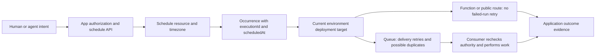

# vercel-schedules

> Make future intent a managed resource; keep schedule definition, occurrence delivery, current authorization and completed work separate.

## Attributes

- **Unit studied:** managed Vercel Schedules plus its SDK/API contracts, target-specific delivery semantics and experimental eve integration. This is a product/API study, not a new standalone skill installation.
- **Version:** public beta as captured 2026-11-06. Requested announcement dated November 4; linked changelog dated November 5. APIs/limits can change. [[sources/vercel--introducing-schedules#root]] [[sources/vercel--schedules-docs#beta]]
- **Evidence:** full article with two code examples and seventeen named primary-source captures, with dates/hashes/read scope. Core schedules docs and eve guide read in full; Queues concepts read at selected contract sections. No backend source, installed SDK behavior or live scheduler test. [[sources/vercel--schedules-docs#root]]
- **Attention:** official launch, not independently measured adoption or reliability. Capture dates are authoritative for this research; implausible 2018 metadata on several docs is not launch evidence.

## Relationships

- **Creator:** [[creators/vercel]]. Sources: [[sources/vercel--introducing-schedules]], [[sources/vercel--schedules-docs]].
- **Builds beside:** [[artifacts/projects/eve]], [[concepts/durable-agent-execution]], [[concepts/agent-control-plane]], [[concepts/business-platform-api-design]].
- **Authority and validation:** [[concepts/agent-habitat-architecture]], [[concepts/completion-contract]], [[patterns/behavioral/context-is-not-authority]].
- **Dedup decision:** a distinct runnable managed scheduling service merits a project page. Existing durability/control-plane concepts get extensions; no near-duplicate generic scheduling concept is added.

## Mechanism

The product moves schedule creation/update/cancellation out of a deploy-only configuration loop. Static schedules remain code-owned and reconcile when a deployment becomes current. Dynamic schedules are runtime resources for user-created future work. They deliver to Queue topics; the app supplies the consumer, evaluates current user permissions and starts or performs the actual work. A schedule payload can replace a separate due-task polling table for the announcement's simple example, not every business database, audit ledger or idempotency store. [[sources/vercel--introducing-schedules#static-dynamic]] [[sources/vercel--introducing-schedules#agent-example]]

The diagram distinguishes responsibilities, not a source-inspected service implementation. Overlap, duplicates, stale permissions and unknown effects remain application concerns at their respective boundaries. [[sources/vercel--schedules-docs#deployment]] [[sources/vercel--schedules-docs#targets]] [[sources/vercel--schedules-docs#dedupe]]

### Static, dynamic and target choices

| Contract | Static | Dynamic |
| --- | --- | --- |
| Source of truth | `vercel.json` / Build Output API | Runtime SDK, CLI or HTTP API |
| Reconcile timing | Current deployment promotion/rollback | API mutation without redeploy |
| Targets | Private function, public path or queue topic | Queue topic only |
| One-time / payload / tenant namespace | No / no / `default` only | Yes / JSON ≤16 KB per service docs / chosen namespace |
| Update/delete | Edit config and deploy | API mutation |
| Pause/enable/manual invoke | Runtime controls, state survives later deploys | Runtime controls |

Function targets have no public URL when correctly configured with their exclusive trigger. Path targets remain public and need their own secret check; `handleSchedule` parses metadata but does **not** authenticate `CRON_SECRET`. Neither retries callback failures. Queue targets retry through Queues, within retention/delivery bounds, and still require idempotent effects. [[sources/vercel--schedules-docs#root]] [[sources/vercel--schedules-docs#configuration]] [[sources/vercel--schedules-docs#event-auth]] [[sources/vercel--schedules-docs#queue-contract]]

### Lifecycle and timing boundaries

| Label/event | Actual documented meaning | Not implied |
| --- | --- | --- |
| `active` | Eligible to fire on cadence | A one-time schedule has not completed; it remains active after its time |
| Invoke accepted / HTTP 204 | Provider accepted an extra occurrence | Handler ran, agent finished, or business effect succeeded |
| Disable | Stop cadence; retain resource | Manual invocation is forbidden, or existing work is killed |
| Delete | Stop future and not-yet-delivered work; delete resource | Already delivered work stops |
| One-time dispatch window | Certain mutations/deletion return conflict after scheduled time | Immediate cancellation is always available |
| Recorded successful request | Observed function/consumer outcome | All expected occurrences had a recorded result, or semantic business success |
| eve `occurrence.dispatched` | Callback and `waitUntil` work finished; sessions were dispatched | Agent tasks completed |

The one-time resource becomes immutable for several operations after its time, disappears about 30 days later, and stops counting against capacity after dispatch. Static names carry state/history across deploys; rename or delete/recreate starts a new identity. [[sources/vercel--schedules-docs#timing]] [[sources/vercel--schedules-docs#lifecycle]] [[sources/vercel--schedules-docs#observability]] [[sources/vercel--schedules-docs#eve-occurrence]]

**Timing is a window, not an exact alarm.** Defaults: 1-minute jitter on Pro/Enterprise; Hobby uses 15 minutes. Runs can overlap. Late recurring occurrences expire after jitter plus the shortest cadence interval, with that interval floored at ten minutes; monthly/yearly forms, manual runs and one-time runs have the documented no-occurrence-expiry exceptions. Surviving occurrences may arrive in a catch-up burst. That scheduler exception does not eliminate the downstream queue message TTL. IANA zones track DST, but the local guide rejects one-time timestamps in skipped/repeated DST periods; production edge behavior needs targeted verification rather than inference. [[sources/vercel--schedules-docs#timing]] [[sources/vercel--schedules-docs#local]] [[sources/vercel--schedules-docs#queue-contract]]

### Two deployment-version contracts

Schedules dispatches to the **current deployment of its environment/branch**, not the deployment that originally declared it. Separately, generic Queues push delivery defaults to the **publishing deployment's partition**, and old consumers can keep retrying after promotion or rollback. Treat scheduling selection and queued-message ownership as separate stages. The exact race between a promotion and schedule-to-queue dispatch is not established here; do not promise all retries run latest code or that a rollback stops old work. [[sources/vercel--schedules-docs#deployment]] [[sources/vercel--schedules-docs#queue-versioning]]

## API contract matrix

| Dimension | Documented contract | Design implication / boundary |
| --- | --- | --- |
| Identity and scope | Team, project, environment, namespace/name, scheduleId, executionId | Names are not identities across delete/recreate; a namespace organizes tenants but does not itself prove tenant authorization. |
| Intent/effects | CRUD/state operations differ from `invoke` | Each invoke request starts a new occurrence; acceptance is not work completion. |
| Inputs | SDK and HTTP target/name shapes differ; omitted fields preserve, null clears certain fields | Don't forward one surface's object blindly into another. Expression type cannot switch in place. |
| Ownership | Static config versus runtime dynamic resource | Resolve name collisions and dual writers; deploy can succeed while a conflicting static entry is skipped. |
| Authentication | OIDC binds deployment project/environment; access token supports explicit selection and role permissions | CLI/access-token default production differs from SDK contextual scope; application tenant permissions remain separate. |
| Read projection | Get/list omit payload; cursor can accompany an empty page | A listing isn't a full recovery backup; enumerate until cursor null, not until no items. |
| Retry | 503 can follow an applied write; conflicts/not-found can reconcile known retries | Existing-name conflict alone doesn't establish matching intent. Invoke has no demonstrated general idempotency key. |
| Concurrency/events | Stable occurrence ID, duplicates, overlapping runs, queue leases and no FIFO | Deduplicate effects and separately coordinate resource contention/order. |
| Evolution | Beta APIs, current deployment routing, provider-specific limits | Payload/schema compatibility and frozen/live fields need an explicit contract. |
| Discovery | Detailed agent skill plus eve direct/deferred operation tools | Declared routing metadata is not measured retrieval or execution success. |

Source anchors: [[sources/vercel--schedules-docs#api]] [[sources/vercel--schedules-docs#sdk]] [[sources/vercel--schedules-docs#retry-boundary]] [[sources/vercel--schedules-docs#configuration]] [[sources/vercel--schedules-docs#queue-contract]] [[sources/vercel--schedules-docs#skill]]

## Experimental eve integration

The later eve documentation adds a creator-owned application layer, not merely a timer wrapper: principal-derived management scope, required current-access resolution before each occurrence, per-operation tools, optional payload preparation and unattended session dispatch. Stored creator references contain no credentials; revalidation must match identity and does not fall back to application identity. Manual invocation executes as the creator, not the invoker. [[sources/vercel--schedules-docs#eve-identity]]

Payload replacement in a shared scope makes the updater the new creator. Timing-only changes retain payload/creator. `preparePayload` runs before model approval and again before write; changing the prepared result invalidates the approved write. Preparation may repeat and should not create irreversible effects. Model-call approval does not apply to direct client code, but scope checks still do. Authorized destination resolution is separate from schedule-management scope. [[sources/vercel--schedules-docs#eve-tools]] [[sources/vercel--schedules-docs#eve-payload]]

Callback retries—including failure of an occurrence event handler—can start additional sessions. Use an execution-derived idempotency key for session sends; successful dispatch is not final agent success. `eve dev` without local Schedules has process-local storage and **no background clock**; `vc dev` with Schedules/Queues supplies timed local delivery. The default provider rejects self-hosted production. These are captured experimental docs, not changes verified in the older pinned eve checkout. [[sources/vercel--schedules-docs#eve-occurrence]]

## Evidence limits and documentation conflicts

- **8/16/64 KB are not interchangeable:** linked skill says 8 KB payloads, service docs say 16 KB, eve says 64 KB prepared writes. Preserve the specific layer and validate the effective hosted limit. [[sources/vercel--schedules-docs#documentation-conflicts]]
- **Example path conflict:** changelog uses source filename `api/cleanup.ts`, while configuration requires build-output ID such as `api/cleanup`. Follow the targeted configuration contract and verify the build. [[sources/vercel--schedules-docs#documentation-conflicts]]
- **Policy versus capability:** skill's migration-only path recommendation is stricter than handler docs' supported public-route use. Its 100-static-schedule statement is broader than the Hobby-specific limit. [[sources/vercel--schedules-docs#documentation-conflicts]]
- **At-least-once is bounded:** message expiry, maxDeliveries and application poison-message handling limit retries. Publish dedupe is time-bounded and does not make business effects exactly once; no built-in DLQ is documented. [[sources/vercel--schedules-docs#queue-contract]] [[sources/vercel--schedules-docs#queue-dedupe]]
- **Environment defaults are asymmetric:** Preview static schedules default inactive, dynamic schedules start active everywhere. Custom-environment defaults can be changed and don't retroactively change existing states. [[sources/vercel--schedules-docs#environments]]
- **Hosted does not mean strict residency:** Queues docs allow temporary neighboring-region failover. No stronger compliance claim follows from choosing a region. [[sources/vercel--schedules-docs#queue-residency]]
- **Not a cost benchmark:** beta changelog publishes starting schedule prices; function and queue work also incur usage. Quota exhaustion can skip runs; downgrading can delete incompatible schedules. No live workload was priced or run. [[sources/vercel--schedules-docs#beta]] [[sources/vercel--schedules-docs#limits]]

## Patterns demonstrated

- [[patterns/behavioral/context-is-not-authority]] — saved task, namespace and creator reference are not current permission; eve separately revalidates authority. [[sources/vercel--introducing-schedules#agent-example]] [[sources/vercel--schedules-docs#eve-identity]]
- [[patterns/behavioral/evidence-gated-completion]] — scheduling/acceptance/dispatch/request outcome/agent result are distinct. [[sources/vercel--schedules-docs#lifecycle]] [[sources/vercel--schedules-docs#eve-occurrence]]
- [[patterns/structural/authoritative-recheck-after-notification]] — dispatch wakes work, then the app checks current identity/resources rather than replaying old authorization. Documentation-level example. [[sources/vercel--schedules-docs#eve-identity]]
- [[patterns/quality-bar/revision-bound-review]] — prepared-payload equality checks bind model approval to the write; current-deployment routing exposes a separate live-version boundary. [[sources/vercel--schedules-docs#eve-payload]] [[sources/vercel--schedules-docs#deployment]]
- [[patterns/composition/resolver-routing-table]] — skill supplies positive/negative prompt, import and path signals; eve exposes operation-specific direct/deferred tools. No routing eval was run. [[sources/vercel--schedules-docs#skill]] [[sources/vercel--schedules-docs#eve-tools]]

## What we'd steal

Documentation-grounded design criteria and adaptations; not instructions to deploy this product or change the user's existing schedules.

1. **★ Separate future intent from executing work.** Make schedules inspectable resources; let handlers own application effects and verified outcomes. [[sources/vercel--schedules-docs#root]]

2. **Keep code-owned and user-owned schedules distinct.** Static reconciliation and dynamic CRUD have different owners and lifecycles. [[sources/vercel--schedules-docs#configuration]]

3. **Choose delivery semantics before target convenience.** Use a queue when failed processing must retry; private function and HTTP targets do not retry failures. [[sources/vercel--schedules-docs#targets]]

4. **Prefer private ingress where public access is unnecessary.** A trigger boundary removes the public-route secret-check burden; it does not validate business authorization. [[sources/vercel--schedules-docs#event-auth]]

5. **Never treat metadata parsing as authentication.** A public path wrapped in handleSchedule still needs its CRON_SECRET check. [[sources/vercel--schedules-docs#event-auth]]

6. **Use build artifacts as the deployment contract.** Resolve function identifiers from build output; source filenames and rewrites can invalidate private-target assumptions. [[sources/vercel--schedules-docs#configuration]]

7. **★ Preserve logical occurrence identity across deliveries.** Use executionId for duplicate detection; pair it with transactional or destination-idempotent effect handling rather than a racy check-then-act. The effect strategy is our adaptation. [[sources/vercel--schedules-docs#dedupe]]

8. **Separate deduplication from concurrency control.** Repeated delivery is one problem; two legitimate overlapping occurrences mutating one resource is another. [[sources/vercel--schedules-docs#timing]]

9. **Expose a timing window to the product.** Jitter and execution latency make exact-time promises inappropriate; use scheduledAt to evaluate lateness. [[sources/vercel--schedules-docs#timing]]

10. **Model stale work explicitly.** Decide skip/catch-up behavior using occurrence age; expect bursts after outage rather than one coalesced run. [[sources/vercel--schedules-docs#timing]]

11. **Distinguish scheduler expiry from queue retention.** A one-time occurrence that never expires at the scheduler is not an immortal downstream queue message. [[sources/vercel--schedules-docs#queue-contract]]

12. **Store timezone intent, not just a UTC offset.** Keep local time plus IANA zone and verify skipped/repeated DST times in the intended environment. [[sources/vercel--schedules-docs#local]]

13. **★ Name the live code boundary.** A stored schedule follows the current environment deployment; persistent configuration does not freeze the eventual handler revision. [[sources/vercel--schedules-docs#deployment]]

14. **Separate schedule routing from queued-message versioning.** Old deployment consumers may remain active after promotion; a rollback is not a universal stop button. [[sources/vercel--schedules-docs#queue-versioning]]

15. **Treat cancellation as a lifecycle cutoff.** Deletion skips pending delivery but cannot kill work already handed off; record what is still running. [[sources/vercel--schedules-docs#lifecycle]]

16. **Do not use active as completed.** One-time resources remain active after their time; track business completion in an application-owned record. [[sources/vercel--schedules-docs#timing]]

17. **Keep manual test runs operationally distinct.** Invoke works while inactive and creates an extra occurrence without consuming the scheduled one. [[sources/vercel--schedules-docs#lifecycle]]

18. **Use expiring enablement for bounded tests.** A temporary activation window reduces forgotten recurring work while preserving the schedule definition. [[sources/vercel--schedules-docs#lifecycle]]

19. **Make environment selection explicit in operator tooling.** CLI/access-token calls default to production; deployment OIDC contextualizes SDK calls. [[sources/vercel--schedules-docs#environments]]

20. **Test static and dynamic Preview defaults separately.** Static starts inactive by default; dynamic starts active, including outside production. [[sources/vercel--schedules-docs#environments]]

21. **Keep tenant namespace mapping collision-free.** Pass the authorized namespace on every operation; grouping is not tenant authentication. [[sources/vercel--schedules-docs#tenancy]]

22. **★ Revalidate authority at firing time.** Resolve current account status, permissions and destinations instead of replaying old roles or credentials. [[sources/vercel--schedules-docs#eve-identity]]

23. **Treat creator transfer as a sensitive payload-update effect.** In shared eve scope, payload replacement changes who the schedule runs as; timing-only changes do not. [[sources/vercel--schedules-docs#eve-payload]]

24. **Bind approval to prepared intent.** Validate/prepare before asking, repeat before writing, and reject changed prepared content; keep preparation side-effect-safe. [[sources/vercel--schedules-docs#eve-payload]]

25. **Keep model approvals and application authority separate.** Direct code clients bypass model approval policy but not scope; unattended sessions cannot wait for a human by assumption. [[sources/vercel--schedules-docs#eve-tools]]

26. **Use narrow operation tools with explicit schemas.** Separate read, create, update, invoke and delete; deferred discovery must preserve the same authorization rules. [[sources/vercel--schedules-docs#eve-tools]]

27. **Store durable references instead of a conversation dump.** Persist authorized destination and resource references; the creating conversation is not automatically retained by eve. [[sources/vercel--schedules-docs#eve-payload]]

28. **★ Deduplicate dispatched sessions, not only callbacks.** Provider/event-handler retries can start multiple agent sessions; derive stable send keys from occurrence identity. [[sources/vercel--schedules-docs#eve-occurrence]]

29. **Separate callback completion from agent success.** occurrence.dispatched records handoff, not the eventual task result or delivery to a user. [[sources/vercel--schedules-docs#eve-occurrence]]

30. **Design names as lifecycle handles.** Renaming/delete-recreate changes identity and history; avoid static/dynamic default-namespace collisions. [[sources/vercel--schedules-docs#configuration]]

31. **Reconcile uncertain writes against known intent.** A create may apply before 503; use a stable intended name and inspect existing state where possible rather than treating any conflict as equivalent success. [[sources/vercel--schedules-docs#retry-boundary]]

32. **Do not blindly retry invoke.** Each accepted request starts another occurrence; an unknown response is a different problem from retrying a named create. [[sources/vercel--schedules-docs#retry-boundary]]

33. **Specify omitted, null and replacement semantics.** API patch omissions preserve fields; null resets/removes supported fields; eve payload replacement is not a merge. [[sources/vercel--schedules-docs#sdk]]

34. **Continue pagination through empty pages with cursors.** Cleanup must terminate on cursor exhaustion, not an empty data array; one-time dispatch conflicts need a separate path. [[sources/vercel--schedules-docs#api]]

35. **Preserve observability denominators.** Request metrics omit unrecorded outcomes; report missing executions separately rather than improving success rates by disappearance. [[sources/vercel--schedules-docs#observability]]

36. **Keep retry cost and poison-message policy bounded.** Use delivery limits/backoff and application-owned failed-work handling; no built-in DLQ is promised. [[sources/vercel--schedules-docs#queue-contract]]

37. **Do not equate one consumer with FIFO.** Retries can be deprioritized even at concurrency one; ordering-sensitive effects need sequence/version logic. [[sources/vercel--schedules-docs#queue-contract]]

38. **Keep publish dedupe and effect dedupe separate.** Queue publish keys have a finite window and do not prevent consumer redelivery of the original message. [[sources/vercel--schedules-docs#queue-dedupe]]

39. **Make migrations remove the old trigger atomically with adding the new one.** Preserve GET where needed, retain secret checks and stable names, and account for changed jitter. [[sources/vercel--schedules-docs#migration]]

40. **Keep local tests from silently targeting production.** Explicit local routing fails closed; document ephemeral state, unsupported service targets and unenforced quotas. [[sources/vercel--schedules-docs#local]]

41. **Treat plan transitions as state mutations.** Downgrades can delete schedules and quota exhaustion can skip work; inventory and preserve intended schedule definitions. [[sources/vercel--schedules-docs#limits]]

42. **Check every layer of capacity.** Team/environment counts, API rate limits, schedule payloads, eve envelopes, queue retention and function duration are different constraints. [[sources/vercel--schedules-docs#limits]]

43. **Preserve conflicting docs instead of averaging them.** Pin the exact capture and surface: skill, changelog, SDK, HTTP and framework advice can differ. [[sources/vercel--schedules-docs#documentation-conflicts]]

44. **Separate timers, queues and workflow recovery.** Use managed timing for future triggers, queue semantics for delivery, and a workflow layer only when durable step state is actually needed. [[sources/vercel--schedules-docs#workflow-boundary]]

## Open questions and verification record

- What precise deployment/version is attached when a schedule fires concurrently with promotion, and how is that exposed in occurrence history?
- What is the effective payload ceiling through eve's prepared-write envelope and the hosted provider? How does a prepared schema evolve across current-deployment changes?
- What is production behavior for ambiguous/nonexistent local times, and how do updates race with already-created occurrences?
- What reconciliation is possible when an invoke response is lost, given no documented invocation idempotency key here?
- Which mechanism atomically binds occurrence dedupe to each application's external effects? The docs' stable ID does not supply that transaction by itself.
- What delivery latency, loss/duplication frequency and end-to-end task success occur under fault injection? None were measured in this ingest.

**Adoption trigger:** user- or agent-selected future work that genuinely needs runtime management. A fixed maintenance task can remain static. Use the existing application data model where business state, approvals, idempotency or audit requirements exceed the schedule payload/history contract. This is our scoped design inference from the documented separation, not a requirement to migrate existing jobs. [[sources/vercel--introducing-schedules#static-dynamic]] [[sources/vercel--schedules-docs#workflow-boundary]]

## Proactive discernment — 2026-11-08

[[concepts/proactive-agent-discernment]] provides a motivation for self-scheduled wakeups and timing delivery to user need. Rubric's design does not establish scheduler guarantees; this project's documented delivery/overlap/retry boundaries remain separate. [[sources/rubriclabs--always-on-agents#wake]] [[sources/rubriclabs--always-on-agents#communication]]
