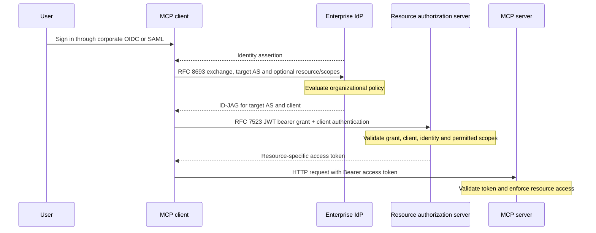

# MCP enterprise-managed authorization

> Corporate identity can authorize a client to obtain server-specific MCP access tokens; the enterprise IdP participates in issuance, while the resource server still enforces access to its own data and actions.

## What it is

Enterprise-Managed Authorization is the stable MCP extension identified by `io.modelcontextprotocol/enterprise-managed-authorization`. It replaces repeated per-service user consent with an enterprise-policy-mediated identity exchange: log in to a client through corporate OIDC or SAML, obtain an ID-JAG from the IdP, then exchange that grant at the resource authorization server for an MCP access token. It preserves a person as the delegated subject; the separate OAuth Client Credentials extension represents an application or service without interactive user delegation. Both extend the base HTTP authorization contract rather than replacing token audience, scopes and server-side enforcement. [[sources/modelcontextprotocol--mcp-authorization-docs#enterprise-flow]], [[sources/modelcontextprotocol--mcp-authorization-docs#client-credentials]], [[sources/modelcontextprotocol--mcp-authorization-docs#base-token-boundaries]]

The distinction matters because **SSO login, authority to obtain a token, authority for a tool operation, and confirmation of a particular business action are different decisions**. The first three have documented identity/token boundaries here; this extension does not create a domain approval workflow for the fourth. That last distinction is an architectural inference from the profile's explicitly limited policy scope, not a new MCP requirement. [[sources/modelcontextprotocol--mcp-authorization-docs#enterprise-policy-limit]], [[patterns/behavioral/context-is-not-authority]]

## Where it came from

The official ext-auth repository lists Enterprise-Managed Authorization and OAuth Client Credentials as stable extensions under the MCP governance process and Authorization Interest Group. This review pins their **2026-07-28** specifications at ext-auth commit `15ca394e00a66434520b9ade26294999295a43ae`. The enterprise profile reuses OIDC/SAML, OAuth Token Exchange (RFC 8693) and JWT authorization grants (RFC 7523), with detailed processing rules linked to **ID-JAG draft-04**. The currently resolving IETF document was **draft-06** when captured; the stable MCP label does not turn that dependency into an RFC or prove cross-revision compatibility. [[sources/modelcontextprotocol--mcp-authorization-docs#extension-status]], [[sources/modelcontextprotocol--mcp-authorization-docs#enterprise-flow]], [[sources/modelcontextprotocol--mcp-authorization-docs#id-jag-version-drift]]

## Why it matters

A business agent needs a consistent answer to “which person or service may use which system through which client?” Enterprise-managed auth moves part of that decision to existing corporate identity policy instead of making every employee grant every connection separately. It also preserves the destination authorization server's control over the token it issues. This can reduce connection friction, but practical value depends on a compatible host, IdP, resource authorization server and resource permission model; a stable specification is only one part of that chain. [[sources/modelcontextprotocol--mcp-authorization-docs#enterprise-overview]], [[sources/modelcontextprotocol--mcp-authorization-docs#enterprise-token-and-discovery]], [[sources/modelcontextprotocol--mcp-authorization-docs#id-jag-processing]], [[sources/modelcontextprotocol--mcp-authorization-docs#support-caveats]]

## Evidence & claims

### Three authorization modes, three identity meanings

| Mode | Subject and interaction | Mechanism | Appropriate boundary |
| --- | --- | --- | --- |
| Base HTTP MCP authorization | A resource owner delegates through an interactive authorization flow | OAuth authorization code with PKCE, resource targeting, discovery and token validation | Person connecting a service under the base contract |
| Enterprise-managed | A person signs into the MCP client through enterprise SSO; organizational policy mediates later service grants | Identity assertion → IdP token exchange → ID-JAG → resource-AS JWT bearer grant → MCP token | Corporate user access through approved clients and servers |
| OAuth Client Credentials | Application/service identity, no end user present | Pre-registered client credentials; `grant_type=client_credentials`, authenticated by signed JWT or secret | Scheduled jobs, CI, daemons and server integrations |

These are documented protocol roles/use cases, not interchangeable labels for the same token. Enterprise-managed flows may require renewed SSO/step-up even though they avoid a separate authorization redirect to each resource AS. [[sources/modelcontextprotocol--mcp-authorization-docs#base-contract]], [[sources/modelcontextprotocol--mcp-authorization-docs#enterprise-flow]], [[sources/modelcontextprotocol--mcp-authorization-docs#client-credentials]], [[sources/modelcontextprotocol--mcp-authorization-docs#id-jag-processing]]

### Base authorization still supplies the foundation

The HTTP MCP server is an OAuth resource server; the client obtains tokens from its authorization server. Authorization is optional in MCP overall, HTTP implementations supporting authorization SHOULD follow this contract, and stdio SHOULD instead obtain credentials from the environment. This does not mean environment credentials are automatically safe: the security guidance treats local process compromise as a separate threat. [[sources/modelcontextprotocol--mcp-authorization-docs#base-contract]], [[sources/modelcontextprotocol--mcp-authorization-docs#security]]

A protected resource publishes its authorization server(s) using RFC 9728 metadata. Clients support the `WWW-Authenticate` resource-metadata challenge and well-known fallback, then discover and validate the selected issuer's metadata. Different authorization servers retain separate registration state; discovery of a new server does not authorize sending an old issuer's client credentials there. The client-registration document prioritizes available preregistration, then supported Client ID Metadata Documents, then supported DCR fallback, then manual information. DCR is not universally mandatory. [[sources/modelcontextprotocol--mcp-authorization-docs#base-discovery]], [[sources/modelcontextprotocol--mcp-authorization-docs#base-registration]]

The client targets its MCP resource through `resource`, includes Bearer authorization on **every HTTP request**, and does not put access tokens in URL query strings. The server validates that tokens are intended for its own resources; unrelated tokens must not be accepted or passed through. An MCP gateway talking to a downstream SaaS therefore needs a separate downstream authorization relationship rather than treating the incoming MCP access token as a universal SaaS token. The gateway conclusion follows from the prohibition; it is not an assertion that any gateway in this wiki implements it. [[sources/modelcontextprotocol--mcp-authorization-docs#base-token-boundaries]], [[sources/modelcontextprotocol--mcp-authorization-docs#security]]

Scopes express granted operation categories. A challenge's required scopes are authoritative for the current request, not necessarily a subset of `scopes_supported`. Clients request least privilege and can perform step-up authorization on insufficient scope; resource metadata should expose a minimal baseline rather than force every powerful scope at connection time. Precise authorization to a business record still depends on the resource's own policy and scope design. [[sources/modelcontextprotocol--mcp-authorization-docs#base-scopes]], [[sources/modelcontextprotocol--mcp-authorization-docs#enterprise-policy-limit]]

### Enterprise exchange, step by step

The diagram distills the stable specification; it does not imply an IdP proxies MCP traffic. [[sources/modelcontextprotocol--mcp-authorization-docs#enterprise-flow]], [[sources/modelcontextprotocol--mcp-authorization-docs#enterprise-token-and-discovery]], [[sources/modelcontextprotocol--mcp-authorization-docs#enterprise-policy-limit]]

1. **Authenticate the person.** OIDC gives the client an ID token. In the SAML branch, the profile first obtains an IdP refresh token by token exchange. These assertions start the chain; they are not sent as MCP resource access tokens. [[sources/modelcontextprotocol--mcp-authorization-docs#enterprise-flow]]
2. **Ask the IdP for a purpose-specific grant.** At the IdP **token endpoint**, send `grant_type=urn:ietf:params:oauth:grant-type:token-exchange`, `requested_token_type=urn:ietf:params:oauth:token-type:id-jag`, the subject token and scopes. `audience` MUST be the resource AS issuer; optional `resource` identifies the MCP server. IdP policy determines whether this client may act for this person toward that destination. The overview's implementation prose says “authorization endpoint,” but the stable profile specifies the token endpoint; the latter governs this description. [[sources/modelcontextprotocol--mcp-authorization-docs#enterprise-flow]], [[sources/modelcontextprotocol--mcp-authorization-docs#enterprise-overview]]
3. **Keep token purposes separate.** The ID-JAG is a signed JWT with `typ=oauth-id-jag+jwt`, target-AS `aud`, person `sub`, intended `client_id`, expiry and optional resource/scope context. The token-exchange response puts this grant in an `access_token` field with `token_type=N_A`; the field name does not make it a resource Bearer token. [[sources/modelcontextprotocol--mcp-authorization-docs#enterprise-flow]], [[sources/modelcontextprotocol--mcp-authorization-docs#oauth-token-exchange]]
4. **Redeem at the resource AS.** Send `grant_type=urn:ietf:params:oauth:grant-type:jwt-bearer` and `assertion=<ID-JAG>`, plus applicable client authentication. The AS validates type/signature/issuer, audience and client continuity; its policy can narrow scopes/resources. The resulting access token MUST be audience restricted to the MCP resource identified by the ID-JAG resource claim. [[sources/modelcontextprotocol--mcp-authorization-docs#enterprise-token-and-discovery]], [[sources/modelcontextprotocol--mcp-authorization-docs#id-jag-processing]]
5. **Discover actual grant support.** Resource-AS metadata advertises `urn:ietf:params:oauth:grant-profile:id-jag` in `authorization_grant_profiles_supported`. The client also declares the MCP extension in per-request `io.modelcontextprotocol/clientCapabilities.extensions`; these are different discovery layers. An extension field does not establish that the IdP or AS supports the required exchange. [[sources/modelcontextprotocol--mcp-authorization-docs#enterprise-token-and-discovery]], [[sources/modelcontextprotocol--mcp-authorization-docs#enterprise-overview]]

### JWT grant and JWT client authentication are different

| JWT use | OAuth field | What it establishes |
| --- | --- | --- |
| Enterprise ID-JAG authorization grant | `assertion` with JWT bearer `grant_type` | An IdP-authorized delegation for the person, target AS and client |
| Signed JWT client authentication | `client_assertion` plus assertion type | The OAuth client proves its own identity using its registered key |
| MCP access token | `Authorization: Bearer ...` | The resource AS's grant accepted by the MCP resource |

A request can combine an authorization grant with client authentication; neither should be substituted for the other. The OAuth Client Credentials extension recommends the second JWT use for service identity, not an ID-JAG for an employee. JWT is an encoding/signature mechanism, not a single authority type. [[sources/modelcontextprotocol--mcp-authorization-docs#oauth-jwt-purpose]], [[sources/modelcontextprotocol--mcp-authorization-docs#client-credentials]], [[sources/modelcontextprotocol--mcp-authorization-docs#enterprise-token-and-discovery]]

### What centralized policy does and does not establish

The enterprise profile explicitly limits IdP visibility to **token issuance**, excluding actual MCP traffic. It can govern combinations of user, client, server and available scopes, with effectiveness tied to how scopes express resource permissions. It does not specify per-tool invocation logging at the IdP, domain-record authorization, transaction approval or a complete agent governance platform. Those limitations follow from the written scope; they are not claims that no vendor can add them. [[sources/modelcontextprotocol--mcp-authorization-docs#enterprise-policy-limit]]

**Revocation needs qualification.** The overview claims immediate centralized revocation. The stable profile specifies no continuous policy channel to resource servers and even shows an access token with `expires_in=86400` (an example, not a required lifetime). The linked ID-JAG draft recommends against resource-AS refresh tokens, steering renewal back through the IdP. This gives the IdP another policy decision when a new grant is needed; it does **not** by itself prove that every already-issued resource token stops working immediately after offboarding. Required access-token lifetimes, revocation/introspection behavior, policy rechecks and any continuous-access mechanism must be verified in the actual deployment. [[sources/modelcontextprotocol--mcp-authorization-docs#enterprise-overview]], [[sources/modelcontextprotocol--mcp-authorization-docs#enterprise-token-and-discovery]], [[sources/modelcontextprotocol--mcp-authorization-docs#enterprise-policy-limit]], [[sources/modelcontextprotocol--mcp-authorization-docs#id-jag-renewal]]

**Identity linking needs tenant context.** The overview recommends a stable subject and only secondary email matching for old accounts. The linked draft further distinguishes issuer- and tenant-scoped subject identity; a naked `sub` or email match is not a sufficient global account key. Which claims a provider emits and which draft it follows need explicit agreement. The current draft-06 adds/revises identity/tenant material, so do not import its claims into a draft-04 integration without review. [[sources/modelcontextprotocol--mcp-authorization-docs#enterprise-overview]], [[sources/modelcontextprotocol--mcp-authorization-docs#id-jag-processing]], [[sources/modelcontextprotocol--mcp-authorization-docs#id-jag-version-drift]]

### Client credentials: simpler flow, different authority

The stable extension `io.modelcontextprotocol/oauth-client-credentials` is for HTTP machine-to-machine use and requires preregistered credentials established out of band; DCR is not used in this flow. It recommends RFC 7523 JWT client authentication and permits a client secret. The request uses `grant_type=client_credentials`, a target `resource` and needed scopes. Application credentials still require issuer-bound storage and resource enforcement; eliminating the browser does not eliminate those boundaries. [[sources/modelcontextprotocol--mcp-authorization-docs#client-credentials]], [[sources/modelcontextprotocol--mcp-authorization-docs#base-registration]], [[sources/modelcontextprotocol--mcp-authorization-docs#base-token-boundaries]]

The official overview documents TypeScript client-secret and private-key providers, plus a Python client-credentials provider. Examples pin `expectedIssuer`/`issuer` so discovered server metadata cannot redirect existing credentials to an arbitrary AS. This study verified the documentation examples, **not** installed package versions or automatic-refresh runtime behavior. [[sources/modelcontextprotocol--mcp-authorization-docs#credential-providers]]

### Support status and spec rough edges

- Both authorization extensions are **Stable** in the captured official repo. Stable is specification maturity, not a claim that every host supports them. [[sources/modelcontextprotocol--mcp-authorization-docs#extension-status]]
- The community client matrix has predominantly empty cells; absence of an entry is not negative proof of support. The enterprise overview separately lists IdP issuers and accepting AS vendors under Available/Early access/Experimental labels and warns about differing ID-JAG revisions. Those listings were captured but not independently validated against each vendor. [[sources/modelcontextprotocol--mcp-authorization-docs#support-caveats]]
- Client-credentials metadata requires at least `private_key_jwt` or `client_secret_basic`, while the secret-auth prose and example put the secret in request content. That mismatch is captured as an interoperability question; do not silently assume `client_secret_post` support from a `client_secret_basic` advertisement. [[sources/modelcontextprotocol--mcp-authorization-docs#client-credentials]]
- The enterprise profile makes `resource` optional in the IdP exchange but subsequently requires access-token restriction to the MCP resource identified in that claim. Deployments need to agree on resource targeting when it is omitted; this study does not invent the missing behavior. [[sources/modelcontextprotocol--mcp-authorization-docs#enterprise-flow]], [[sources/modelcontextprotocol--mcp-authorization-docs#enterprise-token-and-discovery]]

## Patterns demonstrated

- [[patterns/behavioral/context-is-not-authority]] — relevant identity/context and declared extension support do not grant arbitrary resource actions; authority passes through a validated destination-specific token. Documentation correspondence, not an independent enforcement test. [[sources/modelcontextprotocol--mcp-authorization-docs#base-token-boundaries]], [[sources/modelcontextprotocol--mcp-authorization-docs#enterprise-policy-limit]]
- [[patterns/composition/negotiated-capability-intersection]] — related but narrower: extension support and OAuth grant-profile discovery must align across parties. MCP auth does not by itself demonstrate Shopify-style version/dependency pruning, so this page is not sufficient to confirm that whole proposed pattern. [[sources/modelcontextprotocol--mcp-authorization-docs#enterprise-token-and-discovery]], [[sources/modelcontextprotocol--mcp-authorization-docs#support-caveats]]
- [[patterns/quality-bar/revision-bound-review]] — a stable MCP profile and its linked IETF draft must be assessed as a particular revision pair; reviewing the current draft alone can miss the deployed contract. [[sources/modelcontextprotocol--mcp-authorization-docs#id-jag-version-drift]]

## Tensions & counter-arguments

- **Central control versus resource sovereignty:** the IdP decides whether to issue a delegation grant; the resource AS still decides which resources/scopes it honors, and the resource server enforces its token. Central issuance policy is therefore part of authorization, not a transfer of every resource permission decision to the IdP. [[sources/modelcontextprotocol--mcp-authorization-docs#id-jag-processing]], [[sources/modelcontextprotocol--mcp-authorization-docs#enterprise-policy-limit]]
- **Less consent friction versus intentional delegation:** removing per-server prompts is a stated enterprise benefit, but relies on administrator configuration and established trust. The linked draft recommends confidential clients and directs public clients toward the ordinary interactive code flow. This cannot be treated as a universal login shortcut for any client. [[sources/modelcontextprotocol--mcp-authorization-docs#enterprise-flow]], [[sources/modelcontextprotocol--mcp-authorization-docs#id-jag-processing]]
- **Stable extension versus evolving dependency:** the MCP extension is stable, while the ID-JAG definition remains an IETF Internet-Draft, with multiple referenced revisions in circulation. Stable does not imply final standard or compatible implementation. [[sources/modelcontextprotocol--mcp-authorization-docs#extension-status]], [[sources/modelcontextprotocol--mcp-authorization-docs#id-jag-version-drift]]
- **Signed token versus replay resistance:** RFC 7523 requires signature/claims checks but does not itself mandate replay protection. Provider policy and the selected grant profile determine additional defenses; this study makes no replay-resistance claim. [[sources/modelcontextprotocol--mcp-authorization-docs#oauth-jwt-purpose]]

## Timeline (append-only)

- 2026-11-04 — Ingested stable revision 2026-07-28 auth specs and official docs, with ID-JAG drafts 04/06 captured separately. Identified overview/spec disagreements about immediate revocation and the exchange endpoint, plus a client-secret metadata/prose mismatch. Documentation-only research; no enterprise flow executed. [[sources/modelcontextprotocol--mcp-authorization-docs#root]]

## Related

- [[concepts/model-context-protocol]] — base protocol, transport and capability boundaries.
- [[concepts/mcp-extension-architecture]] — extension discovery/maturity and compatibility independent of auth.
- [[artifacts/projects/mcp-apps]] — an embedded interface still needs resource authorization; rendering capability does not establish permission.
- [[artifacts/projects/openai-mcp-extensions]] — vendor extension metadata is a different layer from these official authorization profiles.
- [[concepts/agent-control-plane]] — identity/grants are one control dimension, not the whole execution/approval/audit system.
- [[concepts/business-platform-api-design]] — domain permissions and business operations remain owned by the platform.
- [[analyses/mcp-and-extensions]] — cross-layer synthesis.

## What we'd steal

- ★ Preserve distinct identities for the **human**, **OAuth client/application**, **enterprise/tenant**, **resource AS** and **resource server**; document each trust edge. [[sources/modelcontextprotocol--mcp-authorization-docs#enterprise-flow]], [[sources/modelcontextprotocol--mcp-authorization-docs#id-jag-processing]]
- ★ Use a separate grant for each trust-domain crossing; do not reuse the SSO ID token or an unrelated SaaS access token as MCP authorization. [[sources/modelcontextprotocol--mcp-authorization-docs#enterprise-flow]], [[sources/modelcontextprotocol--mcp-authorization-docs#base-token-boundaries]]
- ★ Bind stored client credentials to the issuer that provisioned them and reject unexpected discovered issuers before transmitting credentials. [[sources/modelcontextprotocol--mcp-authorization-docs#base-registration]], [[sources/modelcontextprotocol--mcp-authorization-docs#credential-providers]]
- ★ Measure real offboarding with an already-issued token; record the observed cutoff time and governing token/revocation policy rather than promising immediate revocation from SSO alone. This is a proposed acceptance test derived from the overview/spec tension. [[sources/modelcontextprotocol--mcp-authorization-docs#enterprise-policy-limit]], [[sources/modelcontextprotocol--mcp-authorization-docs#enterprise-token-and-discovery]]
- Keep compatibility declarations, organizational issuance policy, resource permissions and action approvals in separate reviewable fields. [[sources/modelcontextprotocol--mcp-authorization-docs#support-caveats]], [[sources/modelcontextprotocol--mcp-authorization-docs#enterprise-policy-limit]]
- Use per-user enterprise delegation for human work and explicitly authorized service credentials for unattended work; do not erase attribution by treating all background jobs as a shared employee. [[sources/modelcontextprotocol--mcp-authorization-docs#enterprise-flow]], [[sources/modelcontextprotocol--mcp-authorization-docs#client-credentials]]
- Scope the token to the intended resource and minimum operation set; design scopes granularly enough for useful enterprise policy. [[sources/modelcontextprotocol--mcp-authorization-docs#base-scopes]], [[sources/modelcontextprotocol--mcp-authorization-docs#enterprise-policy-limit]]
- Put Bearer authorization on every HTTP request; keep tokens out of query strings and logs. The log exclusion is a storage/handling application, not a complete audit policy prescribed here. [[sources/modelcontextprotocol--mcp-authorization-docs#base-token-boundaries]], [[sources/modelcontextprotocol--mcp-authorization-docs#client-credentials]]
- Prefer short-lived signed client assertions where supported; keep signing keys in managed storage and plan rotation. Verify replay policy separately. [[sources/modelcontextprotocol--mcp-authorization-docs#credential-providers]], [[sources/modelcontextprotocol--mcp-authorization-docs#oauth-jwt-purpose]]
- Key accounts with issuer/tenant/subject context rather than global email assumptions; make legacy account linking explicit. [[sources/modelcontextprotocol--mcp-authorization-docs#id-jag-processing]], [[sources/modelcontextprotocol--mcp-authorization-docs#enterprise-overview]]
- Preserve exact profile and dependency versions in compatibility evidence. A current living overview, stable profile revision and IETF draft are three different version signals. [[sources/modelcontextprotocol--mcp-authorization-docs#id-jag-version-drift]], [[sources/modelcontextprotocol--mcp-authorization-docs#extension-status]]
- Retain ambiguity as an implementation question when the metadata and examples differ; add an interoperable test only after choosing the intended contract. [[sources/modelcontextprotocol--mcp-authorization-docs#client-credentials]]
- Publish a support matrix that distinguishes unverified/blank from tested unsupported, and issuer support from accepting-AS support. [[sources/modelcontextprotocol--mcp-authorization-docs#support-caveats]]
- Test malicious discovery URLs, wrong audiences, cross-tenant subject collisions, insufficient scopes and stolen state handles as separate cases; these follow from distinct documented threat classes. [[sources/modelcontextprotocol--mcp-authorization-docs#security]], [[sources/modelcontextprotocol--mcp-authorization-docs#id-jag-processing]]

## Open questions

- Which concrete MCP host, IdP and resource AS combination is intended, and which exact ID-JAG draft does each implement? Vendor overview listings are captured, not independently verified.
- What token lifetime, revocation/introspection or continuous-policy mechanism enforces a real offboarding deadline for already-issued access tokens?
- How does the selected provider handle an omitted ID-JAG `resource`, multi-resource grants, tenant scoping and account linking?
- Which secret-auth method resolves the pinned client-credentials spec's `client_secret_basic` advertisement versus body-secret example mismatch?
- Which installed SDK versions actually implement the documented provider APIs and refresh behavior? No SDK execution was performed.
- Which domain actions require human confirmation beyond issuance policy, and where is the resulting audit event recorded? That is outside this extension's documented visibility.
