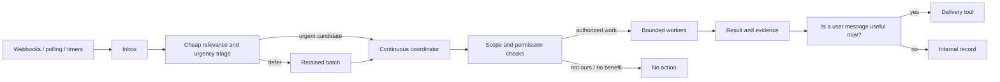

# proactive-agent-discernment

> An always-available agent must decide separately whether to wake, whether useful authorized work exists, and whether the result warrants interrupting a person.

## What it is

Discernment is the judgment required to turn a stream of ambient events into useful, appropriately scoped action. Rubric proposes one continuous user-facing conversation, agent-controlled compaction, delegated workers, scheduled heartbeats, an event inbox and explicit messaging tools. The architectural pieces enable opportunities; they do not establish that acting is wanted, permitted or useful. A model can complete assigned tasks well while still misreading whether an unassigned task belongs to it. [[sources/rubriclabs--always-on-agents#continuity]] [[sources/rubriclabs--always-on-agents#wake]] [[sources/rubriclabs--always-on-agents#communication]] [[sources/rubriclabs--always-on-agents#discernment]]

This page owns **wake/action/notification decisions and feedback calibration**, not general agent hosting. [[concepts/super-agent-architecture]] already owns continuous routing and concurrent workers; [[concepts/agent-control-plane]] owns durable task/session/host separation. [[concepts/agent-memory-consolidation]] owns how learned context is retained and revised. Those are dependencies and comparisons, not duplicate definitions.

## Where it came from

Dexter Storey's *Designing an Always-On Agent*, November 5, 2026, plus both substantive linked Rubric articles: the August harness taxonomy and October Jev examples. These are architecture commentary, reported engineering experience and an explicitly exploratory classifier comparison. The claims that form factor explains AGI disagreement and that task-centric RL causes weak discernment are author hypotheses, not established findings. [[sources/rubriclabs--always-on-agents#root]] [[sources/rubriclabs--always-on-agents#training-hypothesis]] [[sources/rubriclabs--jev-use-cases#comparison]]

## Why it matters

A system can wake on every event, spend tokens on irrelevant work and produce impressive-looking artifacts that nobody requested. Conversely, filtering too aggressively can hide real opportunities. Attention, compute, contextual freshness and authority are different constraints. The design target is not maximum autonomous activity: it is useful interventions with tolerable misses and interruptions, measured under the actual user's scope. That metric framing is our synthesis of the article's over-action/missed-trigger examples. [[sources/rubriclabs--always-on-agents#notifications]] [[sources/rubriclabs--always-on-agents#discernment]] [[sources/rubriclabs--always-on-agents#learning-lane]]

## Architecture

Inbox/filter/heartbeat/dispatch/message separation comes from Rubric. The explicit permission checkpoint, evidence handback and bounded workers are **our adaptation** grounded in the harness's execution-authority distinction and existing [[patterns/behavioral/context-is-not-authority]] research, not an implementation claimed in the essay. [[sources/rubriclabs--always-on-agents#triage]] [[sources/rubriclabs--always-on-agents#dispatch]] [[sources/rubriclabs--always-on-agents#communication]] [[sources/rubriclabs--agent-harness#tools-authority]]

## Evidence & claims

### Continuity is an interface property

The main conversation keeps higher-level context while subagents do slow work. Thus single-threaded does not mean a single worker, one blocking function or one permanently executing inference call. Fold/drop tools and per-turn token awareness let the agent choose when to reduce active context. Rubric reports better momentum when agents compact at lulls, but supplies no controlled comparison, API schema, restart contract or complete transcript-retention design. Do not infer that summaries preserve every obligation or that dropping active messages destroys the audit record. [[sources/rubriclabs--always-on-agents#continuity]] [[sources/rubriclabs--always-on-agents#context]] [[sources/rubriclabs--always-on-agents#dispatch]]

### Waking, working and speaking are separate decisions

A heartbeat may be periodic or self-scheduled; notification events can accelerate response. Explicit delivery lets the agent wake, do internal work and stay silent. Travel preparation and arrival-time messaging illustrate temporal separation, not demonstrated flight tracking or effect authorization. This transport design is source-specific: an assistant whose final messages auto-deliver must not assume its final answer is a private note. [[sources/rubriclabs--always-on-agents#wake]] [[sources/rubriclabs--always-on-agents#communication]]

### Access is neither awareness nor mandate

Broad email/browser/filesystem access makes context discoverable; subscriptions make changes visible sooner. Neither means the agent owns every message or may take every possible action. The article's failed Slack intervention ends in an unwanted design document after mandate/access/context were missing. A permissive environment can therefore worsen busywork as well as expand capability. [[sources/rubriclabs--always-on-agents#awareness]] [[sources/rubriclabs--always-on-agents#notifications]] [[sources/rubriclabs--always-on-agents#discernment]]

### The cheap filter is a prediction, not a policy authority

The linked Jev example asks two separate questions—whether action is needed and whether it is time-sensitive—then uses **80% for each** as an application-selected threshold. It omits personal context and explains how that changes priorities. This is not an 80%-reliable policy or a recommended production cutoff. A fixed-choice classifier can also rank irrelevant options: a separate answer-exists test provides an abstention path. These examples motivate evaluating false negatives and delayed-batch recovery alongside avoided wakeups. [[sources/rubriclabs--jev-use-cases#notifications]] [[sources/rubriclabs--jev-use-cases#relevance]] [[sources/rubriclabs--always-on-agents#triage]]

### The reported comparison is not a calibrated production benchmark

| Reported measure | Jev 1.13 | GPT-6 Luna Decisions | Clef 27B |
| --- | ---: | ---: | ---: |
| Overall accuracy | 96% | 91% | 86% |
| Median latency | 211 ms | 239 ms | 471 ms |
| Cost / 1,000 requests | $0.13 | $0.23 | $0.73 |
| Same answer across three runs | 99% | 100% | 100% |

These are Rubric's results on **101 hand-labeled scenarios**, repeated three times/model: 36 spelling, 20 notifications, 25 search and 20 settings. Prompts were written for Jev, and some labels changed after an initial run. Consistency does not imply correctness; average accuracy does not establish probability calibration, personal relevance or safety. The provider comparisons and larger vendor speed/cost claims were not independently reproduced. [[sources/rubriclabs--jev-use-cases#comparison]] [[sources/rubriclabs--jev-use-cases#limits]]

### Learning a useful lane is not learning unrestricted permission

Rubric recommends clear responsibility, permission to do nothing, clarification when ownership is genuinely uncertain, and consulting records of user reactions before intervening again. Our qualification: thanks, correction and nonresponse are noisy feedback; silence is not approval or necessarily rejection. Prior authorization should be retained, not repeatedly requested, and model confidence should not expand the granted scope. [[sources/rubriclabs--always-on-agents#learning-lane]] [[sources/deepseek-ai--dsh-superagent-prototype#authorization]]

## Patterns demonstrated

- [[patterns/behavioral/context-is-not-authority]] — relevant context and a high triage score do not establish a mandate. [[sources/rubriclabs--always-on-agents#discernment]] [[sources/rubriclabs--agent-harness#tools-authority]]
- [[patterns/behavioral/latent-vs-deterministic-split]] — model predicts importance; application owns thresholds, scheduling, delivery and execution rules. [[sources/rubriclabs--always-on-agents#triage]] [[sources/rubriclabs--jev-use-cases#root]]
- [[patterns/behavioral/diarization]] — feedback should become scoped, revisable lessons rather than repeated unexamined action. [[sources/rubriclabs--always-on-agents#learning-lane]]
- [[patterns/behavioral/evidence-gated-completion]] — a delegated result or polished document is not proof that the right work was done. [[sources/rubriclabs--always-on-agents#discernment]] [[sources/rubriclabs--agent-harness#verification]]
- [[patterns/composition/resolver-routing-table]] — a cheap first-stage decision routes expensive reasoning rather than treating all notifications alike. [[sources/rubriclabs--always-on-agents#triage]]

## Tensions & counter-arguments

- **Availability versus cost:** more frequent wakeups reduce detection delay but consume tokens and add distracting context. Neither article provides an always-on workload/cost curve. [[sources/rubriclabs--always-on-agents#notifications]]
- **Single voice versus boundaries:** one assistant can reduce user coordination while still needing separate data scopes, worker ownership and task state. A unified conversation is not a privacy architecture. [[sources/rubriclabs--always-on-agents#continuity]] [[sources/rubriclabs--agent-harness#orchestration]]
- **Self-compaction versus forgetting:** model-chosen compression may preserve momentum, but the model can drop unfinished commitments or important contrary evidence. Raw-history retention and recovery must be designed separately. [[sources/rubriclabs--always-on-agents#context]] [[sources/openai--codex#trace]]
- **Conservative start versus missed benefit:** allowing silence avoids performative work but requires evaluating genuine missed triggers too. Maximizing precision by never acting is not a useful assistant. [[sources/rubriclabs--always-on-agents#discernment]]
- **Feedback versus endorsement:** reaction memory can personalize judgment, but response signals are ambiguous and must not override explicit instructions or authorization. [[sources/rubriclabs--always-on-agents#learning-lane]]
- **Prediction versus enforcement:** classifiers and LLM permission reviewers can fail; neither a small model nor a named transport protocol supplies the business policy by itself. [[sources/rubriclabs--agent-harness#permissions]]
- **Source maturity:** Rubric reports building this architecture, but the captured post does not expose deployment evidence, durability tests, intervention-quality datasets or a calibrated reward model. [[sources/rubriclabs--always-on-agents#root]] [[sources/rubriclabs--always-on-agents#training-hypothesis]]

## Timeline

- 2026-08-10 — Harness field guide introduces the broader functional taxonomy. [[sources/rubriclabs--agent-harness#root]]
- 2026-10-07 — Jev article describes structured decision primitives and exploratory comparisons. [[sources/rubriclabs--jev-use-cases#root]]
- 2026-11-05 — Always-on article names discernment as the main behavioral bottleneck. [[sources/rubriclabs--always-on-agents#root]]
- 2026-11-08 — Full prose of all three articles captured/read; static illustrations and comparison table preserved. No live demos, policy changes or new autonomous jobs.

## Related

- [[concepts/super-agent-architecture]] — shared attention budget, continuous router and workers.
- [[concepts/agent-control-plane]] — durable work ownership beneath a continuous interface.
- [[concepts/agent-memory-consolidation]] — validated memory rather than accumulated guesses.
- [[concepts/artifact-centered-agent-context]] — task artifacts versus broad standing preferences.
- [[concepts/durable-agent-execution]] — timers and context persistence do not prove replay safety.
- [[concepts/agent-habitat-architecture]] — independent execution/authority boundaries.
- [[concepts/evidence-calibrated-research]] — distinguish demonstrations, scoped measurements and universal claims.
- [[artifacts/projects/vercel-schedules]] — documented timing/delivery contracts missing from the essay.
- [[artifacts/projects/dsh-superagent-prototype]] — separate context and mandate machinery in a studied implementation.

## What we'd steal

The following are portable design judgments from the sources; adaptations are not claims of implemented Rubric guarantees.

1. **★ Separate wake, action and notification decisions.** An event worth examining may justify neither an external effect nor a message. [[sources/rubriclabs--always-on-agents#communication]]

2. **Offer one continuous counterpart without one blocking worker.** Keep the coordinator responsive while delegated work proceeds. [[sources/rubriclabs--always-on-agents#continuity]]

3. **Keep detailed execution out of the main context.** Return bounded outcomes and evidence instead of copying all worker exploration. [[sources/rubriclabs--always-on-agents#dispatch]]

4. **Expose the context budget to the agent.** Make remaining capacity visible early enough to avoid forced surprise compression. [[sources/rubriclabs--always-on-agents#context]]

5. **Give folding and dropping different semantics.** Summarize selected spans versus removing them from active context; define raw-record retention separately. [[sources/rubriclabs--always-on-agents#context]]

6. **Compact around task boundaries where possible.** Preserve still-open commitments and re-entry cues; test the hypothesis that this improves continuity. [[sources/rubriclabs--always-on-agents#context]]

7. **Treat always-on as availability, not continuous inference.** Use events and timed wakeups instead of an unbounded busy loop. [[sources/rubriclabs--always-on-agents#wake]]

8. **Let the agent request future attention.** Schedule a return when it becomes useful, while the host owns actual dispatch and lifecycle. [[sources/rubriclabs--always-on-agents#wake]]

9. **Separate preparation time from delivery time.** Prepare travel context early; surface it when it helps, after checking that circumstances have not changed. [[sources/rubriclabs--always-on-agents#communication]]

10. **Give silence an explicit successful outcome.** No useful action or message is acceptable; do not manufacture a deliverable to justify waking. [[sources/rubriclabs--always-on-agents#learning-lane]]

11. **Keep internal notes separate from user delivery.** Verify the actual channel transport so scratch output cannot accidentally become a message. [[sources/rubriclabs--always-on-agents#communication]]

12. **Pair discoverability with timely events.** Access to files/email can answer a question, but subscriptions/polling are needed to notice changes. [[sources/rubriclabs--always-on-agents#awareness]]

13. **Use a common inbox for heterogeneous triggers.** Adapt webhooks, polling and timers into inspectable event records; event identity/deduplication are additional host requirements. [[sources/rubriclabs--always-on-agents#notifications]]

14. **★ Filter before waking the expensive coordinator.** A small relevance model can reduce interruption and context noise, subject to measured miss rates. [[sources/rubriclabs--always-on-agents#triage]]

15. **Retain deferred items for later inspection.** Low priority should mean batched attention, not silently discarded evidence. [[sources/rubriclabs--always-on-agents#triage]]

16. **Separate action need from urgency.** A task may be important but deferrable, or time-sensitive but not this agent's responsibility. [[sources/rubriclabs--jev-use-cases#notifications]]

17. **Supply scope and user context to triage.** Generic work criteria can misclassify a particular person's priorities; more context still does not grant permission. [[sources/rubriclabs--jev-use-cases#notifications]]

18. **★ Give ranking an abstention path.** Top-ranked does not mean relevant; ask whether any candidate actually satisfies the request. [[sources/rubriclabs--jev-use-cases#relevance]]

19. **Calibrate thresholds to the decision and error costs.** 80%, 60%, 50% and 35% are different demo choices, not universal confidence rules. [[sources/rubriclabs--jev-use-cases#thresholds]] [[sources/rubriclabs--jev-use-cases#bounded-composition]] [[sources/rubriclabs--jev-use-cases#relevance]]

20. **Stop uncertain hierarchical routing at a useful boundary.** Return the current menu/cluster instead of pretending an uncertain leaf is correct. [[sources/rubriclabs--jev-use-cases#bounded-composition]]

21. **Bound judge-and-rewrite loops.** Use an explicit criterion and attempt cap; meeting the judge threshold is not proof of objective quality. [[sources/rubriclabs--jev-use-cases#bounded-composition]]

22. **★ Distinguish related context from an assigned lane.** Check ownership/mandate before turning ambient conversation into work. [[sources/rubriclabs--always-on-agents#discernment]]

23. **Preserve existing authorization; clarify genuine ownership gaps.** Do not restart approval for already-authorized work, and do not guess that an unrelated request is yours. [[sources/rubriclabs--always-on-agents#learning-lane]]

24. **Do not substitute unsolicited artifacts for missing mandate.** A design document is not compensation for lacking permission, access or necessary context. [[sources/rubriclabs--always-on-agents#discernment]]

25. **Learn from reaction history with provenance.** Record what was done, the relevant scope and actual feedback; distinguish observed correction from inferred preference. [[sources/rubriclabs--always-on-agents#learning-lane]]

26. **Treat nonresponse as ambiguous.** Ignoring a message is neither explicit approval nor a clean rejection label; avoid updating policy from silence alone. [[sources/rubriclabs--always-on-agents#learning-lane]]

27. **Revisit memory before repeating proactive behavior.** Use the narrow lesson relevant to this user/task rather than turning one correction into a universal rule. [[sources/rubriclabs--always-on-agents#learning-lane]]

28. **Keep execution permission independent of prediction.** A classifier's importance score or an agent's certainty cannot replace authenticated tool policy. [[sources/rubriclabs--agent-harness#tools-authority]]

29. **Measure missed opportunities as well as busywork.** Evaluate both unwarranted interventions and eligible events left unattended; track notification burden and usefulness separately. [[sources/rubriclabs--always-on-agents#discernment]]

30. **Separate classifier quality from end-to-end value.** Fast correct triage can still initiate a wrong task or produce an unnecessary message. [[sources/rubriclabs--jev-use-cases#notifications]]

31. **Preserve comparison conditions and revisions.** Record prompt tuning, revised labels, scenario mix, repeats, latency and cost; do not generalize a small comparison into a model ranking. [[sources/rubriclabs--jev-use-cases#comparison]]

32. **Require evidence before adopting discernment training claims.** The RL proposal is a research direction; test abstention, memory use and useful intervention rather than assuming task rewards transfer. [[sources/rubriclabs--always-on-agents#training-hypothesis]]

## Adoption trigger and practical evaluation

Promote this architecture when recurring, time-sensitive opportunities are actually missed by user-started sessions. Start with a bounded event corpus and explicit scope; compare existing polling/manual behavior with classifier-assisted wakeups. Measure eligible-event recall, unwarranted intervention rate, time-to-useful-action, interruption rate, task benefit and total compute cost. Use observation-only routing before authorizing new effects. These are proposed evaluation/adoption rules, informed by Rubric's failure modes and the prototype's explicit policy separation, **not experiments performed here**. [[sources/rubriclabs--always-on-agents#discernment]] [[sources/rubriclabs--always-on-agents#triage]] [[sources/deepseek-ai--dsh-superagent-prototype#policy]]

## Open questions

- Which events are genuinely actionable for a particular role, and how is that ground truth collected?
- What is an acceptable false-negative rate, and how does deferred-batch inspection repair misses?
- How do overlapping heartbeats, duplicate events, cancelation and worker failure behave?
- Which commitments must survive fold/drop operations, and how is unintended forgetting detected?
- Can reaction-based learning improve usefulness without permission creep or overfitting to silence?
- Do discernment-specific training environments transfer to unfamiliar teams, channels and tasks?

## Evidence boundary

Three full articles read, **18 evidence files preserved**, including original HTML, seven primary figure fragments, static labels and the Jev table. Interactive animations and live demos were not run. This is a design and author-reported empirical account, not a source-code audit, calibrated decision-model benchmark or production reliability test. No local assistant policy, heartbeat, installed skill or external integration changed.
