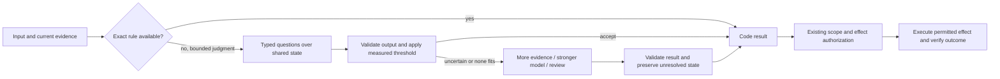

# typed-decision-cascades

> Use code for exact rules, a specialized model for bounded judgments, a generative model for hard/open-ended work, and an independent authorization contract for effects. Measure the whole cascade, not just its cheapest call.

## What it is

A typed-decision cascade separates semantic classification from text generation and lets code decide whether to accept, escalate or abstain. Its design unit is a recurring **decision**, not an entire agent. Questions define a bounded output space, evidence supplies state, a measured threshold selects a path, and downstream execution remains a different contract. This is not a claim that a model trained to emit typed values cannot be wrong. [[sources/buzzoni--jev-engineering#decomposition]] [[sources/buzzoni--jev-engineering#limitations]] [[sources/typesafe--decision-model-docs#routing]]

This page owns **decision decomposition, typed uncertainty, cascade quality and unit economics**. [[concepts/proactive-agent-discernment]] owns whether an event warrants work or interruption; [[concepts/lifelong-skill-routing]] owns access to skills as catalogs grow; [[patterns/behavioral/latent-vs-deterministic-split]] is the broader implementation pattern. The new page specializes these rather than restating always-on architecture.

## Where it came from

Mr. Buzzoni's September 29, 2026 article packages Jev with Kimi K3 as a cost-saving playbook. We read the complete mirrored article, all embedded code/tables and nine images; then checked the linked TypeSafe contracts as of November 9 and Nutlope's fraud-demo source at `9b015f5`. The general cascade idea predates this article; no invention claim is implied. [[sources/buzzoni--jev-engineering#root]] [[sources/typesafe--decision-model-docs#root]] [[sources/nutlope--jev-fraud#root]]

## Why it matters

An agent trace may contain semantic yes/no, ranking and routing decisions that do not need a long generated answer. Exact date/count/permission checks need no model at all. Splitting these decisions can reduce repeated context transmission and make errors inspectable—but cheap wrong decisions, unbounded retries or an overloaded review queue can erase the gain. The article's assertion that bounded decisions dominate most loops is a hypothesis to measure in a real trace, not an established universal workload ratio. [[sources/buzzoni--jev-engineering#decomposition]] [[sources/typesafe--decision-model-docs#jaggedness]] [[sources/nutlope--jev-fraud#queues]]

## Architecture

This is our synthesis, not an executed product architecture. Open-ended generation can go directly to an appropriate model. Approval is not something to skip because a classifier is confident, nor a reason to re-request authorization already granted. [[sources/buzzoni--jev-engineering#cascade]] [[sources/typesafe--decision-model-docs#routing]] [[patterns/behavioral/context-is-not-authority]]

## Evidence & claims

### The important numerical distinction: probability, confidence and calibration

Current TypeSafe docs define Choice confidence as `c = (p_max − 1/n) / (1 − 1/n)`. With two choices, `c=.95` corresponds to top probability `.975`, not `.95`. With five choices, it corresponds to `.96`. Neither is automatically a measured error rate on a new deployment. Calibration needs labeled data from the relevant task/distribution. For a fixed option count, thresholding confidence and top probability supplies no independent second check. [[sources/typesafe--decision-model-docs#confidence]]

Noul returns probability of yes: `.5` is uncertainty, not medium severity. Score is an expected position on ordered levels, not an exact quantity. Probability mass on both sides of an action boundary matters even when the expected score looks decisive. Choice option count/order, criteria and the numerical field used by a gateway therefore belong in the threshold's versioned contract. [[sources/typesafe--decision-model-docs#primitives]] [[sources/typesafe--decision-model-docs#routing]] [[sources/typesafe--decision-model-docs#jaggedness]]

### What the savings arithmetic actually says

The article assumes 10,000 emails/month, 1,000 Jev input tokens each, 1,500 input/300 output tokens per larger-model call, 10% escalation and its quoted prices. Recomputed offline:

| Path | Monthly inference estimate under those assumptions |
| --- | ---: |
| Frontier on every email ($10/M input, $50/M output) | $300.00 |
| Kimi on every email ($3/M input, $15/M output) | $90.00 |
| Jev on every email ($.042/M input) | $0.42 |
| Jev + Kimi on 10% | $9.42 |

That is **89.53% below the assumed Kimi-only baseline**, or **96.86% below the assumed frontier baseline**. The arithmetic supports an illustrative estimate, not a general 90% guarantee or equal-quality result. Count question tokens, retries, review labor, infrastructure and error consequences before calling it total savings. [[sources/buzzoni--jev-engineering#economics]] [[sources/nutlope--jev-fraud#verification]]

Our sensitivity model, derived from the article: `cascade = N × (decision_cost + escalation_fraction × fallback_cost) + operating_costs`. Escalation is measured, not fixed by the sales headline. The article's separate $6,480/$30,400 support-ticket estimate represents about 78.68% savings, not the same workload or reduction. [[sources/buzzoni--jev-engineering#economics]]

### Historical demo and preserved recording are different evidence

| Measure | Article's reported run | Pinned repo's stored recording |
| --- | --- | --- |
| Dataset | 100, half fraud | seeded, length-filtered 50/50 sample |
| Correct | 96/100 | 92/100; Jev alone 90/100 |
| Escalated | 31 | 30 |
| End-to-end | 16s (Jev portion 1.42s) | 6.114s |
| Cost | approximately $.07 | $.101775, mixed reported/estimated basis |

The stored run fixes two cases without regression and has **84% fraud recall** (42 true positives, eight false negatives, zero false positives). Its 92% aggregate accuracy must not hide missed fraud. Jev's recorded cost is provider-reported zero; Kimi costs are token estimates, not invoices. We recomputed the file's summary and ran **12 mock/stub tests**, but did not reproduce inference or re-label every email. A balanced sample is not production prevalence. [[sources/buzzoni--jev-engineering#calibration]] [[sources/nutlope--jev-fraud#recording]] [[sources/nutlope--jev-fraud#dataset]] [[sources/nutlope--jev-fraud#verification]]

### The fallback is another model, not ground truth

The article passes the cheap model's guess into Kimi, asks for JSON including `sure`, and accepts Python truthiness. It does not validate enum membership or boolean type; a nonempty string could pass that check. It also lacks timeout/error handling and a measured fallback-abstention policy. These are snippet limitations, not a reason to assume every deployed cascade shares them. [[sources/buzzoni--jev-engineering#cascade]]

The linked repo independently sends the original email to Kimi, excludes labels, validates classification/reason, and leaves failed reviews unresolved. Its separate queues prevent slow reviews consuming cheap-classifier slots. But a valid Kimi response is still accepted without calibrated abstention. The gateway adapter also falls back from native confidence to selected-class probability at the same threshold: it records `confidenceBasis`, but that does not make the statistics equivalent. All 100 stored rows used native confidence, so this potential path mismatch is **not** an explanation for the stored run's errors. [[sources/nutlope--jev-fraud#pipeline]] [[sources/nutlope--jev-fraud#queues]] [[sources/nutlope--jev-fraud#guarantee-boundaries]] [[sources/nutlope--jev-fraud#recording]]

### Batch decisions that share evidence, not ones that need each other's answers

Fan-out sends a common state once and evaluates independent questions in parallel; application code uses only relevant answers. A second call is necessary when the first result determines new evidence, candidates or state—not merely because the next answer is conditionally used. The current cookbook reports 12.2× cheaper and 11.8× faster for 13 questions over one 53,777-character document. Its time baseline sums sequential calls; concurrency changes that comparison. Repeated answers are close, not universally byte-identical, and consistency is not correctness. [[sources/typesafe--decision-model-docs#fan-out]] [[sources/typesafe--decision-model-docs#primitives]] [[sources/typesafe--decision-model-docs#batching-evidence]]

### Preserve historical claims without freezing the product in September

The article's 1.13-era description says text-only, three primitives and fixed rate limits. November docs describe gated experimental image inputs for 1.13/1.14, Box for 1.14, optional long context and per-organization rate limits. They explicitly say images/Box are not production-ready. Current abstention guidance prefers a companion Noul rather than universally adding `other`. These differences are recorded as dated documentation, not silent edits to the original article. The Kimi landing page alone did not verify 1M context, open weights or 300-agent swarm capacity. [[sources/buzzoni--jev-engineering#primitives]] [[sources/buzzoni--jev-engineering#swarm]] [[sources/typesafe--decision-model-docs#models]] [[sources/typesafe--decision-model-docs#images]] [[sources/typesafe--decision-model-docs#primitives]] [[sources/typesafe--decision-model-docs#kimi-link]]

## Patterns demonstrated

- [[patterns/behavioral/latent-vs-deterministic-split]] — learned semantic judgment, exact computation and routing policy have distinct owners. [[sources/buzzoni--jev-engineering#decomposition]]
- [[patterns/composition/resolver-routing-table]] — typed outputs route to bounded downstream capabilities; preserve an abstention path. [[sources/typesafe--decision-model-docs#routing]]
- [[patterns/behavioral/context-is-not-authority]] — recognition of an intended action does not grant permission for the effect. [[sources/typesafe--decision-model-docs#routing]]
- [[patterns/behavioral/evidence-gated-completion]] — a high done-score does not replace task acceptance evidence; transport failure remains unresolved. [[sources/buzzoni--jev-engineering#swarm]] [[sources/nutlope--jev-fraud#pipeline]]
- [[patterns/quality-bar/revision-bound-review]] — pin model, criteria, numerical statistic, source revision and recorded run separately. [[sources/buzzoni--jev-engineering#rollout]] [[sources/nutlope--jev-fraud#recording]]

## Tensions & counter-arguments

- **Typed is not true.** Schema safety rules out an invalid label, not a wrong valid label. Injection, literal misreading and option-order effects remain documented failures. [[sources/typesafe--decision-model-docs#jaggedness]]
- **An extra layer can cost more.** High escalation, long evidence, retries and human review can outweigh cheaper input tokens; compare equal tasks and quality. [[sources/buzzoni--jev-engineering#economics]] [[sources/nutlope--jev-fraud#accounting]]
- **Confidence can conceal a unit change.** Moving providers or option sets can change statistic meaning even if the field is still named `confidence`. A model pin alone cannot freeze the contract. [[sources/typesafe--decision-model-docs#confidence]] [[sources/nutlope--jev-fraud#pipeline]]
- **More context is not always better.** Fallbacks may need richer evidence, but irrelevant context hurts; shared-state batching and data minimization must be balanced. [[sources/typesafe--decision-model-docs#jaggedness]]
- **A second opinion may share errors.** Passing the first guess can anchor a fallback; independent review removes that particular influence but does not prove independent errors. [[sources/buzzoni--jev-engineering#cascade]] [[sources/nutlope--jev-fraud#pipeline]]
- **Commercial framing is not market proof.** Cost audits/retainers are proposed offers, not validated demand, and screening fraud does not authorize payments. [[sources/buzzoni--jev-engineering#business]]

## Timeline

- 2026-09-20 — Stored fraud recording begins at 03:53:28Z; repository's validation heading uses September 19 local date. [[sources/nutlope--jev-fraud#recording]]
- 2026-09-29 — Buzzoni publishes the playbook with an earlier reported demo. [[sources/buzzoni--jev-engineering#root]]
- 2026-11-09 — Ingest adds current contract differences, source inspection, offline arithmetic and mock tests; no live inference. [[sources/typesafe--decision-model-docs#root]] [[sources/nutlope--jev-fraud#verification]]

## Related

- [[concepts/proactive-agent-discernment]] and [[creators/rubric-labs]] — earlier Jev use-case research; relevance and urgency are decisions, not mandate.
- [[concepts/lifelong-skill-routing]] — changing candidate descriptions can alter routing without changing the task itself.
- [[concepts/evidence-calibrated-research]] — distinguish claims, artifacts, tests and actual outcomes.
- [[concepts/trace-lake]] — logged routing/outcome records become future evaluation cases.
- [[concepts/review-cost-aware-workflows]] — spend expensive review selectively, track both fixes and regressions.
- [[concepts/completion-contract]] and [[concepts/agent-habitat-architecture]] — successful inference does not prove task completion or grant execution authority.
- [[artifacts/projects/inkling-2-small]] — task-specific quality/cost and held-out adaptation are different from headline capability.

## What we'd steal

Exhaustive portable ledger; vendor examples are not automatically production defaults. Application additions below are our synthesis, grounded in the named source boundaries.

1. ★ Audit a real trace before buying a new stack. Label generation, exact computation, bounded semantic choice and effect authorization; count actual frequency and cost. [[sources/buzzoni--jev-engineering#decomposition]]

2. Keep arithmetic, dates, budgets, allowlists and retry limits in code. A classifier adds uncertainty to operations that are already exact. [[sources/buzzoni--jev-engineering#limitations]] [[sources/typesafe--decision-model-docs#jaggedness]]

3. Use typed outputs for genuinely bounded choices; use a generator for prose, explanations and open-ended answers. [[sources/buzzoni--jev-engineering#primitives]] [[sources/typesafe--decision-model-docs#primitives]]

4. Ask one judgment per question; combine factors explicitly in code rather than burying an AND inside a vague prompt. [[sources/buzzoni--jev-engineering#questions]] [[sources/typesafe--decision-model-docs#design]]

5. Put meaning in instructions and criteria, not the question ID; IDs identify results but are not model-visible guidance. [[sources/buzzoni--jev-engineering#questions]] [[sources/typesafe--decision-model-docs#primitives]]

6. Describe observable situations and boundary cases, not adjectives or bare numerical labels. [[sources/buzzoni--jev-engineering#questions]] [[sources/typesafe--decision-model-docs#jaggedness]]

7. Make every rubric level stand alone and keep yes/no polarity intuitive; avoid double negatives or contradictory criteria. [[sources/buzzoni--jev-engineering#questions]] [[sources/typesafe--decision-model-docs#jaggedness]]

8. Point to exact fields with named paths; keep proprietary/reference evidence explicit instead of relying on model recollection. [[sources/buzzoni--jev-engineering#questions]] [[sources/typesafe--decision-model-docs#design]]

9. Filter irrelevant input before inference; retain the evidence required for the decision and a traceable source record. [[sources/buzzoni--jev-engineering#questions]] [[sources/typesafe--decision-model-docs#jaggedness]]

10. Turn extraction into selection only when candidate generation covers the real answer space; missing candidates require abstention. [[sources/buzzoni--jev-engineering#questions]] [[sources/typesafe--decision-model-docs#jaggedness]]

11. ★ Batch independent questions over shared state; ignore irrelevant speculative results in code. Do not pretend batching lets one question read another answer. [[sources/buzzoni--jev-engineering#batching]] [[sources/typesafe--decision-model-docs#fan-out]]

12. Use sequential calls when new evidence, candidates or transformed state genuinely depend on earlier outputs. [[sources/buzzoni--jev-engineering#batching]] [[sources/typesafe--decision-model-docs#primitives]]

13. Budget both per-request and per-question context, plus byte limits; free output does not mean free input/questions or unbounded batching. [[sources/buzzoni--jev-engineering#primitives]] [[sources/typesafe--decision-model-docs#models]] [[sources/typesafe--decision-model-docs#errors]]

14. ★ Preserve an explicit no-fit path. Compare an other option with a companion fit/answer-exists question on your data rather than assuming either is universal. [[sources/buzzoni--jev-engineering#questions]] [[sources/typesafe--decision-model-docs#primitives]]

15. Regenerate action menus from live state, but re-test when membership/order changes; available options are not permissions. [[sources/buzzoni--jev-engineering#examples]] [[sources/typesafe--decision-model-docs#jaggedness]] [[sources/typesafe--decision-model-docs#routing]]

16. ★ Name the actual statistic being thresholded. Probability, normalized confidence, expected score and measured accuracy are not interchangeable. [[sources/typesafe--decision-model-docs#confidence]] [[sources/nutlope--jev-fraud#pipeline]]

17. Keep full distributions. Score means can hide boundary uncertainty; top-two alternatives can matter even when a single confidence value matches. [[sources/typesafe--decision-model-docs#confidence]] [[sources/typesafe--decision-model-docs#routing]]

18. Set thresholds per action and error consequence; retain a meaningful uncertain band instead of rounding every answer into action. [[sources/buzzoni--jev-engineering#rollout]] [[sources/typesafe--decision-model-docs#routing]]

19. Keep effect authorization outside learned predictions. A risk classifier may advise an approval workflow, not replace its enforced scope. [[sources/buzzoni--jev-engineering#decomposition]] [[sources/typesafe--decision-model-docs#routing]]

20. Use stronger models or additional evidence selectively, with a separate acceptance contract for the fallback itself. [[sources/buzzoni--jev-engineering#cascade]] [[sources/nutlope--jev-fraud#guarantee-boundaries]]

21. Validate fallback enums, booleans and required fields in code; JSON syntax and a self-reported sure flag are insufficient. [[sources/buzzoni--jev-engineering#cascade]] [[sources/nutlope--jev-fraud#pipeline]]

22. Avoid feeding the first guess to an independent reviewer unless that influence is intended and tested; both stages need the original evidence. [[sources/buzzoni--jev-engineering#cascade]] [[sources/nutlope--jev-fraud#pipeline]]

23. Keep transport/parser/provider failures separate from semantic uncertainty; a failed review must not silently approve the first guess. [[sources/nutlope--jev-fraud#pipeline]] [[sources/nutlope--jev-fraud#tests]]

24. Use independent stage queues so slow fallbacks do not occupy cheap-stage slots; bound admission, retries and cancellation. [[sources/nutlope--jev-fraud#queues]] [[sources/nutlope--jev-fraud#batch-tests]]

25. Preserve zero, estimated and unavailable costs separately and include failed calls; missing cost is not zero. [[sources/nutlope--jev-fraud#accounting]] [[sources/nutlope--jev-fraud#verification]]

26. Measure fixes AND regressions from escalation, plus class-specific recall/precision and unresolved cases. [[sources/nutlope--jev-fraud#accounting]] [[sources/nutlope--jev-fraud#recording]]

27. ★ Shadow one frequent decision before changing production routing; build held-out labels and inspect accepted/escalated confidence bands. A week is a suggested trial, not sufficient evidence by itself. [[sources/buzzoni--jev-engineering#rollout]] [[sources/typesafe--decision-model-docs#design]]

28. Test option permutations, adversarial text, irrelevant context, literal wording and out-of-scope inputs, not only happy paths. [[sources/typesafe--decision-model-docs#jaggedness]]

29. Pin model, question wording, criteria, candidate set, threshold statistic and gateway/SDK behavior together. Continue monitoring input drift after the pin. [[sources/buzzoni--jev-engineering#rollout]] [[sources/typesafe--decision-model-docs#models]] [[sources/nutlope--jev-fraud#pipeline]]

30. Log exact model response identity when available, distributions, selected path, latency, usage, cost basis and downstream outcome. A provider alias is weaker provenance than a resolved version. [[sources/buzzoni--jev-engineering#rollout]] [[sources/typesafe--decision-model-docs#models]] [[sources/nutlope--jev-fraud#recording]]

31. Turn reviewed failures into evaluation cases and regression checks; version criteria changes with rollback. [[sources/buzzoni--jev-engineering#rollout]]

32. ★ Recompute cost claims from input/output tokens, unit prices, fallback rate and baseline; state omitted operating/error costs. [[sources/buzzoni--jev-engineering#economics]] [[sources/nutlope--jev-fraud#verification]]

33. Compare the same task and quality target. Topic labeling versus summarization and serial versus parallel latency are different comparisons. [[sources/buzzoni--jev-engineering#examples]] [[sources/typesafe--decision-model-docs#batching-evidence]]

34. Keep stored replay, historical announcement and new live run distinct; a successful local mock test does not reproduce a model score. [[sources/nutlope--jev-fraud#results]] [[sources/nutlope--jev-fraud#verification]]

35. Treat cheap completion checks as candidates for acceptance evidence, not substitutes for tests or an excuse for unbounded swarms. [[sources/buzzoni--jev-engineering#swarm]]

36. Do not infer production prevalence from a balanced demo; measure the high-cost error class explicitly. [[sources/nutlope--jev-fraud#dataset]] [[sources/nutlope--jev-fraud#recording]]

37. Integrate through the existing harness only after checking the exact package/provider contract; a vendor or article integration claim is not local compatibility evidence. [[sources/buzzoni--jev-engineering#integrations]] [[sources/typesafe--decision-model-docs#api]]

38. Keep experimental capabilities and opt-ins visible; do not silently upgrade historical text-only assumptions into a tested vision system. [[sources/typesafe--decision-model-docs#images]] [[sources/typesafe--decision-model-docs#models]]

39. Treat implementation advice as dated evidence: later companion-Noul and confidence guidance can qualify older examples without rewriting their snapshots. [[sources/buzzoni--jev-engineering#primitives]] [[sources/typesafe--decision-model-docs#primitives]] [[sources/typesafe--decision-model-docs#confidence]]

40. Sell a bounded decision/cost audit only after measuring the current loop and shadow results; commercial examples are hypotheses, not promised savings or demand. [[sources/buzzoni--jev-engineering#business]] [[sources/buzzoni--jev-engineering#economics]]

## Adoption trigger and evaluation plan

Promote a cascade when a trace shows recurring, material-cost bounded judgments and enough labeled examples to evaluate them. Compare existing baseline, deterministic-only where possible, specialized-only and cascade paths on held-out inputs. Plot accepted-case errors versus coverage and escalation; stratify by class, input source and version. Include latency tails, review backlog, failed calls and total costs. Route effects only under the existing permission contract. This is a proposed experiment, not executed here. [[sources/buzzoni--jev-engineering#rollout]] [[sources/typesafe--decision-model-docs#design]] [[sources/nutlope--jev-fraud#accounting]]

## Open questions

- How calibrated are each stage's probabilities on representative deployment data, especially rare costly errors?
- What changed between the article's reported 96/100 run and the repository's stored 92/100 run? Sources describe different runs; no matched experimental isolation is available.
- Does the current gateway preserve native confidence consistently, and which exact Jev version generated the stored recording?
- How much of the headline saving survives equal-quality baselines, genuine escalation, reviewer time and error costs?
- Which Kimi context/weights/swarm claims and integration package APIs hold in the intended host today? The captured landing page is insufficient evidence.

## Study boundary

Full primary article and nine images read; **27 external evidence captures** preserved across article and supporting docs, plus a pinned full demo checkout and two offline verification/hash records. Twelve bundled mock tests passed; stored summary and illustrative arithmetic checked. No paid inference, model-calibration experiment, production integration, fraud deployment or installed-agent-policy change. The result is a research ingestion, not an implementation endorsement.
