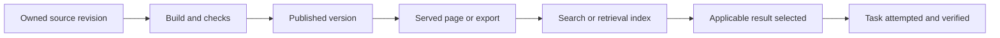

# A documentation system for a large business platform

A proposed operating model derived from [[concepts/developer-documentation-design]]. This is a design aid, not an audit of existing Flex documentation or an installed portal. The concept owns comparative findings; source pages own evidence. Start small with real tasks rather than creating empty structures.

## Give each artifact one job

| Artifact | Accountable owner | Question it answers | Update trigger |
| --- | --- | --- | --- |
| Platform entry point | Platform documentation lead | Which domain/task/tool should I use? | New supported domain, task or surface |
| Shared conventions | Owning platform capability team | How do identity, environment, errors and versioning work? | Applicable platform contract change |
| Domain reference | Domain API/SDK owner | What behavior is supported and under what conditions? | Public contract or domain-rule change |
| Task guide/example | Team owning the business outcome | How do I perform and verify this task? | Prerequisites, sequence, semantics or supported versions change |
| Current architecture | Owning engineering team | What exists and how do responsibilities fit? | Implemented structural or operational change |
| Decision record | Decision owner and affected reviewers | Why was a significant choice made? | Decision, clarification or supersession under local policy |
| Runbook | On-call/service owner | How should an authorized responder diagnose or act? | Operational learning or service/procedure change |
| Live incident record | Assigned incident roles | What is happening and who is doing what? | Incident facts, actions, observations or handoff |
| Retrospective | Incident/action owners | What did we learn and what changes follow? | Reviewed incident analysis and follow-up |
| Migration guide | Change owner with affected consumers | How do we reach the supported target and recover? | Breaking/deprecating change, new discovered transition constraint |

This allocation is our proposal, grounded in task/reference separation, architecture/decision distinctions and operational roles; it is not a published universal RACI. Ownership of text does not grant business execution permission. [[sources/diataxis--documentation-framework#root]] [[sources/docs-research--architecture-20261105#gds-adr]] [[sources/docs-research--operations-20261105#google-managing-incidents]] [[patterns/behavioral/context-is-not-authority]]

## Connect tasks to capabilities without guessing every future use

A capability's reference owns its contract. Task guides link and compose those capabilities for different business outcomes. Preserve a stable reference even when new workflows appear; add a new task path when a new audience or sequence needs it. Separate an explanation when its depth interrupts action, while keeping necessary concepts and qualifications at the decision point. This recommendation applies the API research and observed concept/sample navigation problems. [[concepts/business-platform-api-design]] [[sources/docs-research--empirical-20261105#meng-information-seeking]]

For a retrieval, refresh or full workflow, keep a task's preconditions, effects, permissions, freshness and completion evidence explicit. A general vendor reference can support a lookup guide and a refresh guide without pretending they have the same effects. Which endpoint exists remains an API design question; documentation should accurately reveal that design. [[concepts/business-platform-api-design]]

A lightweight capability registry can link domain, owner, canonical contract, supported versions, example project, task guides and verification evidence. These are proposed metadata fields, not a new schema every service must adopt. Prefer the existing catalog when it can represent them; reference its authoritative ownership relation rather than copying an owner string, and do not create a competing source of ownership. [[sources/docs-research--architecture-20261105#backstage-catalog]] [[sources/docs-research--architecture-20261105#backstage-publishing]]

## Make delivery stages visible

The diagram describes a proposed verification chain. Publication and retrieval may have multiple routes; a browser user can bypass search. Text equivalent: each boundary must preserve source identity, version/applicability and essential constraints. A successful source merge, build, publication, search result and task outcome establish different facts. Backstage and Algolia document the middle stages; the final selection/outcome stages are our evaluation design. [[sources/docs-research--architecture-20261105#backstage-architecture]] [[sources/docs-research--discovery-governance-20261105#search-index]]

Check stale search records, missing version/language facets, incorrect defaults and redirects before rewriting an otherwise correct page. Protect private docs in the chosen delivery and retrieval systems; hidden navigation is not access control. [[sources/docs-research--discovery-governance-20261105#search-filters]] [[sources/docs-research--discovery-governance-20261105#rtd-lifecycle]]

## Plan documentation changes from reader impact

Before drafting, answer:

1. Did supported behavior, prerequisites, availability, recommended use or recovery change for any reader?
2. Which reference, task, example, migration and troubleshooting surfaces are affected?
3. Which source/specification/test establishes each consequential claim?
4. Which critical conditions must remain true when the material is copied or retrieved alone?
5. Is an update required, or is no reader-facing change justified?

This is a proposed documentation-obligation check informed by DoGBench. It does not assume a benchmark's historical no-update label is always correct. Keep critical incorrect behavior separate from optional stylistic improvements. [[sources/docs-research--empirical-20261105#dogbench]]

## Evaluate a bounded set of business tasks

Select tasks from the implemented platform. The examples below illustrate evaluation design; they are not claims these exact capabilities or guarantees currently exist.

| Candidate task | Independent success evidence | Failure branch to include |
| --- | --- | --- |
| Retrieve an authorized vendor record | Correct tenant/resource and understood freshness | Missing record versus missing authority |
| Request and observe a background refresh | Documented successful operation plus published business result | Accepted request that later fails |
| Integrate event handling | Correct effect at the owning boundary | Duplicate or out-of-order delivery under actual contract |
| Recover a lost command response | Reconciled outcome without a new duplicate intent | Unknown external result |
| Upgrade an integration | Supported target behavior and verified consumer compatibility | Mixed old/new traffic and reversal limit |
| Make a first maintainer change | Change, relevant tests and verified local outcome | Setup dependency or misleading architecture assumption |

Use the actual system contract to define the oracle and permitted actions. If evidence or authority is unavailable, recognizing that boundary can be the correct outcome. Do not simulate guaranteed rollback for a product that does not provide it. [[concepts/business-platform-api-design]] [[sources/docs-research--operations-20261105#stripe-upgrade]]

For each trial record audience/experience, provisioning excluded or included, environment, docs revision, API/SDK version, assigned task, help received, correctness, time, recovery and perceived usability. Predefine business-relevant substeps; retain partial/failed attempts. When comparing variants, record prior exposure and task order, use randomized assignment or counterbalancing where appropriate, hold task/start conditions stable and report bundled changes. Repeating the same task with the same reader can introduce learning effects. The 2020 intervention shows why accuracy, total time and perceived usability should be separate measures. [[sources/docs-research--empirical-20261105#meng-intervention]]

For agents also pin model, harness, tool inventory, allowed authority, browser/preloaded/local context and source retrieval. Distinguish exposure, reading, decision, action and outcome. The local-trace paper's observation window does not measure all those channels. [[sources/docs-research--empirical-20261105#agent-traces]]

## Adopt in a useful order

1. Choose representative reader tasks and inspect current failure points.
2. Repair prerequisites, contract errors and broken examples before cosmetic reorganization.
3. Assign canonical owners and connect existing documents/catalog entries.
4. Add checks for recurring consequential failures and report their scope/skip counts.
5. Validate publication, search/export applicability and access boundaries.
6. Observe tasks again; carry verified corrections into authoritative sources and templates.

This sequence is our proposal. The sources support components, not a validated whole-platform adoption program. A small team may combine roles; high-impact workflows may need deeper review. The research has not performed this evaluation against Flex.

## Patterns demonstrated

Applications of [[patterns/composition/single-source-multi-surface-distribution]], [[patterns/quality-bar/revision-bound-review]] and [[patterns/behavioral/context-is-not-authority]]. No new confirmed implementation pattern.

## What we'd steal

A clear document owner, task-to-capability links, explicit state/version labels, reader-impact change review, boundary-specific delivery checks and a task-based evaluation loop. See the owning concept's exhaustive ledger rather than maintaining a second facts catalog here.

## Open questions

- Which existing service catalog and docs pipeline should own these proposed metadata and checks?
- Which actual tasks and representative readers can establish the first baseline?
- Which correctness failures require product/observability/access changes before docs can solve them?
