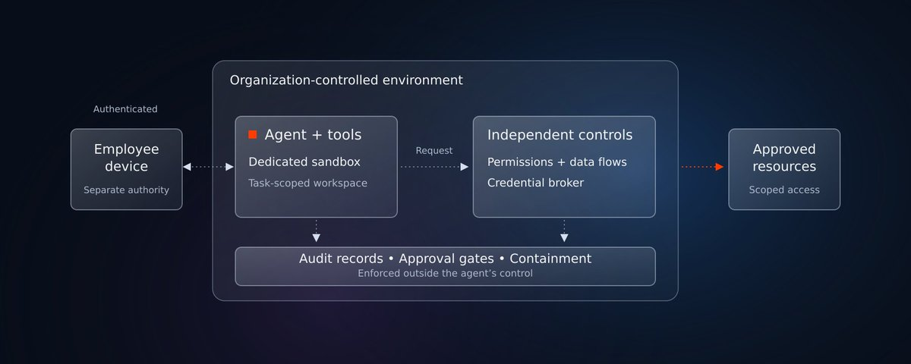
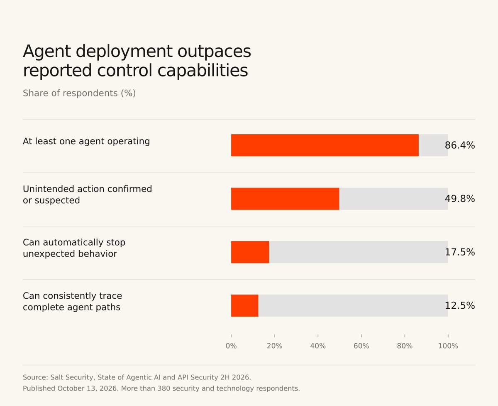
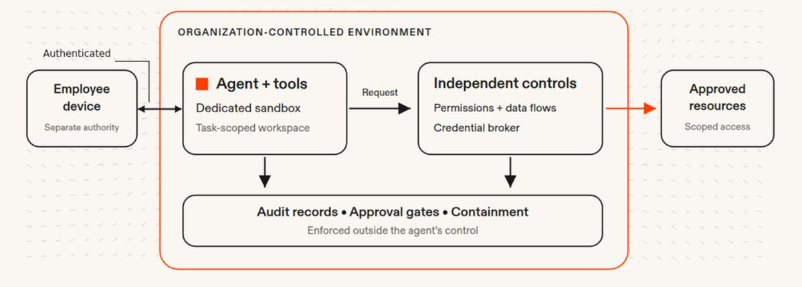

# Security advisory: Make managed cloud environments the default for AI agents

AI agents should operate in dedicated, organization-controlled environments with limited access to the resources each task requires.

Recent security incidents [5], [6] and research demonstrate why this is a growing necessity. Supply-chain attacks have always been able to compromise developer machines and recruit installed AI tools to search for sensitive corporate information and data. Agent harnesses are typically given broad privileges and have a shrinking amount of human oversight. Combined, these two effects are making agents an increasingly interesting target for attackers. Even unattended automations are being targeted: instructions hidden in a GitHub issue or email can redirect an agent toward private data and unauthorized actions. The rise of personal agents increases the risk even more, since they are insufficiently managed by organizations, mostly controlled by individuals, run with an inconsistent set of guardrails, and are incentivized to be proactive above all else: they read every email, every calendar invite; Every interaction is an opportunity to get prompt-injected.

There is a better way forward: Organizations can continue adopting agents by giving them execution environments designed for software that reads untrusted content, runs code, and acts on a user’s behalf.

In a world where agents are becoming more prevalent, @Replit believes that organizations must make managed, isolated cloud agents the default for autonomous development, with credentials, permissions, network access, and production changes controlled outside the agent’s reach.

## Adoption is growing faster than control

AI development tools are becoming standard. Stack Overflow reports that the share of respondents using or planning to use AI tools rose from 70% in 2023 to 76% in 2024 [1] and 84% in 2025 [2]. This establishes the scale of AI-tool adoption and intent across annual respondent samples. Autonomous-agent usage falls outside the specific scope of this measure.

Agent infrastructure is also expanding. Salt Labs [3] detected MCP-related infrastructure in 16.7% of its customer environments in January 2026 and 21.6% in August: a 4.9-percentage-point increase. These observations are limited to the vendor’s customer environments. Their applicability to the wider industry and the consistency of the customer cohort remain unestablished.

The more consequential finding is the gap between deployment and control. In Salt Security’s October 2026 survey [3], 86.4% of respondents reported at least one agent operating in their organization, but only 17.5% could automatically stop an agent behaving unexpectedly in production. Only 12.5% could consistently trace complete agent paths across all agents.

Fig. 1. Agent deployment outpaces reported control capabilities. Source: Salt Security, State of Agentic AI and API Security 2H 2026, published October 13, 2026; more than 380 security and technology respondents [3]. Each bar represents a separate self-reported measure from the survey sample. The measures should be interpreted independently, with generalization limited to that sample. The 49.8% unintended-action measure includes both confirmed and suspected events in the preceding 12 months, so a confirmed breach rate cannot be inferred from it.

A separate Cloud Security Alliance study reinforces the concern [4]: 47% of respondents reported an agent-related security incident in the preceding year, 54% reported between one and 100 unsanctioned agents, and only 31% reported formally adopted agent-governance policies. The study surveyed 445 IT and security professionals in September and November 2025 and was published in April 2026. Zenity financed the research and co-developed the questionnaire. These findings corroborate a governance problem; they should not be combined with Salt’s results into a single incident-rate trend.

## Different attacks, recurring boundary failures

The evidence extends beyond any one model, vendor, or delivery mechanism.

- Sensitive-system access through a personal agent. WIRED reports that an Accenture contractor connected a personal Claude Code account to a sensitive Department of Defense environment and that credentials and system information appear to have reached a third-party service [5]. Accenture disputes the allegations, saying an independent investigation found them without merit. WIRED reports no indication that attackers accessed classified or top-secret systems. The risk illustrated is an uncontrolled connection between sensitive infrastructure and personal agent tooling.

- A malicious extension on developer machines. WIRED reports that a tampered Claude Code extension distributed through Cursor’s marketplace was downloaded by at most 5,000 users [6]. It was not an Anthropic-published release. Cursor describes host-information collection and attempts to install a persistent SSH backdoor [7]. Implementation errors limited the backdoor’s effectiveness on most affected macOS and Windows hosts, but uninstalling the extension alone may not remove its persistence mechanisms. We cannot rely on attacker mistakes in the future.

- Compromised packages recruiting AI tools to find secrets. In the August 2025 Nx “s1ngularity” campaign, malicious packages used previously-installed Claude, Gemini, and Q command-line tools to assist reconnaissance. Wiz [8] observed successful AI-assisted activity in hundreds of cases and more than 1,000 valid GitHub tokens exposed. A subsequent phase used leaked tokens to make over 5,500 private repositories public, affecting more than 400 users or organizations. Developer machines and some build pipelines were affected.

- Private data leaked through legitimate tools. Invariant [9] demonstrated that a malicious public GitHub issue could persuade an agent using GitHub MCP to retrieve private-repository information and publish it in a public pull request. The researchers demonstrated this attack using an uncompromised MCP server. The demonstration establishes a possible attack path; the source reports no mass breach. An approved tool and destination can still carry an unauthorized data transfer.

- A tool running outside its intended sandbox. CodeRabbit confirmed that researchers discovered RuboCop operating outside its sandbox in January 2025 [10]. The company says it deployed a comprehensive fix within 12 hours and found no evidence of customer-data access or malicious activity. The lesson is that isolation must extend from the primary agent runtime to every executable tool and subprocess.

- A cloud agent exposing connected-account credentials. Salt Labs demonstrated that malicious email content could induce code execution in Manus’s cloud sandbox, where connected-service tokens were accessible [11]. A security warning appeared after the payload was executed. Salt says the flaw has since been resolved. This research is an important counterexample to the idea that cloud hosting alone provides security.

- Compromised infrastructure misusing legitimate signing authority. Elliptic’s analysis of the October 29 Binance theft suggests attackers induced Binance’s own systems to sign unauthorized transactions. Binance initially reported a possible compromised DevOps laptop and later disclosed additional breach points; the full intrusion path remains unresolved. On Ethereum, signed EIP-7702 authorizations delegated a hot wallet’s behavior to an attacker-controlled contract, with delegation persisting beyond the initial transaction [12]. This is not evidence of an AI-agent attack. It illustrates a relevant control requirement: protecting credentials is insufficient if a compromised caller can use them to authorize harmful actions.

Together, these cases illustrate three recurring problems: untrusted software executing with excessive access, untrusted content being treated as instructions, and controls that do not prevent the resulting action.

## Why managed cloud agents are the better default

An employee workstation may contain browser sessions, SSH keys, cloud credentials, private repositories, internal-network access, and unrelated business data. That is far more access than most agent tasks require.

A dedicated cloud environment makes it possible to separate agent execution from that workstation. The organization can provision only the necessary workspace, enforce access centrally, record actions independently, and stop or rebuild the environment without rebuilding the employee’s laptop.

Realizing that benefit requires moving execution, policy enforcement, and observability into the controlled environment. A local extension that sends prompts to a cloud model still executes local code. Likewise, a remote agent with copied production credentials and unrestricted network access reproduces the same risks elsewhere.

The objective is to contain a compromised agent or dependency within a limited workspace. Organizational policy must govern the agent’s access independently of the employee’s broader authority.

Fig. 2. A conceptual security boundary for autonomous agents. The agent and its tools run in a dedicated, task-scoped sandbox within an organization-controlled environment, separate from the employee device’s broader authority. Independent controls broker credentials and govern permissions and data flows to approved resources. Audit records, approval gates, and containment are enforced outside the agent’s control. Cloud hosting requires verified controls to provide these protections.

## Required controls

It is recommended to treat agent execution as untrusted and enforce boundaries independently of the agent’s cooperation. Organizations should require:

- Verified execution isolation. Keep agents, installation scripts, tools, and dependencies inside dedicated sandboxes. Place security enforcement outside their control. Do not inherit employee home directories, browser sessions, or unrestricted corporate-network access.

- Brokered credentials and distinct identities. Keep external-service credentials out of agent-readable memory, files, and environment variables. Authorize requests through a broker, bound to the agent, initiating principal, organization, and task.

- Step-up Authorization: Credential isolation must be paired with independent checks on the requested operation, target resource, destination, and any change in delegated authority. Require explicit approval for high-impact actions; possession of a valid identity or access to a signing service is not sufficient authorization.

- Task-scoped permissions. Give each run only the resources and operations it needs. Agents must not be able to raise their own permissions or alter the policy that governs them.

- Network and data-flow restrictions. Control DNS, direct-IP traffic, cloud-metadata access, and external requests. Distinguish permitted operations and data destinations within approved services; allowing GitHub must not imply allowing private data to be published anywhere on GitHub.

- A separate production boundary. Let agents propose changes without standing production-write authority. Apply consequential changes through trusted approval and deployment systems that display the actual action being authorized.

- Controlled software supply chains. Verify provenance, pin approved versions, and review tool and MCP configuration changes. Install dependencies without production credentials.

- Independent audit and containment. Record actions and enforcement decisions somewhere the agent cannot alter. Support automatic containment and revocation without depending on the agent’s cooperation. Containment must also revoke downstream delegations and permissions already granted, not just stop the initiating process or rotate its credentials.

## Recommended action

Make approved, managed cloud-agent environments the standard path for autonomous development. Inventory existing local agents and extensions, remove unnecessary access, and prohibit personal agent accounts from connecting to sensitive production systems.

Require vendors to demonstrate their boundaries: that an agent cannot read service credentials, bypass network controls, expand its permissions, modify audit records, or make unapproved production changes. Verify containment through practical tests, including whether the kill switch actually stops agent activity.

For potentially affected Cursor installations, follow the vendor’s incident-response guidance now. Moving future work to the cloud does not remediate an already compromised endpoint [7].

For regulated and government workloads, use only environments authorized for the relevant data and systems. Assess model endpoints, logs, storage, and external tools against residency, retention, contractual, and accreditation requirements.

The recommendation is cloud execution backed by verified security controls. The sources reviewed do not establish a comparative breach rate for local versus cloud agents. They establish why isolation, limited authority, credential separation, and independent enforcement matter.

Agents’ access should be scoped to the requirements of each task.

For a concrete framework to evaluate these controls, see Replit’s proposed [Agent Habitat Architecture](https://frontier.replit.com/agent-habitat-architecture/) and its evidence-based maturity scale. It provides a reference architecture for independently enforced permissions, brokered credentials, controlled data flows, and out-of-band containment. Each cloud-agent product should be assessed separately to verify which controls it implements.

## References

[1] Stack Overflow, “AI | 2024 Developer Survey”. Accessed: Nov. 1, 2026. [Online]. Available: [https://survey.stackoverflow.co/2024/ai](https://survey.stackoverflow.co/2024/ai)

[2] Stack Overflow, “AI | 2025 Developer Survey”. Accessed: Nov. 1, 2026. [Online]. Available: [https://survey.stackoverflow.co/2025/ai](https://survey.stackoverflow.co/2025/ai)

[3] Salt Security, “Nearly half of enterprises report an AI agent took an unauthorized action last year, Salt Security research finds,” Oct. 13, 2026. Accessed: Nov. 1, 2026. [Online]. Available: [https://salt.security/press-releases/state-of-agentic-ai-and-api-security-2h-2026](https://salt.security/press-releases/state-of-agentic-ai-and-api-security-2h-2026)

[4] Cloud Security Alliance, “More than half of organizations experience AI agent scope violations, Cloud Security Alliance study finds,” Apr. 16, 2026. Accessed: Nov. 1, 2026. [Online]. Available: [https://cloudsecurityalliance.org/press-releases/2026/04/16/more-than-half-of-organizations-experience-ai-agent-scope-violations-cloud-security-alliance-study-finds](https://cloudsecurityalliance.org/press-releases/2026/04/16/more-than-half-of-organizations-experience-ai-agent-scope-violations-cloud-security-alliance-study-finds)

[5] V. Elliott, “A defense contractor gave their personal AI agent access to a secure Pentagon system | WIRED”. Accessed: Nov. 1, 2026. [Online]. Available: [https://www.wired.com/story/a-defense-contractor-gave-their-personal-ai-agent-access-to-a-secure-pentagon-system/](https://www.wired.com/story/a-defense-contractor-gave-their-personal-ai-agent-access-to-a-secure-pentagon-system/)

[6] L. H. Newman, “A supply chain attack put malicious Anthropic Claude extensions on thousands of devices | WIRED”. Accessed: Nov. 1, 2026. [Online]. Available: [https://www.wired.com/story/trojan-malware-targets-thousands-of-anthropic-claude-developer-systems/](https://www.wired.com/story/trojan-malware-targets-thousands-of-anthropic-claude-developer-systems/)

[7] Cursor, “Claude Code extension security notice,” updated Oct. 30, 2026. Accessed: Nov. 1, 2026. [Online]. Available: [https://cursor.com/blog/claude-code-extension-security-notice](https://cursor.com/blog/claude-code-extension-security-notice)

[8] M. Bar and R. McCarthy, “s1ngularity: Supply chain attack leaks secrets on GitHub: Everything you need to know | Wiz Blog,” Aug. 27, 2025, updated Aug. 29, 2025. Accessed: Nov. 1, 2026. [Online]. Available: [https://www.wiz.io/blog/s1ngularity-supply-chain-attack](https://www.wiz.io/blog/s1ngularity-supply-chain-attack)

[9] Invariant Labs, GitHub MCP vulnerability research. Accessed: Nov. 1, 2026. [Online]. Available: [https://invariantlabs.ai/blog/mcp-github-vulnerability](https://invariantlabs.ai/blog/mcp-github-vulnerability)

[10] H. Gill, “Our response to the January 2025 Kudelski Security vulnerability disclosure: Action and continuous improvement,” CodeRabbit, Aug. 19, 2025. Accessed: Nov. 1, 2026. [Online]. Available: [https://www.coderabbit.ai/blog/our-response-to-the-january-2025-kudelski-security-vulnerability-disclosure-action-and-continuous-improvement](https://www.coderabbit.ai/blog/our-response-to-the-january-2025-kudelski-security-vulnerability-disclosure-action-and-continuous-improvement)

[11] Salt Labs, “How we hijacked an AI agent with a single email,” Salt Security, Oct. 1, 2026. Accessed: Nov. 1, 2026. [Online]. Available: [https://salt.security/blog/how-we-hijacked-an-ai-agent-with-a-single-email](https://salt.security/blog/how-we-hijacked-an-ai-agent-with-a-single-email)

[12] T. Robinson, “The largest theft in history: North Korea behind the $6.4 billion Binance hack,” Elliptic, Oct. 30, 2026, updated Nov. 1, 2026. Accessed: Nov. 1, 2026. Available: [https://www.elliptic.co/insights/binance-largest-hack-in-history/](https://www.elliptic.co/insights/binance-largest-hack-in-history/)
