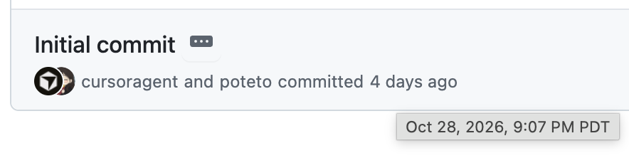
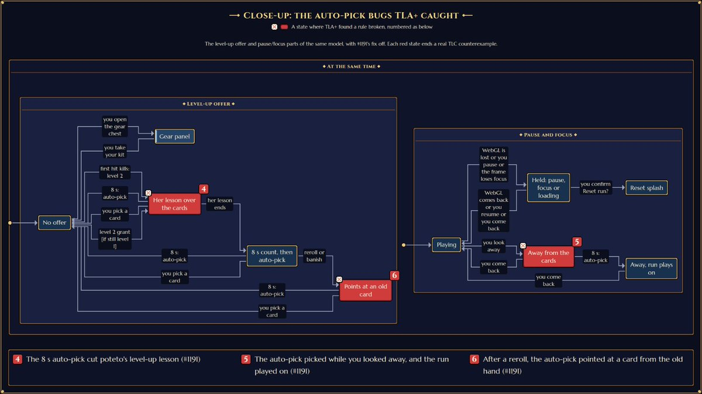
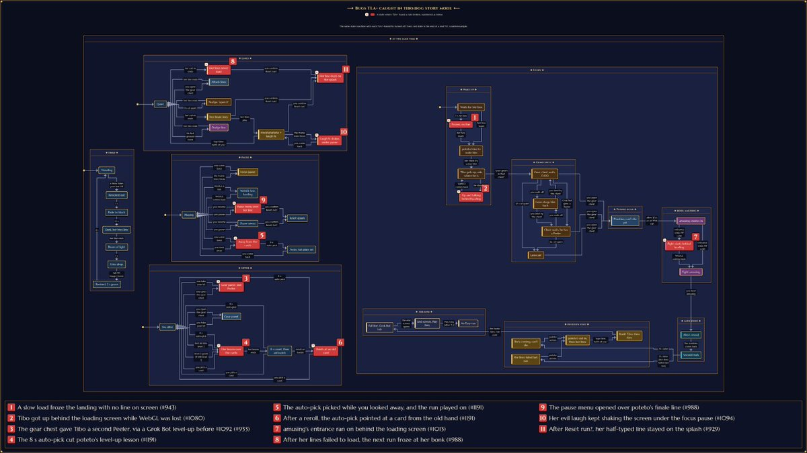
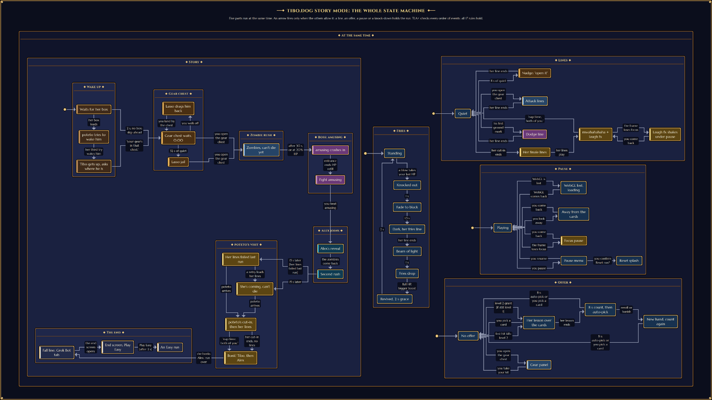

# Tibo engineering — original X post

Canonical URL: https://x.com/poteto/status/2117043478140276847
Author: lauren (@poteto)
Published: 2026-11-01T23:57:52.000Z
Retrieved: 2026-11-03T12:34:41.747603+00:00
Method: X API v2 via xurl; full note_tweet.text, not the truncated text field.

## Full post

trivia:

• started working on the game as a side project 4 days ago, landing ~1,150 PRs 
• every time i found an issue in the code i asked bot to make a lint rule against it
• used TLA+ heavily to find bugs in the game's various state machines: the story, cutscenes, the game's systems. there are many formal verification skills, one for each major system
• i put context into the filepaths: code that runs every frame or every tick gets a .hot.ts extension, and a lint rule bans allocating in it (no object literals, closures, new, etc.), so the game loop creates almost no garbage and GC doesn't cause stutters
• game engine is mostly custom. three.js draws the 3D scene, but the simulation, post-processing and audio are all ours
• the simulation is fully deterministic, so every run replays exactly from its inputs. when you post a high score, the server replays your whole run to check it isn't cheated
• we generate dynamic og:images for every run based on your final stats, and it's all localized too! the game supports 10 languages
• my favorite feature: the music seamlessly transitions into different music for the various biomes, continuing the previous melody
• no audio files. all the music and sound effects are synthesized live in the browser by a custom Game Boy-style chip (two pulse voices, a wave voice, noise) plus a synthwave layer. the songs are written as text in code
• all the pixel art is code. every sprite is a file drawn with one shared palette and packed into a sprite atlas at build time
• it runs inside an X post, from the 245px card up to full screen. the bar is 60 fps with 500 enemies on a mid-range phone
• the build fails if the first download goes over budget. it's about 124 KB gzipped right now
• bots play the game headless to tune each difficulty against target survival rates
• comments are banned by a lint rule. if code needs explaining, the fix is a better name or a test

## Parent announcement

URL: https://x.com/poteto/status/2117004709198475365
Published: 2026-11-01T21:23:49.000Z

Day 28/ tibo's game has landed

i spent $5.99 on this domain, but i had a blast making it with grok bot and cursor! i hope you enjoy it and find all the easter eggs 🤍 

if i did it right you should be able to play it inside of X too

https://t.co/diV7PyPaqv

## Attached images

-  — https://pbs.twimg.com/media/HWE8dRMawAE9vMM.png
-  — https://pbs.twimg.com/media/HWE_v_LaMAADmkY.jpg
-  — https://pbs.twimg.com/media/HWE_xiHasAABpoV.jpg
-  — https://pbs.twimg.com/media/HWE_yjgaUAAeSc2.png

## Retrieval metrics

```json
{
  "bookmark_count": 5945,
  "impression_count": 449046,
  "like_count": 3712,
  "quote_count": 79,
  "reply_count": 197,
  "retweet_count": 167
}
```
